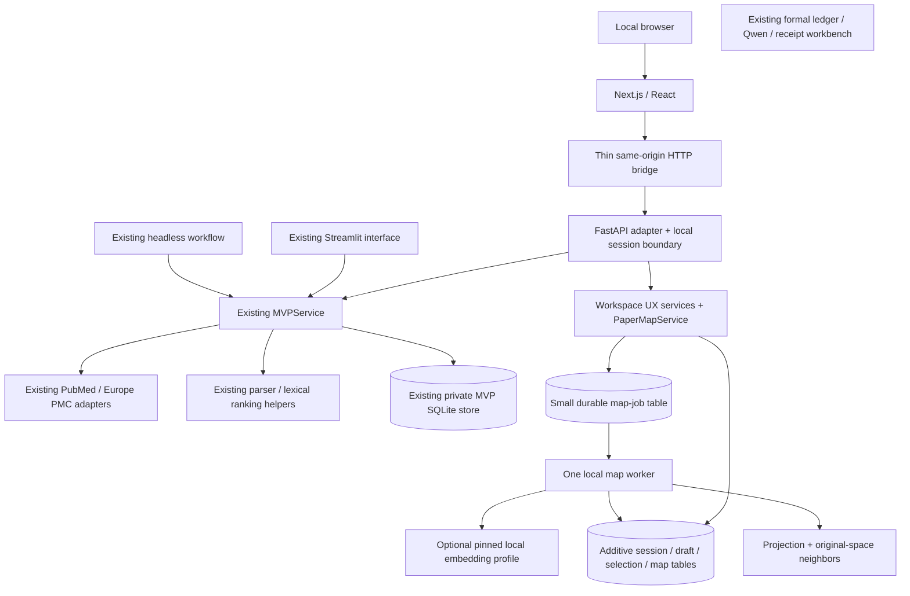

# Literature Review Engine — MVP v0.2
## A reopenable research workspace with semantic exploration

**Prepared:** 20 October 2026  
**Repository:** `hnt119/lit-rev-engine`  
**Inspected implementation:** `codex/mvp-v0-1` at `8df5993c86893d47620a101a2319c564cff2d494`  
**Observed main:** `a506ae05fc19c21a1d80beabc26bfc831582441d`  
**Status:** Architecture and implementation brief, not an implementation or test report.

This replaces the previous main-based handoff for the **next MVP assignment**. The long-term three-interface direction survives; its earlier assumption that the product application layer must be built from scratch does not. Reconfirm branch heads before editing.

## 1. The product decision

Build this user journey:

> Create or reopen a local workspace → run an explicitly approved live search or open a labeled saved example → explore the returned papers through a linked list and semantic map → select papers for exploration → prepare sources → inspect passages and save judgments → export and reopen the work later.

The release has two ordered checkpoints:

- **v0.2a — usable web workspace:** Next.js/FastAPI over the existing MVP service, workflow parity, reliable same-browser reopening, and durable drafts.
- **v0.2b — semantic exploration:** paper-level embeddings, a persisted map of one saved search, linked selection, and within-search similarity.

Both checkpoints belong to the next MVP. Finish and test parity before adding the map. Do not call v0.2 complete after shipping only a React shell or mock scatterplot.

The main new research capability is **exploring relationships among discovered papers**. The main usability improvement is **returning to work without losing access or drafts**. Narrative generation, formal review screening, and hosted SaaS are not release requirements.

## 2. What v0.1 already implements

These observations come from pinned repository documentation and selected implementation files, not newly executed tests. [R1–R8]

| Existing capability | Reuse in v0.2 |
|---|---|
| Streamlit Discover / Prepare sources / Evidence & export | Retain as a working reference until React parity is demonstrated |
| `MVPService`, frozen Pydantic models, injected provider/storage ports | Make these the application boundary, not a new parallel engine |
| PubMed exploratory preview: default 30, maximum 50 results | Preserve the preview contract and exact saved provenance |
| Selection of up to 10 papers | Preserve the limit and `selected_for_exploration` meaning |
| Europe PMC source acquisition, conservative permissions and identity checks | Reuse, including explicit abstract fallback and per-paper failures |
| BM25/context retrieval, at most 5 displayed passages | Preserve method, source bindings, exact anchors, and empty-result behavior |
| Immutable assessments, explicit revisions, stale-state rejection | Preserve all decision and trust-label semantics |
| Private SQLite snapshots and request idempotency | Retain existing tables and behavior; add narrowly scoped auxiliary state |
| Evidence CSV and `mvp.audit-bundle.v1` JSON | Preserve compatibility and historical records |
| Portable paper/ink/olive CSS tokens and paired evidence layout | Carry over actual tokens and interaction decisions |

The new MVP is an **exploratory workspace separate from the formal review ledger**. It reuses parsing and ranking helpers; it does not create ledger screening, study-linkage, or independent-verification events. Do not silently connect these two authorities.

### Observed gaps to address

1. Workspaces persist on disk, but v0.1 can lose the capability needed to reopen them after a hard reload, session loss, or host restart. It has no account/recovery/import workflow. [R1, R4]
2. The evaluation document records a question/query draft-state problem when hidden Streamlit widgets are cleaned up. This review did not reproduce it; add an explicit regression and fix. [R2]
3. There is no current paper embedding/map feature in the documented MVP. Its default saved example contains one actual article, so it cannot demonstrate a multi-paper semantic landscape. [R1]
4. Live PubMed-to-source end-to-end acceptance is explicitly `NOT_RUN` in the branch evaluation. Mocked provider tests are not a live smoke. [R2]
5. The evaluation reports 114 offline MVP tests at its final checkpoint and earlier broader regressions. Those are historical reported results, not tests rerun for this handoff. [R2]

## 3. Architecture: extend, do not restart



`Formal` intentionally has no automatic write path from the new workspace.

### Ownership

- **React:** renders typed data, controls editing and selection, displays errors and progress. It does not implement scientific/domain rules.
- **Next.js bridge:** forwards an allowlisted API surface to one configured loopback backend. No discovery, XML parsing, ranking, model calls, or evidence validation in TypeScript.
- **FastAPI:** transport validation, local session resolution, authorization, safe error mapping, small response projections. It delegates research operations.
- **`src/mvp`:** existing product contracts and research behavior; new use cases belong here unless an actual dependency justifies another module.
- **Map worker:** computes only from an immutable authorized search snapshot; does not write screening, sources, or assessments.
- **SQLite:** existing snapshots plus additive auxiliary tables. No database replacement for this release.

Do not introduce `src/application`, `src/corpus`, `src/workflows`, and multiple new service hierarchies merely to match the old diagram. A small `PaperMapService` and a workspace/session/draft facade are enough.

## 4. Preserve the two discovery contracts

There are now two intentionally different capabilities:

| Contract | Location | Meaning |
|---|---|---|
| Exploratory preview | `src/mvp/adapters/pubmed.py` | Bounded, user-facing discovery; never a comprehensive capture |
| Complete validated capture | `src/search/pubmed_search.py` | Existing formal-ledger workflow with separate completeness/limit rules |

For v0.2, **use the current MVP preview**, not a forced migration to the complete-capture adapter. Preserve the 30/50 discovery cap, 10-source selection cap, and 5-passage display cap. Raising caps is a separate measured change.

Every new map binds to exactly one saved `SearchPreview`. Its immutable ID plus a canonical digest of the saved metadata is the corpus identity for this release. Do not create a duplicate global paper database or multi-search corpus-union engine yet.

Show provider-reported matches, fetched records, distinct records, embedded papers, visible map points, and selected/prepared sources separately. A map of 30 papers remains a map of a preview even when thousands of provider matches exist.

Search refresh creates a new `SearchPreview` and, when requested, a new map. Do not silently move old coordinates, rewrite old metadata, or transfer assessment claims to new sources. A paper absent from a later capped preview is merely absent from that preview, not deleted or retracted.

Distinguish live execution, a cached search, and a curated saved example. Maintain the exact query, dates, sort, provider translation, warnings, and counts.

## 5. Reopening and draft durability

### Local session scope

Target **the same browser profile on the same local machine**, with a valid persistent session and the same configured application origin. This is not named-user authentication or cross-device collaboration.

Implement a persistent local session registry. The browser receives an opaque HttpOnly, SameSite session cookie; the Python boundary resolves only the workspaces authorized to that session. Retain workspace capabilities in OS-private server-side credential storage, not in URLs, generic JSON responses, browser local storage, logs, analytics, or research exports. Document this credential store and protect it and its backups accordingly. Apply appropriate Secure-cookie settings in HTTPS; keep any HTTP allowance explicitly loopback-only.

Use exact Host/Origin validation and CSRF protection for mutations. Both servers bind to loopback. Do not make the registry a public enumeration of every workspace in SQLite, or treat knowing a workspace ID as permission.

A session created by the new UI must survive ordinary reloads, tab closure/reopening, and process restart while its persistent cookie remains valid. Document expiry and cookie-clearing limits. Do not claim recovery of an old v0.1 workspace whose capability has already been lost: its hash is not reversible. Attaching an existing workspace requires an existing valid handle or a separately designed explicit recovery process.

### Drafts are not assessments

Persist question/query controls, pending selected IDs, evidence-question text, and assessment form drafts independently of rendered widgets. Use small versioned draft records scoped to workspace, screen, search/run ID, and expected assessment head. A draft may be incomplete; it must not be passed off as a committed judgment.

Show saving/saved/unsaved/error states. Preserve local edits after a failed save or 409 conflict. Reloading an older draft must not silently supersede a newer assessment. An explicit **Save assessment** continues to call the existing immutable assessment operation.

Map hover and list highlighting never prepare sources. A persisted selection draft is distinct from the committed preparation. When these differ, show: “Selection changed; current passages still use the previous prepared sources.” Only explicit preparation changes the source revision.

## 6. Semantic map specification

### Scope and inputs

Map the paper metadata in **one saved search**, not only the selected ten source papers and not all historical searches combined.

Paper-level representation uses title and abstract. Source-passage retrieval continues using its current lexical method. A map embedding must not replace evidence ranking or alter the frozen Qwen profile.

Use an optional, new `paper_bge_v1` profile based on `BAAI/bge-small-en-v1.5` as an initial local baseline, not a claim of best performance. The existing `Embedder` has useful length-checking/chunking behavior, but imports legacy settings and loads a model in its constructor; it is not automatically the required lazy, revision-pinned product adapter. [R9]

Build a narrow adapter or safely reuse the existing one without changing legacy defaults. Record model/tokenizer revision, input template, length handling, dimension, normalization, runtime versions, and input hashes. Disable remote-code execution and paid fallback. Sentence Transformers supports explicit revision and local-files-only loading. [T1]

Model setup/download is explicit and separate from opening the app. Without the optional dependency or weights, show **Map unavailable: setup required** and keep the full list/evidence workflow usable. Tests do not download models. Mapping is optional to use, but a real map implementation is required to call v0.2b implemented.

For over-length abstracts, implement a documented tokenizer-window policy over the full title/abstract representation, aggregate all window vectors with recorded token weights, then normalize. Do not silently truncate. Mark title-only representations. Reject non-finite, wrong-dimensional, or zero vectors with per-paper reasons; never replace failures with invented positions.

### Map artifact

Persist a small `PaperMap` artifact containing:

```text
schema_version, map_id, workspace_id, search_id, search_snapshot_sha256
ordered_paper_ids, paper_input_hashes
embedding_profile, embedding_profile_sha256, embedding_set_sha256
projection_method, projection_parameters, dependency_versions
coordinates_by_paper_id, coordinate_sha256
excluded_papers_with_reasons, created_at, status
```

Store vectors/coordinates once in auxiliary tables or immutable artifacts. Do not append them to every `WorkspaceSnapshot`, preparation, request result, or audit-history copy. The current store serializes a snapshot and operation results under a 64 MiB bound; avoid amplifying those copies. [R4]

### Layout and similarity

Proposed starting policy, not an empirical quality guarantee:

- At least 20 valid, sufficiently nondegenerate paper vectors: two-dimensional UMAP with cosine input distance, recorded seed, `n_neighbors=min(15,n-1)`, `min_dist=0.1`.
- Two to nineteen usable papers: explicitly labeled PCA small-corpus projection, with rank-deficient handling.
- Zero or one usable paper: honest empty/single-paper state; no fabricated semantic structure.
- Identical vectors: represent overlap/degeneracy visibly and retain the list; do not add random jitter presented as meaning.

Persist actual coordinates. Filtering, selecting, hovering, changing tabs, or reopening never refits the projection. Rebuilding is an explicit operation producing a new artifact. UMAP has stochastic and multithreading reproducibility limits; storing coordinates avoids confusing re-computation with loading a saved view. [T2]

“Similar in this search” uses cosine similarity in the original vector space, with stable tie-breaking and no external API call. Do not use two-dimensional screen distance as the ranking score.

For this release, omit incremental UMAP transform, cross-search alignment, automatic clusters, LLM topic labels, and inferred research gaps. UMAP can distort density and apparent cluster boundaries. [T3]

### Rendering

Use a small React SVG or canvas component; at a 50-record cap, do not adopt a large WebGL application solely because VitaLITy uses one. Include hover details, click-to-inspect, linked selection, pan/zoom/reset, and a complete keyboard/list alternative. Lasso is optional after these work.

Display: **“Approximate semantic layout of this search preview; not all literature and not evidence quality.”**

The current one-paper saved example stays intact. A separate multi-paper demo needs actual licensed metadata, recorded provenance, and genuine saved embeddings. Synthetic points are acceptable only in clearly labeled software tests, not as an apparently live literature map.

## 7. Execution: only add jobs where needed

Keep existing bounded service operations synchronous behind the local API during v0.2a. Execute blocking code in an appropriate bounded execution context, not directly on the async event loop. Preserve request IDs across ambiguous retries; a lost browser response is not proof that the operation failed. Never retry discovery automatically on mount/navigation.

For embedding/projection in v0.2b, add a **small durable SQLite-backed job runner with one local worker**, not Redis/Celery/Kubernetes. FastAPI's background-task feature is not itself the research job record; its documentation separately discusses heavier computation. [T4]

Required map-job semantics: queued/running/succeeded/failed/cancel-requested/cancelled, immutable input binding, idempotent submission, attempt/lease ownership, recoverable interrupted status, bounded retries, and atomic validated publication. Only an active attempt may finalize. A deleted workspace cannot be recreated by a late result.

Compute outside the existing workspace mutation lock and SQLite transaction. Publish a result under its original search; it must not switch the UI to a newer/older search unexpectedly. Cancellation is cooperative and cannot undo work already completed.

PubMed/Europe PMC calls remain owned by one API process so the existing process-wide rate gate remains valid. Do not simultaneously run multiple live Streamlit/API/worker provider processes under that same assumption. Move source preparation onto the job runner only after measuring a concrete responsiveness problem and testing identical service semantics.

## 8. Data, API, and compatibility

### Preserve existing contracts

Keep `WorkspaceSnapshot`, `SearchPreview`, `PreparationResult`, `EvidenceRun`, `Assessment`, and legacy exports readable and behaviorally compatible. Add versioned records for sessions, workspace display metadata, drafts/selections, maps, and map jobs. Use additive schema migrations with rollback/backup tests; do not rewrite the only data copy.

Keep existing IDs, source bytes, timestamps, quotations, Unicode code-point offsets, supersession links, neutral values, and `single_human_self_declared_not_independently_verified` labels. No automatic ledger promotion.

The browser needs small view projections, not `get_workspace()` serialized wholesale with all retained XML and every historical source. Add summary, per-search paper list, per-run, and paginated context views. Reuse existing Pydantic models where appropriate and derive TypeScript contracts from OpenAPI.

### Minimal API

All routes below are proposed, under `/api/v1`; `w` denotes an authorized workspace.

| Route | Behavior |
|---|---|
| `GET /capabilities` | Modes, providers, map readiness, limits; no secrets |
| `GET/POST /workspaces` | Session-scoped list/create; no raw handles in browser responses |
| `GET /workspaces/{w}` | Small summary, not full source history |
| `POST /workspaces/{w}/query-suggestions` | Existing transparent template, not an LLM |
| `POST /workspaces/{w}/searches` | Existing `SearchRequest`; idempotent bounded preview |
| `GET /workspaces/{w}/searches/{s}/papers` | Metadata from that exact saved search |
| `PUT /workspaces/{w}/drafts/{scope}` | Versioned UI drafts/selection; never a judgment |
| `POST /workspaces/{w}/source-preparations` | Existing preparation operation |
| `POST /workspaces/{w}/evidence-runs` | Existing lexical method, with explicit expected preparation/revision |
| `GET /workspaces/{w}/runs/{r}` | Bounded run projection and freshness label |
| `GET /workspaces/{w}/runs/{r}/passages/{p}/context` | Validated canonical context, explicit current/archive mode |
| `POST /workspaces/{w}/assessments` | Existing immutable save/revise semantics |
| `GET /workspaces/{w}/exports?format=csv|json` | Original evidence exports; no map/session schema pollution |
| `POST /workspaces/{w}/maps` | Create/reuse a map job for an exact saved search |
| `GET /workspaces/{w}/maps/{m}` | Bounded points/manifest; not raw model state |
| `GET /workspaces/{w}/maps/{m}/neighbors/{paper}` | Original-space similarity inside that map's search |
| `GET /workspaces/{w}/jobs/{j}` | Persisted state and safe diagnostic |
| `DELETE /workspaces/{w}` | Explicit confirmed deletion and auxiliary-state cleanup |

Optional map export is a separate versioned artifact; do not change `mvp.audit-bundle.v1` silently.

The new web evidence request should carry the preparation/source revision the user saw. Enforce that expectation inside the same serialized service operation as retrieval—not an API-only preflight that can race. Preserve old CLI/service compatibility using a bound operation or versioned request contract.

Current `get_source_context` rejects stale source bindings. Preserve that guard. For history, add a separate read-only path that resolves the original run's `search_id` and `preparation_id`, verifies their retained source hashes and anchors, and labels the result archived. Never use the newest metadata for an old run or make archived evidence assessable as current. [R5]

Map errors must not break evidence exports. HTTP errors should distinguish invalid fields (422), unauthorized/unavailable resources (404), stale/idempotency conflicts (409), and safe provider failures. Drafts survive every failed mutation.

## 9. Interface design

Reuse `apps/streamlit/theme/tokens.css`, not the Streamlit-specific CSS selectors. Avoid a new design-system monorepo. Components can remain under `apps/web/components` until there is a second real consumer. [R7]

Four destinations are sufficient:

**Workspaces:** authorized saved workspaces, question/title, saved/live source mode, last activity, reopen/new.

**Discover & explore:** editable question/query, explicit Search; saved-search selector; truthful counts; linked paper list, map, and paper inspector. On mobile use tabs rather than three crushed panes. Keep list-only mode useful.

**Evidence:** selected-paper/source preparation panel; question and lexical search; each passage paired with its judgment; source context below or in an accessible drawer. Preserve existing desktop pairing and mobile passage-then-judgment order.

**History & export:** searches, preparations, runs, immutable judgment revisions, maps, stale-state labels, original downloads.

Keep metadata compact; make source level, exact quotation, and save state prominent. Unknown availability stays unknown until checked. A point selection is not formal inclusion. Do not add a permanent chat panel for v0.2.

Navigation must preserve drafts and restore useful reading context. Opening the source inspector must neither save an assessment nor rerun search/preparation. Use safe text rendering and tested Unicode-code-point-to-UTF-16 conversion for highlights.

## 10. Repository shape

Add only what the checkpoint needs:

```text
apps/
  streamlit/                 # retained reference interface and theme tokens
  web/                       # new Next.js app; components + generated API client
src/
  mvp/
    contracts.py             # existing contracts; version additions deliberately
    service.py               # existing MVPService facade
    ports.py                 # existing ports; add map port only when used
    adapters/                # retain providers, storage, retrieval
    workspace_ui.py          # proposed draft/display/selection use cases
    mapping.py               # proposed PaperMapService and map contracts
    map_jobs.py              # proposed small map execution boundary
  web_api/                   # new transport, projections, local session handling
  review/                    # unchanged formal ledger
  review_components/         # unchanged frozen Qwen workflows
  review_workbench/          # unchanged receipt tool
scripts/                     # existing smoke + new documented local launcher
requirements-web*.txt        # isolated optional web dependencies
requirements-map*.txt        # isolated optional model/projection dependencies
 tests/mvp/                  # preserve and extend existing suite
 tests/web_api/              # new HTTP/session/contract tests
 tests/mapping/              # deterministic offline map tests
 apps/web/tests/             # component/browser tests
```

Paths marked proposed may be adjusted when a smaller consistent placement is clearer. Do not bulk-move files or create empty future-service directories.

## 11. Three interfaces and later work

**Interface 1: research workspace.** Implement now, local first. Streamlit and React are two versions of this interface, not two research engines.

**Interface 2: portfolio demonstration.** Later export a reviewed static projection and reuse presentational components. Keep the personal homepage unchanged. The demo uses saved data only and never falls back to the live API.

**Interface 3: REST/MCP.** REST is implemented now for React. MCP later wraps the same service boundary, starting with authorized read/query tools. Do not make React call MCP.

Next after v0.2: a typed, opt-in extraction/synthesis chain:

```text
explicit question + exact prepared-source snapshot
→ existing evidence retrieval
→ per-paper source-linked extraction drafts
→ schema/ID/quotation checks
→ cross-paper synthesis draft
→ human inspection and assessment
```

Keep generated drafts separate from assessments; valid citations are not proof of semantic support. No autonomous search expansion, model-based screening, or automatic independent verification. Retain the transparent query template as a no-model path.

Hosted authentication, PostgreSQL/object storage, large-corpus refresh, source jobs, formal-ledger handoff, collaboration, and billing follow demonstrated demand and separate acceptance gates. No cloud migration or deployment is authorized by this architecture.

## 12. Sources and inspection limits

Read-only GitHub inspection and the previous handoff were used. Selected implementation files were read; this is not a complete security audit. No repository was changed, no program/test suite was run, and no live search, model inference, or deployment was performed for this document.

Pinned source base: `https://github.com/hnt119/lit-rev-engine/blob/8df5993c86893d47620a101a2319c564cff2d494/`

- **R1:** [MVP setup and limits](https://github.com/hnt119/lit-rev-engine/blob/8df5993c86893d47620a101a2319c564cff2d494/docs/mvp.md)
- **R2:** [Evaluation and known draft-state issue](https://github.com/hnt119/lit-rev-engine/blob/8df5993c86893d47620a101a2319c564cff2d494/docs/mvp_evaluation.md)
- **R3:** [Typed contracts](https://github.com/hnt119/lit-rev-engine/blob/8df5993c86893d47620a101a2319c564cff2d494/src/mvp/contracts.py)
- **R4:** [Private SQLite storage](https://github.com/hnt119/lit-rev-engine/blob/8df5993c86893d47620a101a2319c564cff2d494/src/mvp/adapters/storage.py)
- **R5:** [Application service](https://github.com/hnt119/lit-rev-engine/blob/8df5993c86893d47620a101a2319c564cff2d494/src/mvp/service.py)
- **R6:** [Existing migration plan](https://github.com/hnt119/lit-rev-engine/blob/8df5993c86893d47620a101a2319c564cff2d494/docs/mvp_migration.md)
- **R7:** [Portable theme and layout](https://github.com/hnt119/lit-rev-engine/blob/8df5993c86893d47620a101a2319c564cff2d494/docs/mvp_theme.md)
- **R8:** [Lexical adapter](https://github.com/hnt119/lit-rev-engine/blob/8df5993c86893d47620a101a2319c564cff2d494/src/mvp/adapters/retrieval.py)
- **R9:** [Legacy embedder](https://github.com/hnt119/lit-rev-engine/blob/8df5993c86893d47620a101a2319c564cff2d494/src/embeddings/embedder.py)
- **T1:** [SentenceTransformer model loading](https://sbert.net/docs/package_reference/sentence_transformer/model.html)
- **T2:** [UMAP reproducibility](https://umap-learn.readthedocs.io/en/latest/reproducibility.html)
- **T3:** [UMAP clustering cautions](https://umap-learn.readthedocs.io/en/latest/clustering.html)
- **T4:** [FastAPI background tasks](https://fastapi.tiangolo.com/tutorial/background-tasks/)

Check current library versions, licenses, compatible environments, and model revisions during implementation. Choose and lock a tested combination; do not infer that this document tested a dependency version.
