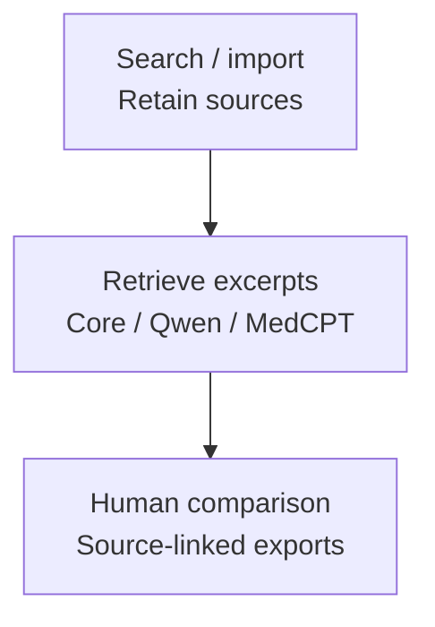

# Literature Review Engine

An open-source, local-first workspace for comparing papers and checking the source behind each research note.

## Downloads

| Platform | Download | Version / size |
| --- | --- | --- |
| macOS · Apple Silicon | **[Download for macOS](https://github.com/hnt119/lit-rev-engine/releases/download/v0.3.0-desktop-beta.2/lit-rev-engine-0.3.0-desktop-beta.2-macos-arm64.dmg)** | Desktop beta.2 · 169.6 MB |
| Windows · x64 | **[Download for Windows](https://github.com/hnt119/lit-rev-engine/releases/download/v0.3.0-windows-experimental-beta.2/lit-rev-engine-0.3.0-windows-experimental-beta.2-windows-x64-Setup.exe)** | Experimental beta.2 · 195.5 MB |

**Windows 11 x64: Experimental, unsigned, not tested on Windows.** Installed workflow and security checks remain **NOT_RUN**. [Windows User Guide](docs/windows_user_guide.md) · [Windows installation](docs/releases/v0.3.0-windows-experimental-beta.2/INSTALL_WINDOWS.md) · [Validation](docs/releases/v0.3.0-windows-experimental-beta.2/VALIDATION.md) · [Release page](https://github.com/hnt119/lit-rev-engine/releases/tag/v0.3.0-windows-experimental-beta.2).

[Getting started](docs/releases/v0.3.0-desktop-beta.2/INSTALL_MAC.md) · [User guide](docs/user_manual.md) · [Demo](https://hnt119.github.io/projects/literature-review-engine/#saved-evidence) · [Release notes](https://github.com/hnt119/lit-rev-engine/releases/tag/v0.3.0-desktop-beta.2) · [Architecture](docs/application_architecture.md)

**Mac: UNNOTARIZED beta, ad-hoc signed; no Apple Developer ID signature.** Read the [official per-app opening instructions](docs/releases/v0.3.0-desktop-beta.2/INSTALL_MAC.md#install-and-open). A damaged-app or malware warning requires investigation.

Mac Desktop Beta **0.3.0-desktop-beta.2**, released **27 October 2026**, bundles Core runtimes. Try the saved example without installing Python/Node, opening Terminal, downloading models or entering a key.

## What you can do

- **Add papers:** import references or explicitly search PubMed; prepare available full text or abstracts.
- **Compare evidence:** organize reports by your questions, with excerpts beside your comments.
- **Check sources:** inspect exact quotation ranges and source versions; keep partial context and missing information visible.
- **Keep your work:** save drafts, explicitly submit or revise entries, export CSV/JSON and reopen locally.

## Start locally

Drag the Mac app to Applications, eject the DMG and open the installed copy. Start with **Try the saved example**. The [installation guide](docs/releases/v0.3.0-desktop-beta.2/INSTALL_MAC.md) covers approval and recovery; the [validation record](docs/releases/v0.3.0-desktop-beta.2/VALIDATION.md) states actual checks and remaining limits.

On Windows, read the [version-matched installation and security limitations](docs/releases/v0.3.0-windows-experimental-beta.2/INSTALL_WINDOWS.md) before running the experimental Setup.

## Review an entry

### Your first comparison

**Add papers → Prepare → Select an excerpt → Comment → Save/export.**

Open a comparison cell, read its source, then choose **I have read this excerpt — use it**. Write your interpretation and use **Review entry before saving → Save reviewed entry**. **Draft: saved** is separate from a submitted entry. [Follow the complete walkthrough](docs/user_manual.md#select-an-excerpt-comment-and-save).

## How RAG fits into the workflow

In a **Retrieval-Augmented Generation (RAG)** workflow, retrieval finds candidate passages in your selected, versioned sources; Core BM25/lexical retrieval needs no LLM. Optional generation proposes text from bounded evidence for human review. Relevance or an exact citation does not prove scientific support: inspection, attachment, judgments and saving remain explicit.

## Choose retrieval in the same app

Core desktop research works without neural models. Qwen/MedCPT profiles remain optional and experimental; **desktop beta.2 does not bundle neural libraries or weights, and its matching library capsule is not publicly offered**. BGE paper maps and optional local/OpenAI/DeepSeek generation are separate features, with separate setup and consent. See [desktop limits](docs/releases/v0.3.0-desktop-beta.2/INSTALL_MAC.md#first-useful-comparison), [source capabilities](docs/local_beta_capabilities.md) and [model configuration](docs/application_architecture.md).

## Under the hood

The same Next.js/React → FastAPI → Python engine uses private SQLite storage. [Full architecture and model roles](docs/application_architecture.md).

Advanced: source beta.4 — setup required

<!-- published-release:start -->
**[Download — source beta 0.3.0-beta.4](https://github.com/hnt119/lit-rev-engine/releases/tag/v0.3.0-beta.4) · [Quick start](https://github.com/hnt119/lit-rev-engine/blob/v0.3.0-beta.4/docs/local_preview.md) · [Read-only demo](https://hnt119.github.io/projects/literature-review-engine/#saved-evidence)**

[Direct source ZIP](https://github.com/hnt119/lit-rev-engine/releases/download/v0.3.0-beta.4/lit-rev-engine-0.3.0-beta.4.zip) · [Manifest](https://github.com/hnt119/lit-rev-engine/releases/download/v0.3.0-beta.4/lit-rev-engine-0.3.0-beta.4.manifest.json) · [SHA-256 checksums](https://github.com/hnt119/lit-rev-engine/releases/download/v0.3.0-beta.4/lit-rev-engine-0.3.0-beta.4.SHA256SUMS) · [Download installation guide](https://github.com/hnt119/lit-rev-engine/releases/download/v0.3.0-beta.4/INSTALL.md)
<!-- published-release:end -->

Source beta.4 needs Python 3.12, Node.js 24 and pnpm 10.20.0. It is separate from the native apps. [Windows source setup](https://github.com/hnt119/lit-rev-engine/blob/v0.3.0-beta.4/docs/windows_source.md) · [All releases](https://github.com/hnt119/lit-rev-engine/releases).

## Help, privacy and status

Research stays outside application files. Explicit searches and optional cloud AI transmit disclosed inputs; cloud calls may cost money. Keys are session-scoped. Read [backup and access-recovery limits](docs/user_manual.md#export-back-up-and-replace-the-app).

[MIT](LICENSE) covers original engine code; dependencies, articles and models retain [their own terms](THIRD_PARTY_NOTICES.md). The demo is saved and read-only. Development commits do not update published downloads.

[Help / issues](https://github.com/hnt119/lit-rev-engine/issues) · [Documentation](docs/README.md) · [Product design](product_design.md) · [Repository agent guide](AGENTS.md)

[Earlier installation and contribution guide](docs/legacy-cli-and-history.md#requirements-and-installation).
