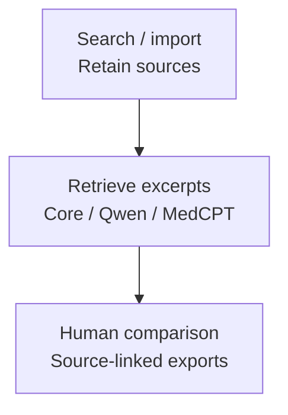

# Literature Review Engine

An open-source, local-first research workspace for comparing papers, inspecting exact evidence excerpts and exporting a table you can verify.

<!-- published-release:start -->
**[Download — source beta 0.3.0-beta.4](https://github.com/hnt119/lit-rev-engine/releases/tag/v0.3.0-beta.4) · [Quick start](https://github.com/hnt119/lit-rev-engine/blob/v0.3.0-beta.4/docs/local_preview.md) · [Read-only demo](https://hnt119.github.io/projects/literature-review-engine/#saved-evidence)**

[Direct source ZIP](https://github.com/hnt119/lit-rev-engine/releases/download/v0.3.0-beta.4/lit-rev-engine-0.3.0-beta.4.zip) · [Manifest](https://github.com/hnt119/lit-rev-engine/releases/download/v0.3.0-beta.4/lit-rev-engine-0.3.0-beta.4.manifest.json) · [SHA-256 checksums](https://github.com/hnt119/lit-rev-engine/releases/download/v0.3.0-beta.4/lit-rev-engine-0.3.0-beta.4.SHA256SUMS) · [Download installation guide](https://github.com/hnt119/lit-rev-engine/releases/download/v0.3.0-beta.4/INSTALL.md)
<!-- published-release:end -->

**[Practical user guide · beta.4](docs/user_manual.md) · [Architecture & model roles](docs/application_architecture.md)**

**Setup required; not a standalone installer.** Beta.4 remains the newest verified published download. The revised guide explains its unchanged interface; it does not update the ZIP. The demo uses saved public data, without live search, models or private workspaces.

## Start locally

Install **Python 3.12, Node.js 24 and pnpm 10.20.0**. In the release page’s **Assets**, download the purpose-built ZIP and matching manifest/checksums, verify them, then extract it. GitHub's automatic source archive is not the tested distribution.

| Platform | Setup and validation scope |
| --- | --- |
| macOS Apple Silicon | [Installation guide](https://github.com/hnt119/lit-rev-engine/blob/v0.3.0-beta.4/docs/local_preview.md); source-app workflow tested |
| Windows x64 | [Windows setup guide](https://github.com/hnt119/lit-rev-engine/blob/v0.3.0-beta.4/docs/windows_source.md); Core and bounded Qwen/MedCPT CPU workflows tested on CI |

On **macOS**, run inside the extracted folder:

```sh
python3.12 scripts/local_preview.py setup
python3.12 scripts/local_preview.py launch
```

Windows uses the guide's isolated bootstrap commands. Setup installs dependencies and builds the production interface; it does not search or download models. Launch opens the browser after readiness checks. Keep the terminal open; Ctrl-C stops it.

Linux installation is unverified; Intel Mac and Windows ARM are unqualified. Physical Windows 11 is **NOT_RUN**. No native executable is publicly available. See the release's [validation record](https://github.com/hnt119/lit-rev-engine/releases/download/v0.3.0-beta.4/VALIDATION.md) for the exact scope.

## Review an entry

### Your first comparison

1. Enter a research question, keep **Saved example · offline**, then **Create workspace → Open saved example**. Thirty saved public papers need no key or model download.
2. Select three reports and choose **Prepare & compare (3)**. Check full-text, abstract-only or unavailable source outcomes; continue to the ready comparison when offered.
3. Edit three field labels/subquestions—for example, population, study design and relevant outcome—then **Create comparison board**. Rows are reports; columns are questions.
4. Open a cell. Choose **Find excerpts in this paper → Read in source · passage 1**, or **Browse this source**. Read the exact context, then **I have read this excerpt — use it**.
5. Write your interpretation beside the selected evidence. Review support/scope states, then **Review entry before saving → Save reviewed entry**. Wait for **Saved to comparison.**
6. Use **Download board CSV** or **Download board audit JSON**. Stop normally and reopen with the same data directory, browser profile and hostname.

**Draft: saved is separate from a submitted entry.** **Paper 1 of 3 · Field 2 of 3** means another question about the same report. Missing information can remain unresolved; candidates do not prove whole-paper absence. Exploration selection is not formal inclusion.

The [full guide](docs/user_manual.md) covers imports, PubMed, broader passage search and return, missing information, corrections and reopening. Earlier submitted values remain in history after **Edit saved cell → Save revision**.

## Choose retrieval in the same app

| Choice | Components |
| --- | --- |
| **Core lexical** | Default BM25 / versioned lexical spans; no neural model or generation key |
| **Qwen hybrid** | BM25 + Qwen3-Embedding-0.6B + Qwen3-Reranker-0.6B |
| **Biomedical/MedCPT hybrid** | BM25 + MedCPT Query/Article Encoders + Cross Encoder |

Use **Research & AI Settings → Evidence retrieval**. Optional packs require explicit dependency installation, model download, runtime checks and source indexing. Both can coexist; existing boards retain their pinned profiles until an explicit revision. Neural profiles are experimental, with no established superiority over BM25.

Optional **BGE paper maps** are separate from passage retrieval. Optional **local/OpenAI/DeepSeek generation** proposes search plans or cell values for review. Core manual research needs neither.

## Under the hood



The local stack is **Next.js/React → FastAPI → Python services**, with private SQLite state. [Full architecture and provider boundaries](docs/application_architecture.md).

## Help, privacy and status

Research lives outside replaceable application files. Explicit searches transmit queries/contact details; optional cloud AI transmits disclosed input and may incur charges. Settings-entered keys are session-scoped; non-secret preferences persist. Cookie loss/expiry can lose workspace access: read [reopening, backups and recovery limits](docs/user_manual.md#export-back-up-and-replace-the-app).

[Documentation index](docs/README.md) · [Original release manual](https://github.com/hnt119/lit-rev-engine/blob/v0.3.0-beta.4/docs/user_manual.md) · [Report an issue](https://github.com/hnt119/lit-rev-engine/issues) · [MIT license](LICENSE) · [Third-party/article/model terms](THIRD_PARTY_NOTICES.md)

The question-to-evidence workbench is separate development work, absent from beta.4 and current main. A main merge does not update a published ZIP.

<a id="requirements-and-installation"></a>
<a id="update-main-and-contribute"></a>
Older installation/contribution links continue in the [legacy CLI guide](docs/legacy-cli-and-history.md#requirements-and-installation).
