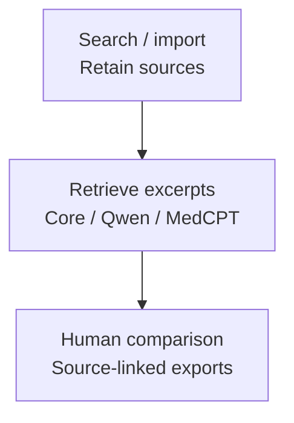

# Literature Review Engine

*An open-source, local-first research workspace for discovering papers, comparing evidence, and reviewing source-linked findings.*

**[Download for macOS](https://github.com/hnt119/lit-rev-engine/releases/tag/v0.3.0-desktop-beta.2) · [Installation guide](docs/releases/v0.3.0-desktop-beta.2/INSTALL_MAC.md) · [Try Interactive Demo](https://hnt119.github.io/projects/literature-review-engine/#saved-evidence) · [User Guide](docs/user_manual.md) · [View All Releases](https://github.com/hnt119/lit-rev-engine/releases)**

**macOS desktop beta.2 · Released 27 October 2026 · Apple Silicon · 169.62 MB (169,622,385 bytes) · [MIT](LICENSE).** The DMG bundles Core runtimes; ordinary use needs no Python/Node installation or Terminal. **Ad-hoc signed and UNNOTARIZED; no Apple Developer ID signature.** Read the installation/trust instructions before opening.

**Windows installer: unavailable.** Windows x64 has a separate setup-required [source option](#start-locally); source CI does not qualify a native installer. The demo is read-only, using saved public papers without a backend, model calls or private workspace access.

## Start locally

On **Apple Silicon Mac**, download from the release page’s Assets, verify its checksum, drag the app to **Applications**, eject the image and open the installed copy. If you trust the verified download, follow [Apple’s official per-app Open Anyway → Open procedure](https://support.apple.com/en-us/102445). Stop on a mismatch, damaged-app/integrity error or malware detection; preserve quarantine and OS protections.

[Desktop beta.2 installation & recovery](docs/releases/v0.3.0-desktop-beta.2/INSTALL_MAC.md) · [Version-matched qualification record](docs/releases/v0.3.0-desktop-beta.2/VALIDATION.md) · [Checksums and component sources](https://github.com/hnt119/lit-rev-engine/releases/tag/v0.3.0-desktop-beta.2)

The native download was checked on a fresh **macOS 26.6.2 (25G83) arm64** guest. Other Mac hardware/OS versions and Windows native installation are unqualified. Research data stays outside the app; existing browser-beta workspaces are not silently migrated.

Advanced: source beta.4 — setup required

<!-- published-release:start -->
**[Download — source beta 0.3.0-beta.4](https://github.com/hnt119/lit-rev-engine/releases/tag/v0.3.0-beta.4) · [Quick start](https://github.com/hnt119/lit-rev-engine/blob/v0.3.0-beta.4/docs/local_preview.md) · [Read-only demo](https://hnt119.github.io/projects/literature-review-engine/#saved-evidence)**

[Direct source ZIP](https://github.com/hnt119/lit-rev-engine/releases/download/v0.3.0-beta.4/lit-rev-engine-0.3.0-beta.4.zip) · [Manifest](https://github.com/hnt119/lit-rev-engine/releases/download/v0.3.0-beta.4/lit-rev-engine-0.3.0-beta.4.manifest.json) · [SHA-256 checksums](https://github.com/hnt119/lit-rev-engine/releases/download/v0.3.0-beta.4/lit-rev-engine-0.3.0-beta.4.SHA256SUMS) · [Download installation guide](https://github.com/hnt119/lit-rev-engine/releases/download/v0.3.0-beta.4/INSTALL.md)
<!-- published-release:end -->

The unchanged source beta.4 ZIP is **1,921,710 bytes**, requiring **Python 3.12, Node.js 24 and pnpm 10.20.0**. Use its rendered Quick start; keep the launch terminal open. [Windows x64 source setup](https://github.com/hnt119/lit-rev-engine/blob/v0.3.0-beta.4/docs/windows_source.md) has Core and bounded optional-model CI evidence; physical Windows 11 is NOT_RUN. Linux installation is unverified. This generated source-release record remains separate from the native release above.

## Review an entry

### Your first comparison

1. Choose **Try the saved example**, or create a workspace with **Saved example · offline → Open saved example**. Thirty saved public papers need no key or model download.
2. Select reports, then **Prepare & compare**. Check full-text, abstract-only or unavailable outcomes.
3. Edit the field labels/subquestions, then **Create comparison board**. Rows are reports; columns are questions.
4. Open a cell: **Find excerpts in this paper → Read in source · passage 1**, or **Browse this source**. Read the context, then **I have read this excerpt — use it**.
5. Comment beside the selected evidence; choose support/scope states. **Review entry before saving → Save reviewed entry**; wait for **Saved to comparison.**
6. **Download board CSV** or **Download board audit JSON**. Quit normally; reopen the same workspace.

**Draft: saved is separate from a submitted entry.** Different fields can describe the same paper. Missing details remain explicit; candidates do not prove whole-paper absence or formal eligibility. The [task-based guide](docs/user_manual.md) covers the shared Core workflow; native installation/welcome differences are in the desktop guide above. [Edit saved cell → Save revision](docs/user_manual.md#correct-an-entry-or-resolve-a-conflict) retains history.

## Choose retrieval in the same app

**Core lexical** works without a model/key. **Qwen hybrid** and **Biomedical/MedCPT hybrid** are optional and experimental, with no established superiority over Core. Libraries, weights, runtime checks and source indexing are separate; boards retain their pinned profiles.

**Desktop beta.2 does not bundle neural libraries or weights, and its matching library capsule is not publicly offered.** Do not infer Ready from a visible control. Source-beta optional setup is documented separately. BGE paper maps are separate from passage retrieval; local/OpenAI/DeepSeek generation requires explicit configuration and data/cost consent. Core needs neither.

[Model IDs, setup and provider boundaries](docs/application_architecture.md) · [Core/Qwen/MedCPT guide](docs/user_manual.md#choose-core-qwen-or-medcpt)

## Under the hood

**Next.js/React → FastAPI → Python services**, with private SQLite state; the Mac shell bundles the same UI/engine. [Full architecture](docs/application_architecture.md).

## Help, privacy and status

Explicit searches send queries/contact details; optional cloud AI sends disclosed input and may incur charges. Settings keys are session-scoped. Cookie loss/expiry can lose access: read [exports, backups and recovery limits](docs/user_manual.md#export-back-up-and-replace-the-app).

[Documentation index](docs/README.md) · [Report an issue](https://github.com/hnt119/lit-rev-engine/issues) · [MIT license](LICENSE) · [Third-party/article/model terms](THIRD_PARTY_NOTICES.md)

The question-to-evidence workbench remains separate development work, absent from both downloads. A merge does not update published assets.

Older installation/contribution links continue in the [legacy CLI guide](docs/legacy-cli-and-history.md#requirements-and-installation).
