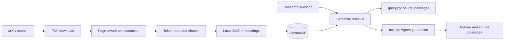

# Literature Review Engine

A local research application for exploring papers, comparing retained evidence and checking the exact source behind each quotation. **Track A Local Beta 0.3.0-beta.2 is setup-required source software**, extending the MIT beta.1 with Research & AI Settings and optional experimental local retrieval. The authoritative download is the purpose-built ZIP on [GitHub Releases](https://github.com/hnt119/lit-rev-engine/releases), with its matching manifest and checksums. GitHub's automatic repository archive is not the tested distribution.

## Run the local research app

Tested on macOS arm64 with Python 3.12, Node 24 and pnpm 10.20.0. Linux installation is unverified; Windows is unsupported. Download and verify the matching release files, extract the source ZIP, then run these commands in its folder:

```sh
python3.12 scripts/local_preview.py setup
python3.12 scripts/local_preview.py launch
```

Setup installs locked dependencies and builds the production Next.js interface over the existing FastAPI engine. No Docker is needed. Models are optional and not downloaded by setup/startup. Research state stays in a separate per-user directory; replacing application files does not migrate or delete your research. Stop with Ctrl-C, or `python3.12 scripts/local_preview.py stop` from the same application folder. Read the [installation, reopening and recovery guide](docs/local_preview.md) before using an existing data folder; cookie/profile/hostname limitations remain.

Start with **Saved example · offline**: 30 public papers and a saved map, then source preparation → comparison board → passage search → exact source → return to cell → explicit judgment/revision → CSV/JSON export. This curated example is exploratory, not a complete systematic-review capture or formal inclusion. Manual work and core lexical retrieval require no LLM or neural models.

| Configure independently | Behavior and guide |
| --- | --- |
| Research sources and per-search specifications | PubMed contact and optional API key; explicit live actions; exact query, dates, sort and bound stay with each search. [Settings](docs/research_ai_settings.md) |
| Evidence retrieval | Core lexical remains default. Optional pinned Qwen/MedCPT encoder + reranker packs use explicit installation/indexing and exact source scopes. Both hybrid profiles are experimental, with no demonstrated superiority over BM25. [Retrieval setup](docs/hybrid_retrieval.md) |
| Paper-level semantic maps | Existing saved artifacts work offline; new maps need separate pinned BGE dependencies/weights and configuration. Filters/navigation do not refit maps. [Optional setup](docs/local_beta_optional_features.md) |
| Generative assistance | Optional real local/OpenAI/DeepSeek adapters; user-supplied backend session-only keys, explicit one-run data/cost consent and no fallback. Proposals remain separate from human support/submission. Real generation/live-provider validation is NOT_RUN for beta.2. [Settings and consent](docs/research_ai_settings.md) |

Read the [capability matrix](docs/local_beta_capabilities.md), [combined validation and evidence boundaries](docs/combined_beta_validation.md), [source/model references](docs/hybrid_model_references.md), [MIT license](LICENSE) and [third-party boundaries](THIRD_PARTY_NOTICES.md). Software/runtime checks do not establish scientific support, clinical reliability or independent human review.

## Separate work and preserved history

The Electron desktop source/private prototype is preserved, but **no public desktop executable is supplied**. Its earlier binary predates the integrated hybrid release and remains withheld pending notices/SBOM, Developer ID signing and notarization. No operating-system protection bypass is recommended. [Desktop status](docs/desktop_preview.md)

Track B protocol-defined researcher-pilot work remains on its separate branch/worktree. It is not in the Track A download and is not modified or launched by this release. Hosted/Render implementation is deferred and no service is deployed. Published beta.1 and frozen retrieval/Qwen experiments keep their original identities.

The following sections preserve earlier engine, branch and CLI guides. The local source-beta instructions above are the primary application entry point.

## Historical local web MVP v0.3 checkpoint

Use [`codex/mvp-v0-3`](https://github.com/hnt119/lit-rev-engine/tree/codex/mvp-v0-3) for the frozen earlier development checkpoint; use the integrated source beta above for the current app. The working application supports imports and exploratory PubMed discovery, linked saved maps, preparation of up to 30 papers, a source-linked manual comparison board with up to six fields, durable drafts/revisions and CSV/JSON exports. Optional AI cell proposals remain separate from human submission. Read the [current workflow guide](docs/usability_consolidation.md), [manual board guide](docs/manual_comparison_board.md), [proposal guide](docs/cell_proposals.md), and [executed usability evidence](docs/usability_consolidation_evaluation.md). This branch is separate from `main`; local mode remains the default.

The [single-instance hosted package](docs/deployment.md) adds explicit invite admission, production Docker supervision, mounted private SQLite state and stopped-app backup/restore. It is deployment preparation, **not a published service**. Generation and new-map fitting are disabled in the initial hosted release. See [deployment checks and remaining gates](docs/deployment_evaluation.md). The portfolio stays on GitHub Pages; no live application link is inserted before an actual HTTPS deployment is verified.

### Thirty-paper offline example

Choose **Saved example · offline**, create or reopen a workspace, then click **Open saved example**. The bundle contains **30 distinct real papers with checked CC BY full text** and a precomputed semantic map. Opening, reopening, filtering and selecting papers need no contact email, provider request, model weights or inference call. Local model setup is only needed to calculate new maps. Earlier one-paper captures remain in history; opening the current bundle adds a new capture. Read the [offline example guide and validation](docs/offline_example.md) and [public source attribution](examples/mvp/offline_microbiome_30_v1/README.md). The collection is a curated demonstration, not 30 formally included studies or a comprehensive search.

## Local web MVP v0.2

Use [`codex/mvp-v0-2`](https://github.com/hnt119/lit-rev-engine/tree/codex/mvp-v0-2) for MVP v0.2. It extends the actual MVP baseline `8df5993` with a Next.js/React interface and a thin FastAPI adapter over the existing `src/mvp` services. The branch remains separate from `main`; no hosted deployment is provided. Use the [v0.2 setup and workflow guide](docs/mvp_v0_2.md) and [executed checkpoint evidence](docs/mvp_v0_2_evaluation.md) for current status, optional local mapping setup, startup/shutdown, durable data and limitations.

Workspaces reopen through a persistent local browser session. Versioned drafts remain separate from immutable assessments; historical evidence retains its original source binding. The new default `.mvp-web-state/` directory is separate from existing research data. The exploratory preview, formal review ledger and frozen Qwen workflows keep their existing boundaries.

## Web MVP v0.1

Use [`codex/mvp-v0-1`](https://github.com/hnt119/lit-rev-engine/tree/codex/mvp-v0-1) for the web MVP; it has not been merged into `main`. Start from a clean checkout of that branch before following these commands.

The [Streamlit MVP](docs/mvp.md) provides **discover → select → inspect source passages → save judgments → export CSV/JSON** through three browser screens. Install the focused CPU-only group in a separate environment:

```bash
python3.12 -m venv .venv-mvp
.venv-mvp/bin/python -m pip install -r requirements-mvp.txt
.venv-mvp/bin/python -m streamlit run apps/streamlit/app.py
```

The default is a clearly labeled offline example using a real CC BY article about diet, gut microbiota and gestational diabetes in Chinese women. For live PubMed, configure `NCBI_EMAIL` and choose live mode as described in [setup and walkthrough](docs/mvp.md). Discovery is an exploratory preview capped at 30 records by default (maximum 50); selected papers are not formal review inclusions. Permitted Europe PMC XML and explicit abstract fallbacks feed the existing lexical passage ranking. There is no generated scientific answer, paid inference or model download.

Services, typed contracts and private SQLite state live in `src/mvp/`, separate from Streamlit and the frozen engine. The [headless smoke](scripts/mvp_smoke.py) runs the same service without a UI dependency. The evidence workspace pairs each passage with its judgment, keeps source context below, and opens each workflow screen at the top. Read the [evaluation evidence](docs/mvp_evaluation.md), [portable visual identity guide](docs/mvp_theme.md) and [frontend migration plan](docs/mvp_migration.md). No hosted deployment is created; the original CLI workflows below remain available.

## Existing review ledger and CLI guides

The existing **`review.py` ledger CLI** manages reproducible medical-review records separately from the browser workspace. Begin with the [offline getting-started guide](docs/getting-started.md): it creates an isolated synthetic project, imports six occurrences into four records, records decisions and reproduces the exports without an API key or model download.

After the Track A integration, `main` contains the local web application as well as the legacy ledger, Qwen component workflow and Agnes/RAG passage pipeline. The source beta above is the tested application distribution. Branch names select source history; they do not automatically activate a retrieval method or confer review eligibility.

| Branch or tag | Purpose |
| --- | --- |
| [`main`](https://github.com/hnt119/lit-rev-engine/tree/main) | Default branch for accepted code and the usage guides below. |
| [`codex/mvp-v0-1`](https://github.com/hnt119/lit-rev-engine/tree/codex/mvp-v0-1) | Web MVP review branch: Streamlit discovery, passage/source inspection, single-user judgments and CSV/JSON export. See the [MVP setup](docs/mvp.md); not yet merged into `main`. |
| [`codex/mvp-v0-2`](https://github.com/hnt119/lit-rev-engine/tree/codex/mvp-v0-2) | MVP v0.2: reopenable React workspace and optional persisted paper maps, extending MVP baseline `8df5993`. See [v0.2 guide](docs/mvp_v0_2.md) and [checkpoint evidence](docs/mvp_v0_2_evaluation.md); separate from `main`. |
| [`codex/human-review-pilot`](https://github.com/hnt119/lit-rev-engine/tree/codex/human-review-pilot) | Prepared branch for the planned next workflow, starting at the same published `main` commit. Begin with team protocol intake, then one approximately 20–50-record [human review pilot](docs/pilot-milestone.md); no human pilot is completed. |
| `codex/<ticket>` | Short-lived work for one focused change, opened from updated `main` and returned through a pull request after suitable checks and evaluation. |
| [`archive/review-ledger-2026-10-05`](https://github.com/hnt119/lit-rev-engine/tree/archive/review-ledger-2026-10-05) | Annotated archive of completed `codex/review-ledger` at [`69d1767`](https://github.com/hnt119/lit-rev-engine/commit/69d17673f1286132a9614d2e2d81f65bdba26eec). |
| [`archive/agnes-rag-2026-10-05`](https://github.com/hnt119/lit-rev-engine/tree/archive/agnes-rag-2026-10-05) | Annotated archive of the earlier `feature/agnes-rag` prototype at [`2d973c8`](https://github.com/hnt119/lit-rev-engine/commit/2d973c8db955970658849e8fc5ed664241d11f10), for historical inspection. Use `main` to run the current passage pipeline. |

The completed work branches are retired after archiving. There is no permanent `dev` or algorithm-specific branch. On GitHub, use the branch/tag picker above the file list: select `main` under **Branches** for current instructions, or an `archive/…` entry under **Tags** to inspect a saved state. Branch selection changes the files you view; select a retrieval method explicitly in the relevant guide.

To work on the planned pilot in a clean checkout, run `git fetch origin`, then `git switch codex/human-review-pilot`; follow its [protocol intake](docs/pilot-milestone.md#objective-and-starting-inputs) first.

| What you need | Where to go |
| --- | --- |
| Understand the modules, stored data and current boundaries | [Architecture and repository map](docs/architecture.md) |
| Run the first project and understand its counts | [Getting started](docs/getting-started.md) |
| Import saved exports or preserve an executed PubMed search | [Import formats](docs/import-formats.md), [PubMed receipts and replay](docs/pubmed-search.md) |
| Associate reports, retain sources and verify findings | [Study links](docs/study-linkage.md), [Source versions](docs/source-documents.md), [Verified evidence](docs/verified-evidence.md) |
| Retrieve exact passages from eligible project sources | [Project retrieval](docs/project-retrieval.md) |
| Run Qwen on a free Kaggle GPU and inspect its acceptance gates | [Component workflow](docs/qwen-components-guide.md), [current run evidence](docs/qwen-components-runs-v1.md), [model strategy](docs/model-strategy.md) |
| Inspect the log repair and test companion evidence for compound questions | [Log diagnosis](docs/qwen-kaggle-log-review.md), [component workflow](docs/qwen-components-guide.md), [selected contract](docs/qwen-components-contract-v1.md) |
| Inspect saved passages and record single-human assessments in a local page | [Workbench guide](docs/review-workbench.md), [cycle evaluation](docs/workbench-cycle-1-evaluation.md), [workflow plans](workflow/lit_review_markdown_pack/README.md) |
| See accepted gates and the next human review pilot | [Pilot contract](docs/pilot-milestone.md), [coordinator roadmap](docs/review-roadmap.md) |

`review.py qwen-export` prepares a source snapshot for the importable [Kaggle notebook](notebooks/qwen_kaggle.ipynb). It runs Qwen3-Embedding-4B / Qwen3-Reranker-4B on a free GPU; `qwen-import` validates returned vectors, ranks and exact source anchors locally. No inference API key or model weights are required on the Mac. Paid inference is disabled unless explicitly enabled. Preserve jobs/results/receipts alongside the ledger. The [software release](docs/qwen-kaggle-release.md) passed 1,545 tests and 31 subtests. The [first actual Kaggle run](docs/qwen-kaggle-run-v2.md) completed on a Tesla T4 with zero paid calls: **80.6% own-evidence coverage and 4/6 complete positives**, compared with lexical retrieval's 72.2% and 2/6. It **failed the fixed 85% coverage gate**. This historical result remains a failure; the component workflow below records the subsequent prospective development and confirmation comparisons.

The [component experiment](docs/qwen-components-guide.md) adds reviewer-declared question parts, a shared twenty-candidate pool and five displayed own passages. It uses a temporary package overlay to address the shared-environment conflicts reported in the supplied Kaggle log. The reviewed checkout passed **1,771 tests and 31 subtests**, including 226 new independent checks. A pinned bootstrap repairs the observed Python 3.13 installer failure; its saved development retry completed on Kaggle with zero paid calls. The first frozen development grade **passed with 100% own-evidence support and 6/6 complete positives**, compared with matched whole-question Qwen's 86.1% and 4/6. The reusable [bundle preparer](tools/prepare_qwen_components_bootstrap.py) packages each original project export with that separately verified bootstrap; **96 focused checks passed**, including 36 tests from a clean checkout.

The first saved blind confirmation passed all eleven frozen gates: **94.4% own-evidence support and 5/6 complete positives**, compared with whole-question Qwen's 86.1% and 4/6. Independent evaluation reproduced the grade and accepted its [portable archive](tests/fixtures/qwen_components_confirmation_run_v1/README.md): clean-checkout replay passed with network, writes and model execution blocked, and eighteen tamper probes were rejected. It took 942.76 seconds of worker time on a free Kaggle T4, with zero paid calls and no truncated inputs. The missing study-date companion and unsupported questions that still return passages remain review limitations. The next priority is a [local assessment workbench](docs/review-workbench.md), followed by [one protocol-defined human pilot](docs/pilot-milestone.md), using Qwen as retrieval assistance and human source checking. Read the [current run record](docs/qwen-components-runs-v1.md) for evidence and replay instructions; earlier failed results remain preserved.

## Local reviewer workbench

Use **`review_workbench.py`** to inspect saved component retrieval receipts, read their retained source text, save passage ratings and bundle sufficiency judgments, and export descriptive method comparisons. The [workbench guide](docs/review-workbench.md) includes an offline demo and actual receipt commands; no inference, model download or API key is needed. The [workflow plans](workflow/lit_review_markdown_pack/README.md) explain the architecture and revised roadmap; the [cycle evaluation](docs/workbench-cycle-1-evaluation.md) records the acceptance evidence.

Assessments are immutable sidecars with explicit revisions, bound to the original question, trace and source snapshot. This local page records **single-human judgments**. Source answerability remains unassessed, live ledger eligibility is not checked, and independent verification is `NOT_RUN`. It does not change screening, findings or the frozen Qwen engine. The public demo uses exposed historical sources and does not constitute a new human pilot or accuracy evaluation.

## Update main and contribute

For a new checkout, use the installation commands below. To update an existing checkout, first run `git status --short`; continue here only if it prints nothing:

```bash
git fetch origin
git switch main
git pull --ff-only origin main
```

Keep local `data/` and `.env` files; do not add them to a commit. If your checkout has existing edits, create a separate workspace from remote `main` instead:

```bash
git fetch origin
git worktree add -b codex/source-parser-fix ../lit-rev-engine-source-parser-fix origin/main
cd ../lit-rev-engine-source-parser-fix
```

For a clean, updated `main` checkout, begin the same example ticket with `git switch -c codex/source-parser-fix`. Use a fresh ticket name for each change. After making the fix and installing [developer dependencies](#automated-tests), check and commit only the ticket's owned files:

```bash
HF_HUB_OFFLINE=1 TRANSFORMERS_OFFLINE=1 python -m pytest -q tests/test_pdf_parser.py
git diff -- src/parser/pdf_parser.py tests/test_pdf_parser.py
git add -- src/parser/pdf_parser.py tests/test_pdf_parser.py
git commit -m "Fix source parser handling"
git push -u origin codex/source-parser-fix
```

Open a pull request targeting `main` using GitHub's **Compare & pull request**, or, if GitHub CLI is installed, `gh pr create --base main --head codex/source-parser-fix`. Describe the change, its checks and any evaluation limits. The team reviews suitable offline checks and independent evaluation before merging; documentation edits need link/content checks rather than a model run or the full software suite. Ordinary tests use temporary data and mocked services and require no GPU or paid model. Method changes require scoped evaluation: preserve frozen sources, thresholds, models and evaluation fixtures, and introduce a new version when changing the method or its evaluation contract.

## Current workflow

```mermaid
flowchart LR
    PubMed[PubMed search] --> Capture[Verify membership and preserve receipt / response bytes]
    Capture --> Import
    Export[Saved JSON / RIS / PubMed XML] --> Import[Import and preserve every occurrence]
    Import --> Ledger[(SQLite review project)]
    Ledger --> Dedup[Conservative record deduplication]
    Dedup --> Screening[Reviewer decisions and adjudication]
    Screening --> Fulltext[Full-text retrieval and assessment]
    Fulltext --> Counts[Reconciled counts and JSON / CSV exports]
    Fulltext --> Link[Audited report / study associations]
    Link --> Counts
    Link --> Sources[Retain original source versions]
    Sources --> Candidates[Retrieve exact passage candidates]
    Candidates --> Findings
    Sources --> Findings[Manual findings and appraisal judgments]
    Findings --> Verify[Independent revision verification]
    Verify --> Evidence[Verified evidence plus complete audit exports]
```



Ledger commands and `retrieve-sources` run offline for imports, screening, lexical passage retrieval, source/evidence review, counts, export and saved-capture verification. `search-pubmed` executes an NCBI search; `qwen-export` and `qwen-import` are offline; the Kaggle notebook separately runs selected source text on its GPU. Historical paid `retrieve-qwen` requires explicit opt-in, while receipt replay is offline. Ledger operations, cloud transport, lexical retrieval and TXT/JATS parsing use Python's standard library; PDF attachment lazily uses PyMuPDF. Full-text retrieval status, eligibility and extracted findings are recorded by reviewers.

The passage exploration pipeline remains separate:



- `main.py` searches arXiv and indexes available PDFs.
- `query.py` retrieves passages with paper metadata and PDF page numbers.
- `ask.py` generates a short answer with source labels and prints the supporting passages.

Embeddings run locally using `BAAI/bge-small-en-v1.5`. Ingestion and retrieval require no LLM API key. Answer generation sends the question and retrieved passages to the configured Agnes API.

## Requirements and installation

Python 3.12 is recommended. The ledger, PubMed adapter and TXT/JATS evidence workflow require no third-party packages or paid API key. PDF source attachment uses PyMuPDF, included in the runtime dependencies below. Live PubMed requests require a contact email; an NCBI API key is optional. An internet connection is needed for PubMed/arXiv searches, PDF downloads, the first embedding-model download, and Agnes generation. Install the runtime dependencies below to use PDF parsing or the passage pipeline.

```bash
git clone --branch main https://github.com/hnt119/lit-rev-engine.git
cd lit-rev-engine
python3 -m venv .venv
source .venv/bin/activate
python -m pip install --upgrade pip
python -m pip install -r requirements.txt
```

On Windows, create and activate the environment with:

```powershell
py -3.12 -m venv .venv
.\.venv\Scripts\Activate.ps1
python -m pip install --upgrade pip
python -m pip install -r requirements.txt
```

For Command Prompt, use `.venv\Scripts\activate.bat` instead of the PowerShell activation command.

`requirements.txt` lists the direct runtime dependencies. `requirements-dev.txt` adds pytest. The previous complete environment freeze is retained as `requirements.lock.txt`; it is an optional constraints file, rather than a second list of packages to install:

```bash
python -m pip install -r requirements-dev.txt -c requirements.lock.txt
```

## Usage

### Manage a review project

Create a project, then copy its returned `id` into the variable below:

```bash
python review.py create --title "My scoping review" --type scoping \
  --question "Enter the review question" --protocol "Enter the protocol reference"

REVIEW_PROJECT_ID="COPY_PROJECT_ID_FROM_CREATE_OUTPUT"
python review.py import "$REVIEW_PROJECT_ID" examples/review/synthetic-records.json \
  --source "Synthetic demonstration" --import-key demo-v1
python review.py history "$REVIEW_PROJECT_ID"
python review.py records "$REVIEW_PROJECT_ID"
```

The synthetic example has six imported occurrences, two duplicates, and four unique records. It describes no real publications. For a real database export, supply the exact executed `--query`, actual `--searched-at` ISO date/time, and any `--filters-json`, `--reported-count`, and `--notes`. Unknown query/date fields stay null. The import stores the source-file SHA-256 and raw record provenance; a checksum does not establish that an export was complete. Supported formats and a reproducible multi-format example are documented in [Import formats](docs/import-formats.md).

Use an actual record `id` from `records` to record decisions:

```bash
REVIEW_RECORD_ID="COPY_RECORD_ID_FROM_RECORDS_OUTPUT"
python review.py screen "$REVIEW_PROJECT_ID" "$REVIEW_RECORD_ID" \
  --stage title_abstract --decision include --reviewer reviewer-1
python review.py fulltext "$REVIEW_PROJECT_ID" "$REVIEW_RECORD_ID" \
  --status requested --reviewer reviewer-1
python review.py fulltext "$REVIEW_PROJECT_ID" "$REVIEW_RECORD_ID" \
  --status retrieved --reviewer reviewer-1
python review.py screen "$REVIEW_PROJECT_ID" "$REVIEW_RECORD_ID" \
  --stage full_text --decision exclude --reviewer reviewer-1 \
  --reason "Enter the actual eligibility reason"
python review.py counts "$REVIEW_PROJECT_ID"
python review.py export "$REVIEW_PROJECT_ID" /tmp/review-export
```

Every screening revision is retained with reviewer identity and reason. The latest vote per reviewer determines the current state; disagreements become `conflict`, and `uncertain` remains unresolved. `adjudicate` takes the same screening arguments with a required `--reason`; later reviewer votes invalidate an earlier adjudication. This version does not enforce a required number of independent reviewers. Exclusions and unsuccessful full-text retrieval require reasons.

Only title/abstract inclusions can enter full-text retrieval, and full-text assessment requires `retrieved`. Once retrieval starts, title/abstract changes must preserve inclusion. Retrieved status is terminal in this version; reopening prior stages requires a future explicit operation.

Exports include a versioned `project.json` bundle, records, search runs, original occurrences, all decision/retrieval events, active exclusion reasons, and counts in JSON/CSV. Seven reconciliation checks account for pending screening, retrieval, assessment, and unresolved decisions; projects using manual study linkage add an eighth report-linkage partition. Export fails if an arithmetic check fails. `included_studies` stays null until linkage is available and complete for all current full-text inclusions. Each export reads one consistent SQLite snapshot; replacing the separate output files is not a single atomic directory operation.

CSV uses standard quoting and prefixes a single quote to user text beginning with spreadsheet formula characters (`=`, `+`, `-`, `@`, tab, carriage return). JSON retains the exact original text. Repeated exports of an unchanged ledger are deterministic. Without `--import-key`, each import adds a new historical run; an identical keyed retry returns the original result, while changed input under that key fails.

The default database is repository `data/reviews.sqlite3`. To use a separate database, put `--db PATH` before the command. Run `python review.py --help` for all commands. Preserve the SQLite file to retain your review; the passage index is a separate artifact.

### Capture and replay a PubMed search

Set `NCBI_EMAIL` to your contact email and optionally `NCBI_API_KEY` in your shell. The review CLI reads these environment variables directly and does not load `.env`. Use your actual protocol query and a new output directory:

```bash
PUBMED_QUERY="REPLACE_WITH_YOUR_EXACT_PUBMED_QUERY"
python review.py search-pubmed "$REVIEW_PROJECT_ID" --query "$PUBMED_QUERY" \
  --output data/pubmed-captures/my-first-search --import-key pubmed-001
python review.py verify-pubmed data/pubmed-captures/my-first-search
python review.py import-pubmed "$REVIEW_PROJECT_ID" data/pubmed-captures/my-first-search \
  --import-key pubmed-001
```

The first command searches, captures complete PMID membership and citation XML, then imports it. The other commands run offline; verification opens no ledger. Inspect the saved translated query and warnings. Identical keyed replay returns the original run, including from a moved or exported capture. SQLite retains the receipt and exact ESearch/EFetch/combined XML bytes, so deleting the original folder does not lose them. Export adds a hash/size manifest and `search_captures/<run_id>/` assets to the normal ledger files.

This version accepts at most 10,000 PubMed matches and fails on truncation or wrong membership. A larger search needs a separately validated segmentation/EDirect workflow. If capture succeeds but import fails, the complete folder is retained and the error gives an offline recovery command. Supported date/sort options, rate limits, failure behavior, and a fully offline synthetic example are in [PubMed capture and replay](docs/pubmed-search.md). Capture completeness describes saved membership; it does not establish comprehensive biomedical coverage or clinical evidence quality.

### Link reports to studies

Create a manual study identity after checking source/registry information, then copy its returned ID:

```bash
python review.py study-create "$REVIEW_PROJECT_ID" --label "Enter the study label" \
  --reviewer reviewer-1 --reason "Enter the source evidence establishing this identity"
REVIEW_STUDY_ID="COPY_STUDY_ID_FROM_CREATE_OUTPUT"
python review.py link-studies "$REVIEW_PROJECT_ID" "$REVIEW_RECORD_ID" \
  --study-id "$REVIEW_STUDY_ID" --reviewer reviewer-1 \
  --reason "Enter the evidence associating this report with this study"
python review.py links "$REVIEW_PROJECT_ID" --record-id "$REVIEW_RECORD_ID"
python review.py studies "$REVIEW_PROJECT_ID"
python review.py counts "$REVIEW_PROJECT_ID"
```

Several reports can share a study ID, and one report can link to several studies using repeated `--study-id` flags. Each event replaces that reviewer's complete set; `--clear` explicitly records an empty set. Disagreements remain conflicts, `adjudicate-links` requires existing reviews and a reason, and later reviews invalidate an adjudication. Labels and supplied `--identifiers-json` metadata never auto-merge study identities.

Linking does not change eligibility. Only current full-text-included reports contribute to study totals. Missing, empty, or conflicting links leave `included_studies=null` while `linked_included_studies` exposes a partial observed total. Complete linkage counts distinct study IDs, preserving every report and association revision. Projects using linkage export `studies.csv`, `study_links.csv`, and `study_link_events.csv` plus corresponding bundle arrays. See [study linkage](docs/study-linkage.md) for the independent six-report/three-study example and [evaluation evidence](docs/study-linkage-evaluation.md).

### Retain original report sources

Source attachment retains version history, hashes and exact quotation blocks for UTF-8 text, publisher JATS XML, and text-bearing PDFs. JATS own DOI/PMID checks can reject a wrong report association; XML reference lists and peer-review sub-articles are excluded from finding passages. PDF locators use actual page positions. Every source version survives export and original-file deletion. Source attachment does not change screening status.

```bash
python review.py attach-source "$REVIEW_PROJECT_ID" "$REVIEW_RECORD_ID" article.xml \
  --format jats_xml --reviewer reviewer-1 --reason "Checked this source against the report"
REVIEW_DOCUMENT_ID="COPY_DOCUMENT_ID_FROM_OUTPUT"
python review.py source-blocks "$REVIEW_PROJECT_ID" "$REVIEW_DOCUMENT_ID"
python review.py documents "$REVIEW_PROJECT_ID" --record-id "$REVIEW_RECORD_ID"
```

See [source documents](docs/source-documents.md) for API usage, transformations and limitations.

### Find passages in retained project sources

```bash
python review.py retrieve-sources "$REVIEW_PROJECT_ID" \
  --query "Enter the population, outcome and timepoint" \
  --method bm25 --scope included --top-k 5 > retrieval-trace.json
```

`included` searches active sources of currently full-text-included reports. Use `--scope all_attached` explicitly to inspect pending or excluded reports during screening. Superseded sources remain in the audit history but do not supply candidates. `bm25` (the default), `token_overlap`, `bm25_context` and `bm25_context_blocks` return exact Unicode quotation bounds, original locators, source/block hashes, screening/linkage state and a hashed source manifest from one SQLite snapshot. The first three methods use 200-word windows with 40 words of overlap. The optional whole-block method retains complete canonical paragraphs, tables, TXT blocks and physical PDF page blocks, including long text and table footnotes. Both context methods add separate exact anchors for a preceding XML paragraph used in scoring; those context quotes do not become the candidate finding anchor. Save the entire JSON trace to retain its query, method/version/parameters and provenance.

These commands initialize no embeddings, Chroma collection or generation service and create no ledger search or evidence events. Scores rank lexical matches; they do not establish answerability or clinical support. Inspect candidates, enter values/context manually and verify the resulting extraction independently. See the [executed synthetic guide](docs/project-retrieval.md) for scope, active-version and direct-anchor reuse examples.

### Enter and verify evidence

Prepare a JSON payload containing `study_id`, `document_id`, `field`, finite `value`, `context`, and an exact `anchor` (`block_id`, half-open character `start`/`end`, and `quote`). Use an included report, its active document and a resolved association with the selected study. The [executable offline guide](docs/verified-evidence.md) creates complete finding/appraisal payloads and exercises revisions, disagreement, source replacement and export.

```bash
python review.py propose-evidence "$REVIEW_PROJECT_ID" "$REVIEW_RECORD_ID" \
  --payload evidence-proposal.json --reviewer reviewer-1 --reason "Entered value and source context"
REVIEW_REVISION_ID="COPY_REVISION_ID_FROM_OUTPUT"
python review.py review-evidence "$REVIEW_PROJECT_ID" "$REVIEW_REVISION_ID" \
  --decision confirm --reviewer reviewer-2 --reason "Checked quotation, value and context independently"
python review.py evidence "$REVIEW_PROJECT_ID" --verified-only
python review.py evidence-history "$REVIEW_PROJECT_ID"
python review.py export "$REVIEW_PROJECT_ID" /tmp/review-export
```

`revise-evidence` takes the stable `evidence_id` and a complete replacement payload. Verification takes its current revision `id`; a different named reviewer must confirm/reject/adjudicate it. Disagreement remains visible, explicit adjudication requires prior reviews, and any later review invalidates adjudication. Edits inherit no confirmations. Replacing a source makes old revisions stale; changed eligibility, unresolved links or source-identifier contradictions suppress verified output while retaining audit history. Reviewer names are declared identities, without authentication or an enforced quorum.

Appraisal payloads use `kind="appraisal"`, a judgment string, and explicit `appraisal` instrument/instrument_version/domain metadata chosen in the review protocol. The engine computes no overall quality score. Exact quote validation establishes location; reviewers must assess whether the entered finding and context are supported. Exports add complete evidence/revision/review audit arrays and CSVs, plus separate `verified_evidence.json`/CSV. Screening count reconciliation does not imply complete extraction or clinical validity. See [independent evidence checks](docs/evidence-evaluation.md).

### 1. Search and index papers

```bash
python main.py
```

Enter a keyword query when prompted. The default search limit is five papers. The pipeline downloads available PDFs, extracts text page by page, and creates chunks that fit the embedding model's token limit.

A failed download or unreadable PDF is reported and skipped. PDFs with no extractable text are skipped; scanned documents may require OCR. Empty searches and batches do not load the embedding model or clear the existing vector index.

### 2. Retrieve source passages

```bash
python query.py
```

Enter a focused research question. Results include the paper title, paper ID, chunk ID, vector distance, paper URL, PDF page number, local PDF path, and full retrieved passage when those fields are available.

Page numbers are one-based positions in the PDF file; they may differ from the page numbers printed in a journal article.

### 3. Generate an answer with Agnes

Copy `.env.example` to `.env` and set your key:

```dotenv
AGNES_API_KEY=your_key_here
AGNES_BASE_URL=https://apihub.agnes-ai.com/v1
AGNES_MODEL=agnes-2.0-flash
```

Then run:

```bash
python ask.py
```

The assistant uses up to `top_k` retrieved passages, asks Agnes to cite factual claims using `[Source 1]` labels, and shows the passages alongside the answer. Short passages are retained by default. If retrieval produces no usable passages, no generation request is made and no API key is needed.

The application rejects answers with missing or malformed source labels, labels referring to nonexistent sources, empty responses, and completions truncated by the token budget. Agnes can also return an explicit insufficient-evidence response.

**Citation validation checks labels, not whether each claim is supported.** Every generated claim and numerical result still needs verification in the original report. Nearest-neighbor retrieval returns the closest available passages even when the collection does not contain an answer.

`test_agnes.py` is a separate, optional live API smoke test:

```bash
python test_agnes.py
```

It sends an actual generation request and is excluded from the automated test suite.

## Configuration

`src/settings.py` is the shared configuration for ingestion, chunking, embeddings, retrieval, storage, and generation. `.env` is loaded from the repository root. Default data paths also resolve from the repository root, so changing the shell's working directory does not create a different index.

| Setting | Default | Purpose |
|---|---|---|
| `data_directory` | repository `data/` | Generated artifacts |
| `max_search_results` | `5` | Maximum arXiv results per ingestion |
| `chunk_size` | `300` | Word ceiling per chunk |
| `chunk_overlap` | `50` | Requested overlap in words |
| `embedding_model` | `BAAI/bge-small-en-v1.5` | Local embedding model |
| `top_k` | `5` | Retrieval and answer source limit |
| `chroma_directory` | `None` | Override index path; otherwise `data_directory/chroma` |
| `chroma_collection` | `research_chunks` | Chroma collection name |
| `max_source_distance` | `None` | Optional distance cutoff for answer sources |
| `max_tokens` | `5000` | Agnes completion token budget |
| `temperature` | `0.2` | Agnes generation temperature |

The tokenizer, including special tokens, determines the actual chunk length. A chunk may contain fewer than 300 words to fit the model. Overlap is reduced when necessary to ensure progress. Oversized embedding inputs are rejected instead of silently truncated; shorten unusually long research questions.

The default BGE model has a 512-token input limit. [BGE model documentation](https://huggingface.co/BAAI/bge-small-en-v1.5).

The index uses Chroma's L2 distance with normalized vectors. Lower distances indicate closer embeddings; distance is not a probability or evidence-quality score. Leave `max_source_distance=None` until a cutoff has been evaluated against your own corpus. A cutoff filters retrieved passages; it does not establish factual support.

## Repeated ingestion and existing indexes

Chunk IDs are deterministic within each arXiv report version. Re-ingesting a successfully parsed paper upserts its full chunk set and deletes obsolete chunk IDs after successful writes. Other indexed papers are retained. Do not pass partial paper chunk sets to `VectorStore.add_chunks()`; the method treats each supplied paper's chunks as its complete replacement set.

New collections record the embedding model. A different model cannot be used with that collection, even if its vector dimensions match. Set a new `chroma_collection` name and re-ingest when changing models.

Existing prototype indexes remain readable with the original BGE model. Legacy results may lack titles and page numbers, and their original embeddings may have been truncated. Re-ingest those papers to regenerate token-bounded chunks and provenance. Only papers returned by that ingestion are refreshed; other legacy papers remain in the collection. For a wholly refreshed corpus, choose a new collection and repeat the required searches.

Generated PDFs, chunks, and Chroma files are excluded from Git. Previously tracked generated files have been removed from Git tracking without deleting the local files. Cloning the repository creates a clean checkout; run ingestion to build your own index.

## Generated data

```text
data/
├── raw/arxiv_results.json             # Latest search metadata
├── pdfs/                             # Downloaded PDFs
├── processed/all_parsed.json         # Latest parsed papers and pages
├── chunks/all_chunks.json            # Latest chunks with provenance
├── embeddings/chunks_embedded.json   # Latest chunks with vectors
├── chroma/                           # Persistent aggregate vector index
├── pubmed-captures/                  # Saved search receipts and citation XML
└── reviews.sqlite3                   # Persistent review ledger
```

JSON snapshots are UTF-8 and replaced atomically. Downloads are written to temporary files and moved into place after their PDF signature and document readability are checked; interrupted downloads do not become cached final files. Corrupt cached files are downloaded again.

**The passage pipeline's JSON outputs describe the latest run and are overwritten.** Its vector index accumulates papers across runs. `review.py` keeps a separate persistent search/import ledger; running `main.py` does not automatically add a ledger search run.

Each new indexed chunk retains title, authors, publication date, arXiv entry URL, PDF URL, PDF path, PDF page number, and word offsets within that page. arXiv report versions remain distinct identifiers. The review ledger deduplicates citation records within a project using normalized DOI/PMID, or exact title/year/first author when both records lack those identifiers. It preserves ambiguous records and rejects conflicting identifier imports transactionally. Manual study associations preserve secondary reports and keep citation identity separate from study identity.

## Project structure

```text
src/
├── settings.py
├── search/                           # arXiv search and PubMed capture/replay
├── download/pdf_downloader.py
├── parser/pdf_parser.py
├── chunking/chunker.py
├── embeddings/embedder.py
├── vectorstore/chroma_store.py
├── retrieval/semantic_search.py
├── review/                           # Ledger, source/evidence history, lexical retrieval, CLI
├── llm/agnes_generator.py
└── rag/rag_assistant.py
main.py
query.py
ask.py
review.py
test_agnes.py
tests/
```

PDF parsing uses PyMuPDF with sorted text extraction and standalone-heading detection. Recognized headings include abstract, introduction, methods, results, discussion, conclusion, and references. Section extraction remains heuristic; ingestion chunks page text and does not treat detected sections as verified evidence categories. Multi-column layouts, tables, figures, and scanned PDFs need further work.

## Automated tests

```bash
python -m pip install -r requirements-dev.txt
python -m pytest -q
```

For an explicitly offline run on macOS/Linux:

```bash
HF_HUB_OFFLINE=1 TRANSFORMERS_OFFLINE=1 python -m pytest -q
```

The reviewed release passed **1,240 tests and 31 subtests** in 77.00 seconds in a clean checkout of the staged release files with API credentials removed and model downloads disabled. All four licensed-source archive checkers and all three frozen medical-question checkers passed. The five warnings were existing PyMuPDF SWIG deprecations. The [coordinator roadmap](docs/review-roadmap.md) records release evidence; the separately frozen medical retrieval results include both earlier failures and the accepted bounded v3 pilot.

The suite uses temporary PDFs, SQLite/Chroma databases, fake embeddings, and mocked network/generation responses. It covers token bounds and text coverage, page provenance, section detection, interrupted downloads, repeated indexing, stale-chunk removal, empty indexes, model mismatch, citation validation, and CLI behavior. Independent review fixtures verify import provenance, deduplication, rollback, reviewer conflicts/revisions, stage prerequisites, export escaping, and hand-computed count reconciliation. PubMed cases verify exact membership, throttling/retries, tamper rejection, transactional artifact retention, source deletion, offline replay, and snapshot exports. It does not call PubMed, arXiv, or Agnes or download a model. See the [ledger contract](docs/review-milestone.md), [ledger evaluation](docs/review-evaluation.md), [PubMed contract](docs/pubmed-milestone.md), and [PubMed evaluation](docs/pubmed-evaluation.md).

## Medical systematic and scoping reviews

The ledger supports an auditable record-screening workflow for saved database exports and captured PubMed searches. Comprehensive biomedical discovery and evidence synthesis still depend on the reviewer's search strategy, eligibility protocol, and verification of original reports. The arXiv passage search is relevance-limited and cannot serve as the complete biomedical search.

The six development priorities are:

1. Persistent review projects, protocols, eligibility criteria, and exact search histories: implemented for saved imports and captured PubMed execution receipts.
2. Biomedical discovery: JSON, RIS, PubMed XML imports, and complete PubMed capture/offline replay implemented; additional databases and validated searches beyond 10,000 matches remain future work.
3. Citation-record deduplication and auditable manual many-to-many report/study linkage implemented; manual citation merging remains future work.
4. Title/abstract and full-text screening, reviewer identity, exclusion reasons, reconciled report counts and conditional distinct-study totals implemented; reviewer requirements and reopening stages remain future work.
5. Durable TXT/JATS/PDF sources, manual structured findings/appraisals, exact quotations, append-only revisions and independent reviewer verification implemented through API/CLI.
6. Verified evidence exports and optional project passage retrieval, independently evaluated on medical papers. The whole-block method passes its prospective source-disjoint pilot with 85.2% mean support coverage and 6/9 complete answerable questions at five candidates. Earlier BM25 and windowed-context failures remain preserved; broader medical quality and automatic synthesis remain future work.

The coordinator's [roadmap](docs/review-roadmap.md) tracks accepted gates and remaining requirements. The [integrated review gate](docs/integrated-review-evaluation.md) passed exact record/report/study counts, source/evidence history, 29-file exports and offline replay after input deletion. [Initial medical retrieval evidence](docs/medical-retrieval-evaluation.md) retains the failed 64.29% support result and source-reporting discrepancies. The [windowed-context evaluation](docs/medical-retrieval-v2-evaluation.md) passed development completeness at 7/7, but failed on new articles with 50% support coverage and 3/9 complete questions.

The [whole-block evaluation](docs/medical-retrieval-v3-evaluation.md) passes its own frozen gate on three further document-disjoint sources: 85.2% mean support coverage, 6/9 complete answers and 60/60 valid own anchors. Three answers remain incomplete, and all three no-answer queries return candidates; only 1/4 declared no-answer context quotes is recovered. These different corpora do not establish a comparative improvement or clinical validity. A URL-schema mismatch stopped the first setup attempt before ranking; a separately pinned metadata-only adapter fixes reproducible evaluation without changing the frozen gold, metrics or selection. All earlier failures and receipts remain retained. Use `--method bm25_context_blocks` explicitly; BM25 remains the existing API/CLI default. Inspect exact source quotations and verify findings independently before exporting evidence.

PRISMA is a reporting guideline; implementing a flow diagram alone does not establish review quality. Systematic and scoping workflows should retain their distinct methodological requirements. [PRISMA 2020](https://www.prisma-statement.org/prisma-2020), [PRISMA-ScR](https://www.prisma-statement.org/scoping).

## Troubleshooting

- **No passages:** run ingestion first and check the configured collection/path. An empty index returns a useful message without loading a model.
- **Missing Agnes key:** create the root `.env` file. A key is needed only when a generation request is made.
- **Invalid citations:** the generated answer was rejected. Inspect retrieval results with `query.py` and retry with a more focused question.
- **Completion budget exhausted:** the partial answer was rejected. Reduce `top_k` or increase the configured token budget within your provider's limits.
- **Embedding input too long:** ingestion uses token-bounded chunks automatically; shorten an oversized query or use `Embedder.chunk_text()` when supplying documents programmatically.
- **Model mismatch:** choose a new collection and reindex with the selected model.
- **Legacy source locations missing:** re-ingest the original papers, or build a fresh collection.
- **Scanned or malformed PDF:** inspect the reported file; OCR and automatic repair are not implemented.

## License

The owner’s original engine code and associated original documentation are licensed under [MIT](LICENSE), Copyright (c) 2026 Yixuan Huang. Third-party notices and data/model/dependency boundaries are in [THIRD_PARTY_NOTICES.md](THIRD_PARTY_NOTICES.md). The beta label adds no restriction to the MIT grant. Publisher articles in the [original source corpus](tests/fixtures/medical_sources/README.md), [v2 source corpus](tests/fixtures/medical_sources_v2/README.md), [v3 acquisition archive](tests/fixtures/medical_sources_v3/README.md) and [v3 imaging archive](tests/fixtures/medical_sources_v3_imaging/README.md) carry their own CC BY 4.0 license and attribution; article licenses remain separate from the engine’s MIT license. The v3 ranked corpus uses the trial and cohort from the acquisition archive plus the imaging article; its original diagnostic acquisition remains archival and unranked.
