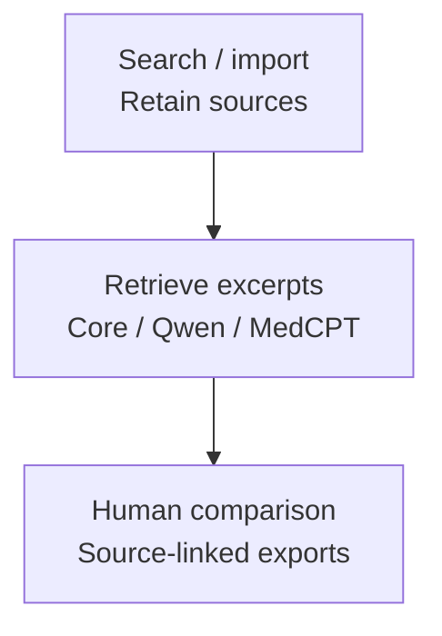

# Literature Review Engine

A local-first research workspace for comparing papers, inspecting exact evidence excerpts and exporting a table you can verify.

<!-- published-release:start -->
**[Download — source beta 0.3.0-beta.4](https://github.com/hnt119/lit-rev-engine/releases/tag/v0.3.0-beta.4) · [Quick start](https://github.com/hnt119/lit-rev-engine/blob/v0.3.0-beta.4/docs/local_preview.md) · [Read-only demo](https://hnt119.github.io/projects/literature-review-engine/#saved-evidence)**

[Direct source ZIP](https://github.com/hnt119/lit-rev-engine/releases/download/v0.3.0-beta.4/lit-rev-engine-0.3.0-beta.4.zip) · [Manifest](https://github.com/hnt119/lit-rev-engine/releases/download/v0.3.0-beta.4/lit-rev-engine-0.3.0-beta.4.manifest.json) · [SHA-256 checksums](https://github.com/hnt119/lit-rev-engine/releases/download/v0.3.0-beta.4/lit-rev-engine-0.3.0-beta.4.SHA256SUMS) · [Download installation guide](https://github.com/hnt119/lit-rev-engine/releases/download/v0.3.0-beta.4/INSTALL.md)
<!-- published-release:end -->

**[User guide · beta.4](https://github.com/hnt119/lit-rev-engine/blob/v0.3.0-beta.4/docs/user_manual.md) · [Architecture & model roles](docs/application_architecture.md)**

**Setup required; not a standalone installer.** The demo is a guided walkthrough using saved public data, without live search or model calls. Beta.4 remains the newest verified published download.

## Start locally

Install **Python 3.12, Node.js 24 and pnpm 10.20.0**. In the release page’s **Assets**, download the purpose-built ZIP and matching manifest/checksums, verify them, then extract it. GitHub's automatic source archive is not the tested distribution.

| Platform | Setup and validation scope |
| --- | --- |
| macOS Apple Silicon | [Installation guide](https://github.com/hnt119/lit-rev-engine/blob/v0.3.0-beta.4/docs/local_preview.md); source-app workflow tested |
| Windows x64 | [Windows setup guide](https://github.com/hnt119/lit-rev-engine/blob/v0.3.0-beta.4/docs/windows_source.md); Core and bounded Qwen/MedCPT CPU workflows tested on CI |

On **macOS**, run inside the extracted folder:

```sh
python3.12 scripts/local_preview.py setup
python3.12 scripts/local_preview.py launch
```

Windows uses the guide's isolated bootstrap commands. Setup installs dependencies and builds the production interface; it does not search or download models. Launch opens the browser after readiness checks. Keep the terminal open; Ctrl-C stops it.

Linux installation is unverified; Intel Mac and Windows ARM are unqualified. Physical Windows 11 is **NOT_RUN**. No native executable is publicly available. See the release's [validation record](https://github.com/hnt119/lit-rev-engine/releases/download/v0.3.0-beta.4/VALIDATION.md) for the exact scope.

## Review an entry

Start with **Saved example · offline** and its 30 public papers, or search/import references. Select reports and choose **Prepare & compare**. Source labels distinguish full text, abstract only and unavailable material.

**Open a cell → find an excerpt → inspect its source → use the excerpt → comment and judge → save.**

The excerpt stays beside your comment in the comparison editor. Reopen saved entries through explicit revisions, then export CSV/JSON. Draft notes remain separate from submitted entries. Missing information can remain unresolved; an empty candidate list does not prove whole-paper absence. A preview or board selection is not formal review inclusion.

## Choose retrieval in the same app

| Choice | Components |
| --- | --- |
| **Core lexical** | Default BM25 / versioned lexical spans; no neural model or generation key |
| **Qwen hybrid** | BM25 + Qwen3-Embedding-0.6B + Qwen3-Reranker-0.6B |
| **Biomedical/MedCPT hybrid** | BM25 + MedCPT Query/Article Encoders + Cross Encoder |

Use **Research & AI Settings → Evidence retrieval**. Optional packs require explicit dependency installation, model download, runtime checks and source indexing. Both can coexist; existing boards retain their pinned profiles until an explicit revision. Neural profiles are experimental, with no established superiority over BM25.

Optional **BGE paper maps** are separate from passage retrieval. Optional **local/OpenAI/DeepSeek generation** proposes search plans or cell values for review. Core manual research needs neither.

## How RAG fits into the workflow

**Retrieval-Augmented Generation (RAG)** helps connect a research question to evidence in the papers you have retained. Instead of asking an AI model to answer from memory, the application first retrieves candidate passages from the selected, versioned sources. Researchers can then inspect the exact excerpts before making a judgment.

- **Retrieve:** Core BM25/lexical search works without an LLM; optional Qwen or MedCPT embeddings and rerankers can rank source-linked passages (experimental).
- **Generate (optional):** A user-configured local model, OpenAI or DeepSeek can propose an answer using a bounded evidence packet. No generation is required for manual review.
- **Verify:** Source inspection, excerpt attachment, human support judgments, revisions and exports remain explicit. Neither retrieval relevance nor a generated citation proves that a scientific claim is supported.

**RAG is an optional assistance path, not an automatic literature reviewer.** [See the full retrieval and model architecture](docs/application_architecture.md).

## Under the hood



The local stack is **Next.js/React → FastAPI → Python services**, with private SQLite state. [Full architecture and provider boundaries](docs/application_architecture.md).

## Help, privacy and status

Research lives outside replaceable application files. Explicit searches transmit queries/contact details; optional cloud AI transmits disclosed input and may incur charges. Settings-entered keys are session-scoped; non-secret preferences persist. Cookie loss/expiry can lose workspace access: read [reopening, backups and recovery limits](https://github.com/hnt119/lit-rev-engine/blob/v0.3.0-beta.4/docs/user_manual.md#export-back-up-and-replace-the-app).

[Documentation index](docs/README.md) · [Report an issue](https://github.com/hnt119/lit-rev-engine/issues) · [MIT license](LICENSE) · [Third-party/article/model terms](THIRD_PARTY_NOTICES.md)

The question-to-evidence workbench is separate development work, absent from beta.4 and current main. A main merge does not update a published ZIP.

<a id="requirements-and-installation"></a>
<a id="update-main-and-contribute"></a>
Older installation/contribution links continue in the [legacy CLI guide](docs/legacy-cli-and-history.md#requirements-and-installation).

Contributors can consult the [product design](product_design.md) and [repository agent guide](AGENTS.md).
