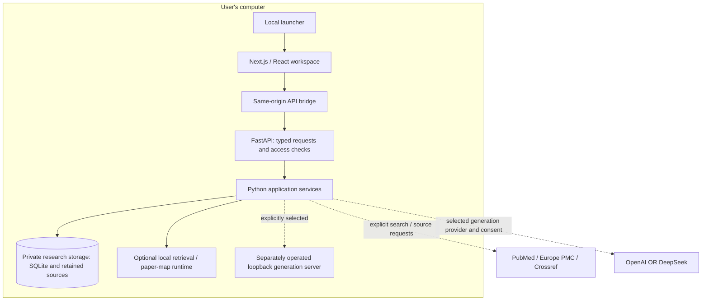
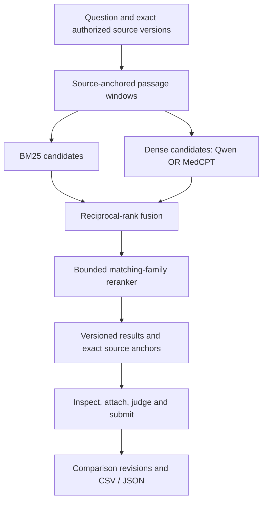

# Application architecture & model roles

**Scope: the local Track A application.** The public website is a saved, read-only demonstration; it does not connect to your local workspace.

The published download is [source beta.4](https://github.com/hnt119/lit-rev-engine/releases/tag/v0.3.0-beta.4), bound to `d52e5e35c80ef435abaec0c0a6f4ed236cba9356`. This overview was checked against main at `265b291aaf0a2a60ac9aa89862dc531a78207874`. The separate question-to-evidence branch is described only in the development section below; it is in neither that main snapshot nor the beta.4 ZIP. A merge and a release are separate events.

[Version-matched user guide](https://github.com/hnt119/lit-rev-engine/blob/v0.3.0-beta.4/docs/user_manual.md) · [Documentation index](README.md)

## One local application

The launcher starts the production Next.js/React interface and a thin FastAPI adapter over the existing Python services. The browser talks through a same-origin API bridge; server-side authorization and source-binding checks remain in force. Ordinary source use requires separately installed runtimes, rather than a bundled native installer.

The arrows show dependencies and explicit operations, not work triggered by visiting a page. Models and source-derived indexes live outside replaceable application files. The configured loopback generation server is separately operated; the application does not install/start it or download its weights. A loopback destination does not establish what that server itself does with data.

Implementation: [launcher](../scripts/local_preview.py), [web workspace](../apps/web), [same-origin bridge](../apps/web/lib/bridge.ts), [FastAPI adapter](../src/web_api), [service assembly](../src/mvp/bootstrap.py).

## Discovery, import and source acquisition

| Path | Role and boundary |
| --- | --- |
| PubMed | Explicit discovery, executable query, diagnostics and saved search receipts. A capped exploratory preview is not a complete review capture. |
| CSV, RIS and DOI/PMID identifiers | Local bibliography parsing; explicit metadata resolution is a separate network action. A citation is not an inspected source or an inclusion decision. |
| Europe PMC | Exact-identity, permission-checked source acquisition; permitted full text or a labeled abstract fallback. The implemented reuse gate is conservative CC BY/CC0. |
| Crossref / Europe PMC metadata | Resolve supported identifiers and metadata; this does not grant full-text access or reuse rights. |

Paper-provider settings are independent of generation selection. No publisher login, copied browser cookie, Zotero attachment-path import or general PDF-upload workflow is implied by bibliography intake. Keep unavailable and abstract-only outcomes visible.

Sources: [PubMed adapter](../src/mvp/adapters/pubmed.py), [import parser](../src/mvp/import_parsing.py), [metadata resolution](../src/mvp/adapters/metadata_resolution.py), [Europe PMC acquisition](../src/mvp/adapters/europe_pmc.py).

## Four tools with different jobs

| Tool | Input → output | Boundary |
| --- | --- | --- |
| Paper discovery/intake | Approved query or bibliography → candidate records and retained sources | Provider access is not LLM inference. |
| Passage retrieval | Question + exact authorized source scope → ranked, anchored excerpts | Core lexical by default; optional local neural packs. A score is not support probability. |
| Paper map | Titles/abstracts → persisted coordinates and neighbors | Separate BGE model and artifact; does not determine eligibility or evidence quality. |
| Generation | Question or bounded evidence packet → structured proposals | Optional, configured adapter; explicit human approval/adoption remains necessary. |

## Passage retrieval: Core, Qwen and MedCPT

These are selectable profiles in one app. Existing sources, drafts, cell revisions and citations remain shared contracts.

| Choice | Algorithm / exact model IDs | Profile |
| --- | --- | --- |
| Core lexical | BM25 and versioned lexical/context methods; no neural weights | Existing passage-search methods and board profiles `legacy_block_prefix_v1` / `lexical_spans_v1` retain their separate contracts. |
| Qwen hybrid + reranking | BM25 + `Qwen/Qwen3-Embedding-0.6B` → rank fusion → `Qwen/Qwen3-Reranker-0.6B` | `hybrid_qwen3_06b_rrf_rerank_v1` |
| Biomedical/MedCPT hybrid + reranking | BM25 + `ncbi/MedCPT-Query-Encoder` / `ncbi/MedCPT-Article-Encoder` → rank fusion → `ncbi/MedCPT-Cross-Encoder` | `hybrid_medcpt_passage_rrf_rerank_v1`; experimental passage adaptation |

The authoritative [pack manifest](../src/mvp/retrieval_pack_manifest.json) defines exact model/tokenizer revisions, permitted files, byte counts and hashes. [Pack notices](../src/mvp/retrieval_pack_notices.json) and [model references](hybrid_model_references.md) retain attribution. Use these records rather than a second model registry in prose.

The two candidate branches independently search the same authorized inventory **before ranking**. Core bypasses dense encoding and reranking. Hybrid receipts retain model/profile/window identities, stage scores/ranks, exact source bindings and omissions. Missing, stale or incompatible models/indexes fail visibly; there is no silent lexical fallback. Existing boards change profile only through an explicit definition revision.

Both neural profiles remain **experimental**. Genuine encoder/reranker execution establishes integration, not superiority over BM25, scientific support, completeness or user benefit. See [retrieval boundaries](hybrid_retrieval.md) and the release's [actual validation record](https://github.com/hnt119/lit-rev-engine/releases/download/v0.3.0-beta.4/VALIDATION.md).

## Paper maps use separate BGE embeddings

`BAAI/bge-small-en-v1.5` represents title/abstract metadata, or title alone when an abstract is absent. Its pinned revision is `5c38ec7c405ec4b44b94cc5a9bb96e735b38267a`, defined in [mapping contracts](../src/mvp/mapping.py) and loaded locally by the [paper-embedding adapter](../src/mvp/adapters/paper_embeddings.py).

This is not the passage evidence index. New maps require explicit setup and computation; saved coordinates can be viewed without new inference. Filtering, selection and navigation do not refit a saved map. Qwen/MedCPT packs do not replace BGE map embeddings. BGE-M3 is not an implemented profile in this application.

## Optional generation: user-configured model and provider

No generative model is fixed by the product. The researcher supplies a compatible model ID and configured revision/profile. A configured revision is not a verified weight hash, and a provider label does not establish model compatibility.

| Adapter | Allowed destination | Boundary |
| --- | --- | --- |
| Local server | Literal HTTP loopback `127.0.0.1` or `::1`, explicit port, `/v1/chat/completions` | Separately installed/operated server and weights. |
| `openai.chat-json.v1` | `https://api.openai.com/v1/chat/completions` | Own key, JSON-object output and bounded completion. |
| `deepseek.chat-json-nonthinking.v1` | `https://api.deepseek.com/chat/completions` | Own key, JSON-object output, thinking disabled. |

These are implemented backend adapters, not live-provider validation claims. Fixed cloud endpoints and returned model identity are checked; arbitrary cloud base URLs are unsupported. See [cloud adapter](../src/mvp/adapters/cloud_generation.py), [local planning adapter](../src/mvp/adapters/search_planning.py) and [Settings guide](research_ai_settings.md).

- **Search planning:** a structured proposal is reviewed by the user; deterministic compilation, query approval, diagnostics and execution remain separate.
- **Cell proposals:** a bounded, deduplicated evidence packet produces a typed suggestion. The server validates ownership and reconstructs exact quotation anchors. Unknown, ambiguous, mismatching or stale references fail. The researcher inspects and may adopt/edit/dismiss it before explicit judgment and submission.

Source text is untrusted data; the model has no action tools. Candidates, inspected evidence, suggestions and human support judgments remain distinct. Exact quotation matching proves text/location, not semantic support. Null/insufficient-context outputs do not establish whole-paper absence. Adoption never marks support or independent verification automatically.

Cloud generation leaves the local backend only after operation-specific data/cost consent. Requests have bounded context, output, calls, concurrency and runtime; there is no automatic retry/provider fallback or guaranteed dollar cap. Failure/timeout can still incur charges. Settings-entered credentials stay in backend session memory and require re-entry after restart. Non-secret preferences persist separately in private JSON; a private operator launch file has its own permission/storage rules. Do not infer that all configuration is memory-only, or that local storage grants cloud-transmission rights.

Real LLM planning/proposal and live PubMed checks were **NOT_RUN for beta.4**. Mocked generation tests and real local retrieval/model execution are different evidence categories; neither establishes research usefulness.

## Private storage, explicit review and history

Private SQLite research state and retained source storage live in the chosen per-user directory outside the application. They preserve bibliography, searches, source versions/canonical blocks, preparations, map artifacts, retrieval receipts, board definitions, editable drafts and immutable submitted revisions. Historical cells retain their original source IDs, hashes and exact ranges; preparation never silently switches their sources.

The comparison editor keeps source excerpts beside manual comments. For evidence-supported entries, explicit inspection/attachment precedes human support judgment and submission. Missing or unavailable information can instead be recorded as a null value with an explicit limitation, without inventing an attachment. Revisions and two-tab conflicts preserve earlier entries; CSV/JSON exports retain the existing contracts. These are self-declared researcher actions, not authenticated independent or dual review.

Model weights are separately installed and excluded from release assets. Source-derived index windows/vectors are also outside the app, but remain **private research-derived runtime data**, and must not be distributed as if they were public model weights. See [hybrid index storage](../src/mvp/hybrid_service.py) and [pack management](../src/mvp/retrieval_packs.py).

Exports are scholarly records, not necessarily complete backups/access-recovery packages. Keep the same browser profile, hostname and session cookies; losing them can lose workspace access. Read the version-matched [backup and recovery limitations](https://github.com/hnt119/lit-rev-engine/blob/v0.3.0-beta.4/docs/user_manual.md#export-back-up-and-replace-the-app).

## Question-to-evidence extension — feature branch only

Implementation: [`bda0803`](https://github.com/hnt119/lit-rev-engine/commit/bda0803d4c234de2f3a7852fa53af5b89b22459a); development/documentation head: [`ec7897f`](https://github.com/hnt119/lit-rev-engine/commit/ec7897f82005eba924475848164782848d8a1708) on `codex/question-evidence-workbench`.

**Not in beta.4 or the inspected main snapshot.** This extension adds clearer concepts/search diagnostics, readable strategy exports, source-linked typed dimensions and saved Overview / Methods / Needs review views. Attributes remain distinct from labels and unreviewed suggestions; unknowns and multiple sample sites are retained. Views/filtering/sorting do not trigger inference, invalidate reviewed cells or infer same-cohort relationships.

Read the [development guide](https://github.com/hnt119/lit-rev-engine/blob/ec7897f82005eba924475848164782848d8a1708/docs/question_evidence_user_guide.md) and [separate Windows Core evidence](https://github.com/hnt119/lit-rev-engine/blob/ec7897f82005eba924475848164782848d8a1708/docs/question_evidence_windows_validation.md). An eventual approved merge changes integration status; only a successor published archive changes download claims.

## Preserved separate paths

- **Legacy/research:** [architecture.md](architecture.md) covers the ReviewStore ledger, Chroma/Agnes exploration and frozen Qwen4B/Kaggle experiments. It is not this downloaded app's active architecture.
- **Track B:** the protocol-defined review pilot is separate; its screening authority/counts are not active in every Track A workspace.
- **Desktop:** the same-UI Electron prototype is separate from the public setup-required source download. Native executables and physical-device qualification have separate gates.
- **Hosting:** existing implementation is preserved but deferred. There is no running hosted backend, cloud vector database or MCP deployment in this application description.

Original code is [MIT-licensed](../LICENSE); [third-party/article/model terms](../THIRD_PARTY_NOTICES.md) remain separate. This overview explains implemented boundaries, not a new performance or scientific validation result.
