# Optional AI-assisted cell proposals

The manual comparison board and this optional proposal layer are versioned together on [`codex/mvp-v0-3`](https://github.com/hnt119/lit-rev-engine/tree/codex/mvp-v0-3). Use the latest feature-branch checkout: the earlier `60f8aa9` discovery commit alone does not contain either checkpoint. The manual workflow and its historical [evaluation](manual_board_evaluation.md) remain the baseline. Main is unchanged.

Generation is disabled by default. Opening, reopening, inspecting or exporting a board does not run a model. The existing research engine, retrieval profiles, maps, assessment rules, cell revisions, source bindings and export schemas are preserved. No narrative synthesis, MCP, deployment or provider fallback is added.

## Researcher workflow

1. Start the existing local web application using [the manual-board guide](manual_comparison_board.md#start-locally). Open a current retained board. Expand **Optional AI suggestions** to inspect configuration and saved run receipts.
2. When one adapter is explicitly configured, choose up to three reports and fields covering at most nine cells. **Generate proposals for selected cells** is the only generation action. Current drafts are flushed first. Editing a selected cell or changing dependencies while generation runs can reject the entire result.
3. Select a cell. Its saved proposals are labeled **AI suggestion — needs review**. A nullable value, model reason and missing-information statement can be edited locally. Those edits are temporary until adoption; they are not durable drafts yet.
4. **Inspect suggestion reference** opens exact canonical source context. **Inspect generation context and coverage** loads the actual retained input packet, including source availability, per-field retrieval counts, supplied excerpts and omissions. Model context is a bounded subset even when full text was retained.
5. **Use in draft** uses server-side draft-version and submitted-head checks. It only accepts an empty editable draft: existing values, references, inspection declarations and judgments are never replaced. For an already populated cell, inspect the suggestion and edit the existing manual draft directly. **Dismiss** records a separate action without changing a draft or submission.
6. Adoption creates a manual draft with references but **no declared inspected ranges**, **not-assessed scope** and **unassessed human support**. Opening a citation does not declare inspection. Explicitly mark the ranges you inspected, edit the value/reason and make your own judgment. Then submit through the existing manual form. Referenced drafts cannot be submitted until their references lie within declared inspected ranges.
7. Reopen and inspect previous suggestions, source context, draft state and submitted history. The proposal's `adopted` status means it was used in a draft; it does not certify submission, support or independent verification. Null suggestions mean insufficient retrieved evidence and never establish whole-paper or literature-wide absence.

Current-definition proposals can still be reviewed after generation is disabled. Historical definitions and their suggestions remain inspectable, with new adoption/dismissal blocked. Existing manual conflicts and explicit revision rules continue to apply.

## One explicit adapter

Use [the adapter configuration guide](cell_proposals_adapter.md) for the exact environment variables. It supports only a literal HTTP loopback OpenAI-compatible endpoint with an explicit model and configured revision. There is no model download, credential lookup, paid provider or remote fallback. A misconfigured optional adapter disables AI and reports a safe configuration reason while the manual application remains available.

No real model was run for this checkpoint. An operator-supplied revision is recorded as configured, **not verified against model weights**. A loopback endpoint is not proof about an operator's downstream infrastructure or billing; configure an appropriate local or separately authorized free endpoint. The engine supplies no paid credentials or provider routing. Model quality, scientific entailment and usefulness require separate authorized evaluation.

## Boundaries and acceptance

```mermaid
flowchart LR
  UI[Explicit selected-cell request] --> Reserve[Validate and reserve input bindings]
  Reserve --> Candidates[Existing per-paper / per-field lexical retrieval]
  Candidates --> Packet[Deduplicated bounded paper packet]
  Packet --> Adapter[One configured adapter: no tools]
  Adapter --> Validate[Strict typed output and exact quote reconstruction]
  Validate --> Recheck[Recheck sources, definition, profile, heads and drafts]
  Recheck --> Proposal[Separate unreviewed proposals]
  Proposal --> Human[Inspect / edit / use in empty draft / dismiss]
  Human --> Manual[Existing explicit manual submission]
```



`CellProposalService` composes the existing `EvidenceBoardService`. Source text, titles, questions and fields are untrusted data in the prompt. The model receives no action tools. Candidate runs are generated using the existing top-three per-paper/per-field operation. Canonical anchors are deduplicated across a paper's fields, while each field retains its permitted evidence IDs and retrieval input. Omissions remove complete excerpts and are recorded explicitly.

Output must contain every requested field exactly once. Each citation identifies a supplied evidence ID and an exact quotation. The server checks paper/field ownership, source versions/hashes and unique substring occurrence, including overlapping occurrences, then reconstructs the canonical half-open Unicode anchor. Unknown, ambiguous, mismatching or wrong-paper/field references reject the run. Exact-but-non-supporting quotations can pass mechanical integrity; they never establish semantic support.

A run reserves the definition/source/retrieval/model/prompt bindings and each selected cell's submitted head plus full draft identity. Slow generation holds none of the lifecycle, research-snapshot or SQLite mutation locks. Publication rechecks those bindings under the existing lock order and publishes all proposals atomically or none. Concurrent edits, changed definitions/sources/profile and deletion cannot cause stale publication. Failed or interrupted requests do not retry automatically. Reusing a request ID returns its saved receipt; another attempt requires a new explicit request.

## Limits

| Resource | Bound |
| --- | ---: |
| Reports / fields / cells per run | 3 / 6 / 9 |
| Generation calls | One per selected report; at most 3 |
| Automatic retries | 0 |
| Runtime | 10 seconds per call; 35 seconds per run |
| Evidence text per paper | 12,000 Unicode code points |
| Serialized packet / total HTTP request | 20,000 / 24,000 UTF-8 bytes |
| Response / requested output tokens per call | 32,768 bytes / 2,048 tokens |
| Runs per workspace, including failures | 20 |
| Storage | Existing shared 32 MiB board payload budget |
| Supported paid spend cap | 0; no paid routing supported |

A timed-out adapter cannot publish later. Its in-process call lease blocks additional calls until it exits, limiting orphaned work. After process interruption an expired running receipt remains visible; reopening it never repeats inference. Usage that was not reported stays null, not zero. A separate bounded failure reserve helps retain terminal failure receipts when storage limits reject inputs or publication.

## Storage, interfaces and exports

Proposal records use **additive tables in the existing private board SQLite sidecar**: `proposal_runs`, `cell_proposals`, `proposal_events` and `proposal_actions`. They share its quota, integrity checks, workspace authorization and deletion tombstones. They are separate from board drafts and submitted cells. Adoption events bind the proposal to the acknowledged draft version and edited-data digest without changing the existing cell schema.

Routes beneath `/api/v1/workspaces/{workspace}/boards/{board}` inherit the existing Host/Origin, CSRF, session and request-size boundary:

```text
GET  /proposal-capabilities
POST /proposal-runs
GET  /proposal-runs/{run}
GET  /proposals?revision_id=&paper_id=&field_id=&offset=&limit=
POST /proposals/{proposal}/adopt
POST /proposals/{proposal}/dismiss
GET  /proposals/{proposal}/references/{reference}/context
GET  /proposal-audit?revision_id=
```

Normal listings paginate suggestions and return compact run summaries. Complete packets are loaded only through explicit run/context inspection or audit export. **Download separate proposal audit JSON** uses `mvp.proposal-audit.v1`, including input packets, bindings, usage/failure receipts, original suggestions and adoption/dismissal events. Existing board CSV/JSON and evidence export schemas remain unchanged; they do not treat unadopted proposals as human submissions. Source-linked artifacts remain local unless separately authorized for sharing.

See [checkpoint evaluation](cell_proposals_evaluation.md) for exact changed files, commands, failures/fixes, browser evidence and limits. Mock software checks do not establish research usefulness or real-model performance.
