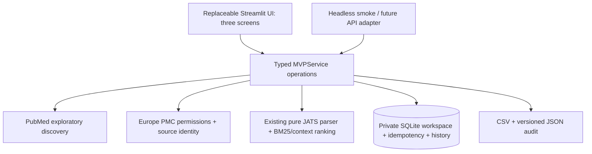

# Literature Review Engine MVP v0.1

A researcher can discover papers, select up to ten for exploration, inspect up to five source-anchored passages, record judgments and download an evidence table through a local Streamlit interface. The sample topic is **Gut Microbiome in Asian Women**; live queries and passage questions are editable for other topics.

This is exploratory research assistance. It does not perform a comprehensive systematic review, screen studies automatically, write a scientific answer, infer ethnicity, or independently verify a researcher's judgment. The original ledger, CLI and frozen Qwen workflows remain separate and unchanged.

## Install and start

Python 3.12 on macOS or Linux is the tested target. Install the focused CPU-only group in a separate environment; the original engine installation is not needed or modified:

```bash
cd /Users/hunt/Desktop/lit-rev-engine
python3.12 -m venv .venv-mvp
.venv-mvp/bin/python -m pip install -r requirements-mvp.txt
.venv-mvp/bin/python -m streamlit run apps/streamlit/app.py
```

Open [http://127.0.0.1:8501](http://127.0.0.1:8501). To use another port, append `--server.port 8502`. The repository's `.streamlit/config.toml` binds the server to loopback and disables usage telemetry. No GPU, inference key, embeddings, model download, PDF upload, paid service, separate API server or cloud database is required.

The default is **Saved example (offline)**. All committed research state lives in a private local SQLite store under `.mvp-state/`, which is ignored by Git. Override it with an absolute private `MVP_DATA_DIR` path. Do not use the existing review-ledger database as this store.

## Walk through the saved example

1. On **Discover**, keep or edit the research question and click **Search literature**. This opens one real licensed article from a preserved Europe PMC example. The recorded search reported nine matches and originally returned two metadata records; one permitted CC BY article is bundled. The app displays one curated record and explicitly states that it did **not** run a new PubMed query.
2. Click **Continue to source selection**. Select the article, then **Prepare selected papers**. Confirm its identity, full-text status, license, attribution and recorded acquisition time. Selecting a paper means `selected_for_exploration`, not formal inclusion or verified relevance.
3. Click **Continue to passage search**. Enter a question such as “What does this source report about diet and gut microbiota in the studied Chinese pregnant women?” and click **Search passages**. Results come from lexical BM25/context ranking, not generated answers. An unrelated or stop-word-only query may return no matches; the app does not fill an empty result with unrelated text.
4. Click **Inspect source** on a passage, then **Read selected source context ↓** to jump to the lower inspector. **Verifiable source context**, below the passage and judgment columns, highlights its exact quotation in canonical source text, with a block/section locator and original-source link. Expand retained surrounding blocks when needed. XML and abstract sources have no invented PDF page numbers.
5. Enter passage decisions and notes in **Record your judgments**, beside **Retrieved passages** on wide screens. On narrow screens these panels stack before source context. Leave unknown decisions **Unreviewed**. An optional bundle judgment requires a reason when assessed; partial/insufficient needs missing information, and sufficient needs supporting passages with no declared gap. Contradiction is separate. Click **Save assessment**.
6. Corrections use **Revise saved assessment**, which loads the saved record and explicitly supersedes it. Earlier records remain in history. A stale revision is rejected while the form remains editable; compare it with the latest record before resubmitting.
7. Download **evidence CSV** and **audit JSON**. The CSV includes unreviewed passages and neutral values. Formula-like cells are escaped; JSON preserves the original text and complete history.

The saved source is Zheng et al., *Influences of dietary intake on Chinese women with gestational diabetes mellitus by inhibiting gut microbiome on plasma metabolome*, Frontiers in Immunology (2026), [PMID 42051515](https://pubmed.ncbi.nlm.nih.gov/42051515/), [DOI 10.3389/fimmu.2026.1745459](https://doi.org/10.3389/fimmu.2026.1745459). It is CC BY 4.0; the [fixture provenance](../tests/fixtures/mvp/README.md) retains attribution, actual query/times, checksums, license and transformations. This saved demonstration is not a scientific conclusion, retrieval benchmark or representative sample of Asian women. Study location and reported population description remain distinct.

## Enable live PubMed discovery

Set your developer contact email in the server shell, then restart the app:

```bash
export NCBI_EMAIL="you@your-institution.edu"
export MVP_MODE=live
# Optional: export NCBI_API_KEY="your-own-key"
.venv-mvp/bin/python -m streamlit run apps/streamlit/app.py
```

Use your actual contact email, not the placeholder. There is no inference API key. The app does not automatically load the existing `.env` or legacy model configuration. [mvp.env.example](../mvp.env.example) lists supported settings without credentials. If live discovery is unavailable, the UI retains the saved-example option.

On Discover, edit the question and proposed PubMed query. **Propose editable query** uses a transparent concept/word template; it never calls a model or silently relaxes a filter. Review synonyms and population terms yourself. Optional publication-date restrictions require both From and Through; otherwise leave the restriction unchecked.

Search returns **30 records by default, at most 50**. It preserves the exact query, available query translation, date bounds, sort, timestamp, reported total, fetched count, ordered identifiers, warnings and truncation. Returned citations are deduplicated conservatively by PMID/compatible DOI. Similar titles and distinct PMIDs are not merged as one study. A capped preview is never labeled a complete PubMed capture, even when it happens to fit all reported matches.

Select up to ten papers. Europe PMC metadata and the article's own identifiers are checked before retaining a full-text XML source. The conservative MVP policy accepts clear **CC BY or CC0** permissions; it does not assume every open-access article permits unrestricted reuse. Restricted/unknown permissions, missing full text, transport failures and identity mismatch are distinguished. An available abstract can be used with an explicit **Abstract** label and reason; it never becomes full text. No usable text produces an unavailable source, not an invented passage.

Normal widget reruns do not repeat searches/downloads. Identical submissions reuse their request key. Explicit refresh creates a new search/source/passage run. Changed selections or source refresh invalidate the current evidence run and current-assessment pointers; historical results remain exportable and are marked as older source bindings.

**Current evidence limit:** live PubMed is implemented and tested with mocked ESearch/EFetch responses, not a completed real PubMed smoke in this cycle. The only live source acquisition was the bounded Europe PMC example search and XML fetch. Current network availability and permissions for another paper must be established when it is retrieved.

## What is saved and exported

Each workspace has stable IDs for searches, preparations, documents, runs, passages and assessments. A random capability is required for every service operation; the database stores only its hash. The UI has no global workspace list. Capabilities, API keys, filesystem paths and database connections are not included in exports.

Sources retain provider, URL, timestamps, available license/attribution, parser provenance, original-byte hash when retained, canonical block hash and version. Original XML is retained only under accepted reuse permission. If original bytes are absent, a canonical-text hash basis is identified explicitly. Quotation offsets are **half-open Unicode code-point indices** into canonical block text; they must not later be used directly as JavaScript UTF-16 indices.

CSV rows include question, workspace/search/run/passage IDs, citation and identifiers, source type/status, quotation, locator, source version/hash, method, passage decision/notes, bundle judgment, single-user review state and timestamps. Historical source bindings are distinguished from current ones. The JSON audit bundle is versioned (`mvp.audit-bundle.v1`) and retains search provenance, preparation/run snapshots and immutable assessment history.

An insufficient bundle means the **retrieved passages lack support**. It does not establish that the article or the literature lacks an answer. These judgments are self-declared by one user and are not independent verification. The MVP does not create formal screening, study-linkage or verification events in the review ledger.

## Headless workflow and tests

The same application service runs without importing Streamlit:

```bash
.venv-mvp/bin/python scripts/mvp_smoke.py \
  --output /private/tmp/lit-review-mvp-example-export
```

Choose a new output directory; existing exports are not overwritten. By default, passages stay unreviewed. Add `--save-example-judgment` to exercise immutable saving with an explicitly **synthetic uncertain software-test judgment**. Such records are not human review evidence.

Live smoke requires an explicit query, server contact configuration and opt-in:

```bash
.venv-mvp/bin/python scripts/mvp_smoke.py --mode live --allow-live \
  --query 'YOUR_EXACT_PUBMED_QUERY' --question 'YOUR_QUESTION' \
  --output /private/tmp/lit-review-mvp-live-export
```

It caps discovery at three records, prepares only the first record and makes no inference calls. A zero-result search stops without inventing a source.

Install development dependencies and run normal offline tests:

```bash
.venv-mvp/bin/python -m pip install -r requirements-mvp-dev.txt
.venv-mvp/bin/python -m pytest -q tests/mvp
```

The [evaluation report](mvp_evaluation.md) separates service/provider tests, Streamlit AppTest, actual browser checks, broad regression and live acquisition. Tests use synthetic providers in temporary workspaces; synthetic papers never populate saved-example mode.

## Architecture and limits



Only `apps/streamlit/app.py` imports Streamlit. It renders typed results and retains the workspace handle and UI drafts. `src/mvp/service.py` owns selection, source/run bindings, assessment rules and exports. `ports.py` defines injected discovery/source/storage capabilities. `bootstrap.py` constructs adapters and reads server configuration; it never stores a current user's results in a shared UI cache.

Provider operations are bounded and synchronous: fixed HTTPS endpoints, redirects rejected, 12-second socket timeout (configurable up to 15), two attempts, at most 8 MiB per response, XML entity declarations rejected and no external-DTD resolution. Rate gates are process-wide and shared across Streamlit sessions: NCBI start spacing is 0.4 seconds and Europe PMC 0.25 seconds. Use **one server process per outbound IP** for this MVP; multiple processes need a shared rate gate. Per-workspace locks and short SQLite commits prevent duplicate committed operations. A workspace's serialized snapshot plus idempotency records is bounded at 64 MiB.

Saved state survives ordinary widget reruns and server-side service reconstruction when the session retains its capability. A hard reload, closed tab, expired anonymous session or restarted host may lose that capability. There is no account, recovery link, JSON re-import or cross-device recovery in v0.1. Local disk persists until cleared; ephemeral hosting may erase it. Export regularly. **Clear session and local workspace** requires an explicit acknowledgement, deletes the active workspace, and starts a fresh anonymous session; it is not secure disk erasure of SQLite backups/WAL pages.

Local operation is the supported default. For a later private deployment, install this focused group, retain `src/`, `apps/`, `.streamlit/` and the saved fixture directory, give the process a private writable data directory, and place Streamlit behind authenticated TLS access with persistent storage and one worker process. This cycle creates no cloud resources or hosted deployment. Multi-user security, durable jobs, original PDF/table rendering, OCR, automated extraction and scientific usefulness evaluation remain future work.

The [migration plan](mvp_migration.md) explains how to replace Streamlit with a thin FastAPI adapter and Next.js while retaining Python services and contracts. Do not move retrieval or assessment rules into the frontend.

The [visual identity guide](mvp_theme.md) records the inspected portfolio source, portable theme tokens, responsive layout and keyboard behavior. The Streamlit styling adapter is separate from the tokens and application services.

Primary references: [NCBI usage policy](https://www.ncbi.nlm.nih.gov/books/NBK25497/), [E-utilities parameters](https://www.ncbi.nlm.nih.gov/books/NBK25499/), [Europe PMC API](https://europepmc.org/RestfulWebService), [OA reuse conditions](https://europepmc.org/downloads/openaccess), [Streamlit forms](https://docs.streamlit.io/develop/api-reference/execution-flow/st.form).
