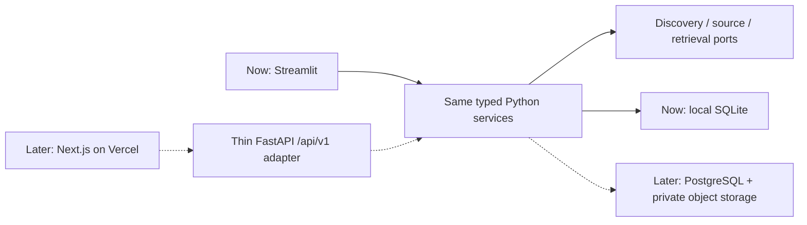

# MVP migration: replace the UI, retain the Python foundation

**Current:** a single local Streamlit process calls typed `MVPService` operations with injected discovery, source and storage adapters. **Later proposal:** Next.js/React on Vercel calls a thin FastAPI service over HTTPS. These later systems are not implemented or deployed in v0.1.

The Streamlit UI will be replaced. The Python application services, domain rules, typed contracts, source provenance and tests are the reusable product foundation.

Keep the visual identity too: import `apps/streamlit/theme/tokens.css` into the future frontend's global CSS unchanged, then build React components against those variables. `apps/streamlit/theme/streamlit.css` contains temporary Streamlit selectors and should be replaced during migration. The [theme guide](mvp_theme.md) records the portfolio source pin, typography, spacing and layout contract.

## Proposed API mapping

Each endpoint wraps the corresponding existing service operation. Authentication and project authorization must be added before exposing these routes; current capability handles are an anonymous local isolation mechanism, not a complete hosted identity system. Never put capability tokens in URLs, logs or exported audit bundles.

| Proposed endpoint | Existing service operation / typed model |
| --- | --- |
| `POST /api/v1/workspaces` | `create_workspace(CreateWorkspaceRequest)` |
| `GET /api/v1/workspaces/{id}` | `get_workspace` → `WorkspaceSnapshot` |
| `DELETE /api/v1/workspaces/{id}` | `clear_workspace` → `ClearResult` |
| `POST /api/v1/workspaces/{id}/query-suggestions` | `suggest_query(QuerySuggestionRequest)` |
| `POST /api/v1/workspaces/{id}/searches` | `search_literature(SearchRequest)` → `SearchPreview` |
| `POST /api/v1/workspaces/{id}/source-preparations` | `prepare_sources(PrepareSourcesRequest)` → `PreparationResult` |
| `POST /api/v1/workspaces/{id}/evidence-runs` | `retrieve_evidence(RetrieveEvidenceRequest)` → `EvidenceRun` |
| `GET /api/v1/workspaces/{id}/runs/{run_id}/passages/{passage_id}/context` | `get_source_context(SourceContextRequest)` |
| `POST /api/v1/workspaces/{id}/assessments` | `save_assessment(SaveAssessmentRequest)` |
| `GET /api/v1/workspaces/{id}/exports` | `export_workspace` → `WorkspaceExport` or streamed CSV/JSON |

FastAPI should reuse the Pydantic models in `src/mvp/contracts.py` for request/response validation and OpenAPI. Translate `MvpError` codes into stable HTTP errors: invalid request 422, unavailable/unauthorized workspace 404, stale revision or reused-key conflict 409, bounded provider failure 502/503. Redact credentials and provider exception bodies.

Generate TypeScript request/response types and a small client from that OpenAPI document rather than maintaining hand-written duplicate schemas. Publish the API/schema version together. Keep status literals, null/unreviewed values and structured per-paper errors intact. Treat provenance/source text as untrusted data in React, and convert Unicode code-point offsets explicitly before highlighting; JavaScript string indices use UTF-16.

## Keep decisions in Python

The future API performs authentication, authorization, request validation, transport and response serialization. It delegates all research behavior to the same application services. The Next.js frontend renders results and edits drafts. Neither should duplicate PubMed query execution, rights/identity checks, XML parsing, ranking, source-version invalidation, assessment prerequisites, supersession or export escaping.

The service's explicit request IDs and fingerprints become idempotency keys at the HTTP boundary. Preserve the existing rule that repeated identical submissions reuse a committed result, conflicting payloads fail, and old source-bound results cannot silently become current again. A refresh is an explicit new operation. Optimistic concurrency/stale responses must retain the user's draft and identify the current revision for comparison.

## Storage and state migration

Replace `WorkspaceStorage` behind its existing port with PostgreSQL transactions and project-scoped authorization. Migrate local snapshots into normalized tables only when a demonstrated workload requires it. Preserve workspace/search/preparation/source/run/passage/assessment IDs, exact historical source versions, timestamps, query text, counts, source snapshots and supersession relationships. Do not regenerate IDs to hide changed provenance or label exploratory selections as review inclusion.

Move permitted original XML and canonical block objects into private object storage with checksums, MIME/size bounds, retention policy and access control. Private notes and source text must never use public URLs or shared frontend caches. Keep restricted/unknown reuse states and abstract/full-text distinctions; a storage migration does not grant new redistribution rights. Export/import and migration reconciliation need their own tests before any live cutover.

Introduce named users, authenticated sessions, project membership, read/write roles and reviewer identities before collaboration. Independent human verification requires a separate method and workflow; neither two account strings nor model judgments establish it. Audit retrieval, assessment and user-action provenance separately.

## Jobs and hosting

Start with the same bounded synchronous operations. Add a durable job adapter only when measured response times or workloads require it. A later worker must accept the same typed requests and source bindings, use durable idempotency, report partial failures and cancellation, and share provider rate limits across workers. Do not infer success from a queued job.

Heavy parsing, retrieval/model execution, source downloads and job state stay in the Python service/worker outside the Vercel frontend. Vercel hosts presentation and short authenticated requests; it is not the location for large model weights, SQLite or long GPU inference. Optional models remain separately authorized, pinned and evaluated. No paid or automatic model fallback belongs in the default path.

## Gates before replacing Streamlit

1. Run the existing headless service/provider tests against both storage adapters with equivalent fixtures.
2. Reconcile every migrated ID, record count, source checksum and assessment revision; preserve null and unreviewed states.
3. Run API contract tests for isolation, idempotency, stale revisions, safe errors and permissions.
4. Exercise search → select → inspect → save → export through the new frontend using the same saved example and mocked providers.
5. Perform a separate rights/privacy and deployment review, then a real researcher usefulness pilot.

These are migration acceptance criteria, not claims that authentication, cloud storage, FastAPI, Next.js or job infrastructure already exists.
