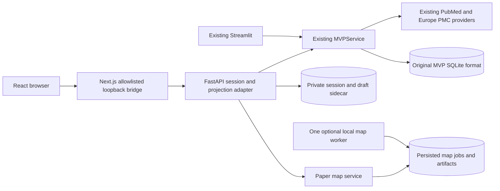

# Local MVP v0.2 workspace

This extends the MVP at `8df5993c86893d47620a101a2319c564cff2d494` on the
[`codex/mvp-v0-2`](https://github.com/hnt119/lit-rev-engine/tree/codex/mvp-v0-2)
branch, separate from `main`. React renders the existing research workflow through a
thin FastAPI adapter. The original Streamlit interface, formal review ledger,
Qwen profiles, source provenance and evidence export contracts remain separate.

See [the executed evaluation](mvp_v0_2_evaluation.md) for checkpoint status,
actual commands, browser checks, skips and limitations. The supplied
[architecture](../ARCHITECTURE_V0_2.md) and [acceptance criteria](../ACCEPTANCE_V0_2.md)
are scope documents, not evidence that a check passed.
The [exact changed-file inventory](mvp_v0_2_changed_files.md) distinguishes this
assignment from preserved preexisting local work.

## Start and stop

Use Python 3.12 and Node.js 20.9 or later with pnpm. The executed environment uses
Python 3.12.7 and Node 24.19.0. Keep the optional web environment separate from the
existing engine and Streamlit environments:

```sh
python3 -m venv .venv-web
.venv-web/bin/python -m pip install -r requirements-web-dev.txt
cd apps/web
pnpm install --frozen-lockfile --ignore-scripts
cd ../..
.venv-web/bin/python scripts/run_web.py --data-dir .mvp-web-state
```

Open **http://127.0.0.1:3000**. Ctrl-C in the launcher terminal stops both child
processes. `localhost` is a different origin and is not accepted by this local
configuration. Alternate ports are supported through `--api-port` and
`--web-port`; keep the same origin when reopening. Supply `--node` if Node is
not on PATH. For a local production build:

```sh
cd apps/web
NEXT_TELEMETRY_DISABLED=1 pnpm build
cd ../..
.venv-web/bin/python scripts/run_web.py --production --data-dir .mvp-web-state
```

The launcher binds both servers to loopback. This is a local application, not
hosted authentication or a deployment recipe. Run one provider-owning API
process. Do not run live Streamlit and live API processes assuming their
process-local provider rate gate is shared.

## Research workflow

1. **Workspaces:** create a workspace or reopen one authorized to this browser.
2. **Discover & explore:** enter a question, inspect the transparent query, and
   explicitly search. Saved-example mode reads a curated licensed capture with
   one actual paper; it makes no live PubMed call. Every preview retains its
   original query, metadata, provider counts, warnings and timestamp.
3. Select up to ten papers **for exploration**, then explicitly prepare sources.
   Selection drafts do not change current prepared sources or passage bindings.
   Source outcomes distinguish full text, abstract fallback, permissions and
   identity failures. Refresh is an explicit new operation.
4. **Evidence:** enter an evidence question and retrieve up to five passages
   using the existing lexical baseline. Inspect the exact canonical source and
   its recorded offsets. Each passage is paired with its judgment controls.
5. Draft notes save separately from assessments. **Save assessment** makes an
   immutable record. **Revise saved assessment** creates an explicit successor.
   Bundle status describes the retrieved passages, not the entire literature.
6. **History & export:** inspect old runs against their original preparation and
   bibliography; archived evidence is read-only. Download the original evidence
   CSV or `mvp.audit-bundle.v1` JSON with the immutable history.

The exploratory preview remains capped at default 30 / maximum 50 records.
Provider-reported matches, fetched records, distinct papers, selected papers and
prepared sources have different meanings. A preview or a map is not complete
PubMed capture, formal eligibility, independent verification, or a scientific
answer. The existing complete-capture and formal-review commands retain their
own contracts.

## Reopening, drafts and credentials

A persistent HttpOnly, SameSite session cookie authorizes this browser profile
on the configured origin for 30 days. Reload, tab reopening and process restart
reuse the same workspace IDs and saved records. Cookie clearing or expiry loses
that session's access. This does not recover an old v0.1 capability that has
already been lost, provide cross-device accounts, or infer reviewer identity.

Question/query, selection, evidence-question and assessment drafts are stored
with versions and assessment-head bindings. Watch the draft state: edits are
durable after **saved**, not while **unsaved** or **saving**. Normal navigation
waits for pending saves. Failed saves and conflicts retain the current edits;
explicit revision is required before an older draft can supersede a newer
assessment. Source inspection does not prepare, search or save a judgment.

The browser receives no research workspace capability. Only pending operation
IDs and one-way payload fingerprints enter session storage for ambiguous-response
retries. Capabilities remain in the OS-private server credential registry. Keep
its backups private as well.

## Durable data and backups

The default **new** directory is `.mvp-web-state/`; `--data-dir` can select another
private directory. It does not import or rewrite `.mvp-state/` or existing
research databases.

- `workspaces.sqlite3`: the existing MVP snapshot/idempotency storage format.
- `web-credentials.sqlite3`: private session bindings, operation reservations,
  draft records and deletion metadata; workspace capabilities stay here.
- `paper-maps.sqlite3`: immutable map manifests, shared cached vectors, map/vector
  bindings, request keys and durable job attempts. These do not enter research
  snapshots or the original evidence exports.

Directories are private (`0700`) and database files are private (`0600`). Unsafe
symlink paths are rejected; use a real absolute path such as `/private/tmp/...`
on macOS. Back up the complete directory after stopping API and worker processes,
including any SQLite sidecars. Restore into a **new copy**, then test it; never
migrate the only copy. Workspace deletion removes active records and access but
does not securely erase SQLite free pages, filesystem snapshots or backups.

## Optional local semantic maps

Mapping uses the separate `paper_bge_v1` profile with
`BAAI/bge-small-en-v1.5`, pinned to revision
`5c38ec7c405ec4b44b94cc5a9bb96e735b38267a`. This is an initial English-metadata
baseline, not a validated medical relevance model or a replacement for passage
retrieval. No Qwen, legacy embedding or lexical retrieval default changes.

Install model/projection dependencies separately and inspect local setup:

```sh
python3 -m venv .venv-map
.venv-map/bin/python -m pip install -r requirements-map-dev.txt
MVP_MAP_ENABLED=1 .venv-map/bin/python scripts/run_map_worker.py --check-setup
```

The check does not load weights or download anything. Normal startup and tests
do not download models. If the exact weights are absent, an **explicit optional
download**, separate from app startup, can populate the Hugging Face cache:

```sh
.venv-map/bin/hf download BAAI/bge-small-en-v1.5 \
  --revision 5c38ec7c405ec4b44b94cc5a9bb96e735b38267a \
  config.json model.safetensors tokenizer.json tokenizer_config.json modules.json \
  1_Pooling/config.json sentence_bert_config.json config_sentence_transformers.json \
  special_tokens_map.json vocab.txt
```

That download was **not run** in this assignment: the exact cached revision was
already available. The installed CLI help and local setup check were exercised.
`HF_HUB_CACHE` or `HF_HOME` can select a different cache; use the same setting in
the API and any standalone worker.

Stop the web launcher before replacing its Python environment, then start with
explicit mapping opt-in and offline model access:

```sh
MVP_MAP_ENABLED=1 HF_HUB_OFFLINE=1 TRANSFORMERS_OFFLINE=1 \
  .venv-map/bin/python scripts/run_web.py --data-dir .mvp-web-state
```

One cooperative worker starts with the enabled API and claims a private OS lock.
It loads the model only for an explicitly submitted or previously queued job.
Computation runs outside research mutation locks and SQLite write transactions;
publication checks the active lease, original search, credentials and deletion
state. Jobs retain progress, bounded attempts and interruption/cancellation
state. Ctrl-C stops the launcher; interrupted attempts recover on restart. A
second worker cannot claim the same directory. The optional standalone runner
is `scripts/run_map_worker.py --data-dir ...`; it uses saved metadata and has no
provider objects. Normally the API-owned worker is sufficient.

In **Discover & explore**, choose one saved search and click **Build map of this
saved search**. Reopening only reads saved artifacts. **Explicitly rebuild as a
new map** creates another artifact and preserves the old one. Map point, list and
inspector use the same stable paper IDs. Selection still requires explicit
source preparation. Filtering hides points without changing their positions;
pan, zoom, navigation and judgments do not refit. Keyboard controls and the full
paper list provide alternatives to pointing at the SVG.

Every artifact records the saved-search digest, ordered paper IDs, full input
hashes, model/tokenizer revision and file hashes, runtime profile, vector-set
digest, projection parameters, exact coordinates and exclusions. The full
title/abstract token stream is split into disjoint 510-content-token windows;
normalized window vectors are weighted by token count, averaged and normalized
again. Title-only inputs are labeled; invalid vectors are excluded with reasons.

Zero/one usable vectors produce honest empty/single-paper states. Small corpora
use labeled PCA, including rank-deficient axes; at least twenty sufficiently
distinct, nondegenerate vectors use recorded single-thread UMAP with cosine
distance and seed 42. Identical vectors overlap without invented jitter.
Within-search neighbors use original-space cosine, not screen distance.

The intact saved example contains **one actual article**, so its map has one
point and no neighbors. Multi-point tests use explicitly synthetic vectors.
The display warns: **“Approximate semantic layout of this search preview; not all
literature and not evidence quality.”**

An explicit model integration check is available separately from normal tests:

```sh
.venv-map/bin/python scripts/mvp_map_smoke.py --allow-local-model \
  --output /private/tmp/lre-map-smoke-new
```

Choose a new output directory. This smoke denies network connections and uses
the real saved licensed metadata. It records window coverage, vector and file
hashes and a single-point artifact; it is not a scientific quality benchmark.

## Interfaces and development



TypeScript contains presentation and transport, not a second research engine.
The portable identity remains `apps/streamlit/theme/tokens.css`; the React CSS
adapter imports it directly. Source text uses escaped React text nodes and
Unicode code-point conversion for exact highlighting.

The baseline-reader compatibility test requires a Git checkout with commit
`8df5993` available. A source archive alone does not contain that Git history.

```sh
.venv-web/bin/python -m pytest tests/web_api -q
.venv-web/bin/python scripts/export_web_openapi.py
cd apps/web
pnpm generate:api
pnpm typecheck
pnpm test
NEXT_TELEMETRY_DISABLED=1 pnpm build
```

Original Streamlit/headless setup remains in [the MVP guide](mvp.md). Web and
model dependencies are optional; importing the core research service does not
start a server, import a UI or load model weights. Tests using injected providers
or vectors are software checks, and are reported separately from actual local
embeddings and live provider calls.
