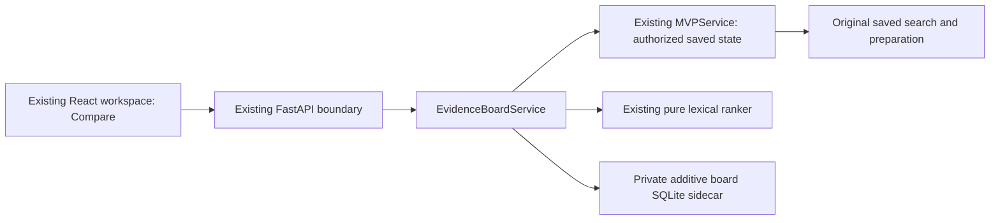

# MVP v0.3 comparison board: implementation plan

Updated 21 October 2026. **The manual board checkpoint is implemented locally and evaluated.** The subsequent [optional cell-proposal checkpoint](cell_proposals.md) is implemented separately with generation disabled by default; its [evaluation](cell_proposals_evaluation.md) does not establish real-model quality or human usefulness.

This checkpoint extends the actual MVP at `60f8aa96a4e3ea6dcced805e2158bf5aeafa5923` on `codex/mvp-v0-3`. The discovery checkpoint already has recorded live multi-paper execution and a separately captured public thirty-paper example; it was not repeated. Its provider/model results remain in the [discovery evaluation](mvp_v0_3_evaluation.md). The [manual-board guide](manual_comparison_board.md) describes the delivered interface; [board evaluation](manual_board_evaluation.md) records software and browser evidence separately from human usefulness.

## Delivery gates

1. Evaluate Checkpoint 0: exact approved query/contact prerequisites, actual multi-paper counts, source outcomes, saved map/reopening and honest `NOT_RUN` states. Missing live prerequisites do not become a successful live case.
2. Build and evaluate the manual, source-linked board over retained sources. It must work with no generation configured.
3. Only after that gate passes, consider optional bounded structured extraction. No extraction, automatic support judgment or narrative synthesis is part of the initial board tickets.

No merge, push, deployment, public API exposure, private-source publication or migration of the only data copy is authorized by this plan.

## Architecture and ownership



| Path | Implemented responsibility |
| --- | --- |
| `src/mvp/board_contracts.py` | Strict frozen contracts, validation and versioned board schemas |
| `src/mvp/evidence_board.py` | One service for source/dependency validation and board operations |
| `src/mvp/adapters/board_storage.py` | Private `evidence-boards.sqlite3`, idempotency, CAS and immutable history |
| `src/web_api/board_routes.py` | Thin session-authorized routes, following `map_routes.py` |
| `apps/web/components/compare.tsx` | Matrix, compact states, manual editor and canonical source inspector |
| `tests/mvp/test_boards.py`, `tests/mvp/test_boards_independent.py`, `tests/web_api/test_boards_independent.py` | Implementation and independent domain, transport, lifecycle and regression evidence |

Preserve `WorkspaceSnapshot`, existing evidence contracts and assessments, lexical passage retrieval, frozen Qwen profiles, map coordinates/jobs and `mvp.audit-bundle.v1`. Generate TypeScript contracts from Python/OpenAPI. Reuse the current paper/ink/olive theme and loopback session boundary.

## Binding and state contracts

A stable board ID has immutable definition revisions. Each `BoardRevision` records workspace ID, saved search ID and digest, question and digest, preparation ID, source revision and manifest digest, ordered paper IDs, field definitions, retrieval profile/digest, timestamp and explicit parent revision. Each field has a stable field ID and immutable field-revision ID, label and subquestion.

Creation selects a unique subset of one preparation, up to the existing ten-source limit. The initial interface starts with three editable fields and supports up to six. The completed vertical slice uses three retained reports and three fields. Question, field or source changes require a new definition revision with `expected_revision_id`. Old judgments remain historical; changed dependencies never silently inherit support. Resolve bibliography through the original saved search, including when later searches return the same PMID.

Implemented bounds: six fields, sixty cells per definition revision, ten boards per workspace, twenty definition revisions per board, fifty submitted revisions per cell, five references and thirty inspected ranges per cell, and a 32 MiB sidecar payload budget per workspace. These are exposed as capabilities and tested. Revisit capacity only after measurement.

Keep these dimensions separate in projections and exports:

| Dimension | States / meaning |
| --- | --- |
| Source availability | Full text, abstract only or unavailable; retain original acquisition status |
| Reference integrity | Checked or failed mechanical validation |
| Human semantic assessment | Unassessed, human-supported, partial or unsupported |
| Inspected scope | Value found, not found in inspected material or not assessed |
| Freshness | Current dependencies or historical/changed dependencies |

A `CellRevision` binds board/field revisions and paper ID, with nullable value, exact references, inspected ranges, semantic assessment, scope result, missing information, reason, producer, timestamp and explicit supersession. Human review retains the existing meaning: **single-human, self-declared, not independently verified**. Rows represent reports; do not infer study independence.

Human-supported requires a nonempty value, reason and valid supporting reference. Exact quotation matching never establishes entailment. Missing values remain null with an explicit scope/reason. Retrieval returning nothing does not establish absence from the paper or literature.

## Retrieval and exact source inspection

Add a separately versioned `mvp.board-candidates.v1` operation scoped to **one paper and one field**. Its request includes request ID, expected board revision, paper ID, field ID and `top_k` at most three. Resolve and hash-check the immutable prepared source, then call `LexicalRetrieval.search` on that source subset and field subquestion. Do not mutate workspace selection or populate the matrix from the global top-five result.

Persist the retrieval profile/parameters, input bindings, indexed/matched block counts, candidate references, returned count, explicit omissions and timestamp. Candidates indicate potential relevance, not inspected support. Viewing, filtering and navigation trigger no retrieval or inference.

Reference input identifies source/version/hashes, canonical block and half-open Unicode code-point range. The server checks paper ownership and the saved preparation binding and reconstructs the quotation. A client-supplied quotation is not authority. Wrong-paper, wrong-source, changed-hash and invalid-range references fail validation.

Bound candidate text and response sizes explicitly. Oversized blocks need an omission/coverage label and a paginated canonical inspector; do not silently truncate and imply full inspection. Inspector responses contain bounded ranges plus original offsets and total lengths. Existing Unicode-safe React text rendering remains the highlighting approach.

## Revision-safe drafts and lifecycle

Store typed drafts separately from submitted cells. A `CellDraft` records board revision, paper/field, draft version, expected cell-head ID, bounded data and update time. Draft PUT checks draft version, definition revision and expected cell head; submission checks explicit supersession and advances the immutable cell head atomically. Conflicts and failed requests preserve edits. Require an explicit revision action to work from the latest submission; never silently rebase a judgment.

Use board-specific head terminology rather than repurposing `expected_assessment_head`. A shared draft-hook implementation may be factored behind existing interfaces if it preserves assessment behavior.

Follow the established lock order for short mutations:

```text
registry.lifecycle_guard(workspace_id)
  -> engine.with_workspace_state(handle, callback)
    -> short board-store transaction
```

Check tombstones and dependency/head CAS under that ordering. Do not acquire these locks in reverse. Any later slow generation runs outside locks and revalidates before publication. Extend workspace cleanup to both map and board sidecars; cleanup is idempotent and cannot recreate deleted data after interruption or a late write.

## API and exports

All routes inherit exact Host/Origin, session authorization, CSRF and request-size protections:

```text
GET/POST /workspaces/{w}/boards
GET      /workspaces/{w}/boards/{b}?revision_id=...
POST     /workspaces/{w}/boards/{b}/revisions
POST     /workspaces/{w}/boards/{b}/candidates
GET      /workspaces/{w}/boards/{b}/cells/{paper}/{field}/history?offset=&limit=
GET/PUT  /workspaces/{w}/boards/{b}/drafts/{paper}/{field}
POST     /workspaces/{w}/boards/{b}/cell-revisions
GET      /workspaces/{w}/boards/{b}/sources/{source}/blocks?offset=&limit=
GET      /workspaces/{w}/boards/{b}/references/{reference}/context
GET      /workspaces/{w}/boards/{b}/exports?format=csv|json&history=false
```

Normal projections contain compact bibliography and cell states/reference metadata, not source quotations or history. History and inspector reads are paginated and read-only. New `mvp.board-table.v1` and `mvp.board-audit.v1` exports record original bibliography, bindings, states, exact anchors and ancestry without changing old exports. CSV contains the selected definition's submitted heads; audit JSON always includes its immutable cell history and candidate audit. `history=true` additionally includes earlier definitions. Unsubmitted drafts are excluded. Existing formula-safe CSV handling applies; canonical JSON preserves original values. Source-linked exports remain local artifacts unless separately approved for publication.

## Small implementation tickets

| Ticket / owner | Deliverable | Acceptance evidence |
| --- | --- | --- |
| B1 Implementation | Contracts, sidecar and board creation/revision service | Empty matrix honestly unassessed; exact source/search bindings; bounds, idempotency, reopening and deletion tested; existing snapshots unchanged |
| B2 Implementation | Per-cell lexical candidates and canonical inspector | Independent paper/field scope; exact server-derived anchors; Unicode and wrong-source rejection; explicit empty/oversized coverage; no global retrieval changes |
| B3 Implementation | Human submissions, drafts and exports | Immutable ancestry; concurrent edit and stale field/source CAS; failed-save draft retention; original-history bibliography; formula-safe CSV and separate JSON schemas |
| B4 Implementation | Compare destination and manual workflow | Accessible matrix plus narrow-screen list; linked inspector; durable reopening; actual browser walkthrough including conflict/revision; no generation requirement |
| B5 Retrieval | Real-case evidence and source-linked example | Uses Checkpoint 0 provenance; reports actual availability/missing fields and inspected scope; preserves permission boundaries and existing saved example |
| B6 Evaluation | Independent checkpoint review | Wrong-paper anchors, exact-but-nonentailing quotes, abstract-only/unavailable sources, duplicate reports, stale revisions, simultaneous saves, deletion races, credential isolation and preserved map/engine behavior tested |

Review evidence after each ticket and resolve failures before advancing. Browser checks, software tests, real provider execution, real model execution and human usefulness are separate evidence categories. A manual board passing code checks does not establish scientific usefulness or superiority. Optional extraction remains a later gated ticket with default inference disabled, explicit cost/runtime limits and no automatic support certification.
