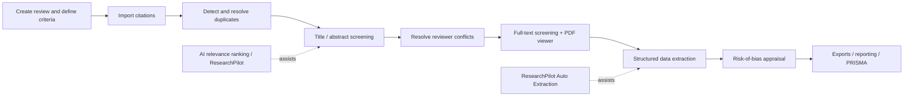
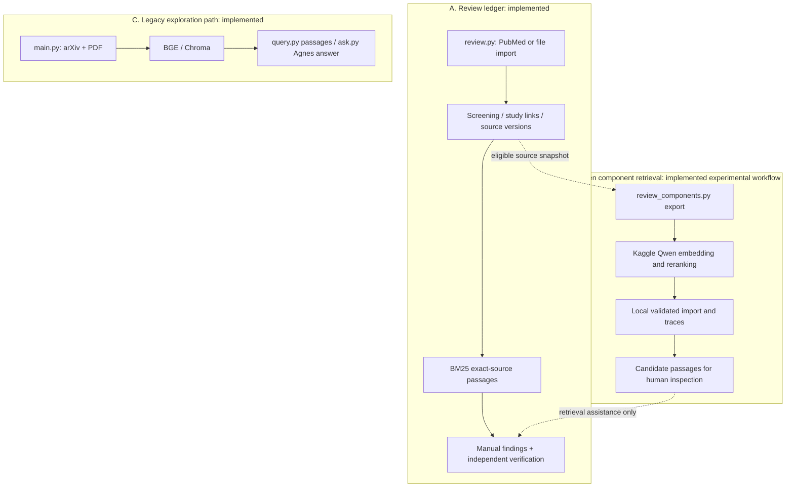
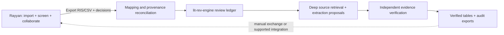

# Rayyan workflow and a realistic differentiation strategy

**Research date:** 15 October 2026
**Compared with:** [`hnt119/lit-rev-engine`, `main` at `aefa26ebc616952c51c07d6aad9ac1155eb8b6d8`](https://github.com/hnt119/lit-rev-engine/tree/aefa26ebc616952c51c07d6aad9ac1155eb8b6d8)
**Status convention:** **Verified Rayyan** = publicly documented feature; **Implemented baseline** = inspected at `aefa26e`; **Cycle 1** = the additive local assessment workbench described in [the usage guide](../../docs/review-workbench.md); **Proposed** = later work. Validation and limitations are recorded in [the cycle report](../../docs/workbench-cycle-1-evaluation.md).

## Executive conclusion

Rayyan is **not** merely a title-and-abstract screening tool. As of October 2026, Rayyan supports bibliographic imports, deduplication, independent and collaborative screening, full-text screening with attached PDFs, structured data extraction, risk-of-bias assessment, exports, and—depending on the plan—AI assistance including full-text Auto Extraction. Competing by adding those basic features alone is unlikely to produce a meaningful technical advantage.

The strongest plausible niche for `lit-rev-engine` is **reproducible, evidence-grounded research analysis**: configurable retrieval and model providers; transparent, multi-part question answering with exact anchors; traceable numeric extraction; explicit insufficient-evidence decisions; frozen comparative evaluations; and reviewer-owned verification. In the near term, **complement Rayyan as a specialist evidence-analysis engine**, rather than reproduce its mature user interface, collaboration, and screening workflow.

## 1. How a reviewer works in Rayyan

### Rayyan workflow: what happens, and what matters

| Stage | Typical user action | Verified Rayyan behavior | Implications for this project |
|---|---|---|---|
| Set up | Create a review, define inclusion/exclusion criteria, invite members | Criteria are shared and can support AI Reviewer/Analyzer; team members can work independently | Mirror the **protocol** and eligibility definitions, not merely search keywords |
| Import | Upload reference exports from databases/reference managers | Supports RIS, BibTeX, CSV and other formats; import and deduplication are core features | Preserve original source files, original occurrences, hashes and exact search strategies |
| Screen titles/abstracts | Include / Exclude / Maybe, labels, reasons, notes | Blind Mode hides other reviewers' decisions while screening; conflicts can be resolved later | Preserve separate human votes and reasons; AI suggestions should not silently become human decisions |
| Rank undecided records | Review predicted relevance | On all plans, the ranking learns from reviewer decisions; a five-level rating helps prioritization | An improved **passage retriever** is not the same as improved **citation screening**; evaluate separately |
| Full text | Bring eligible records into full-text screening; read PDF and decide | Rayyan has a PDF viewer, full-text decisions and full-text conflict handling | **Do not** claim Rayyan lacks full-text screening |
| Extract | Define study fields/questions; enter values | Rayyan supports structured Data Extraction; ResearchPilot Auto Extraction (eligible institutional plans) reads attached text-searchable PDFs and highlights source passages | Differentiate by multi-document support, numeric qualification, provenance/replay, and rigorous benchmark artifacts—not by basic extraction alone |
| Appraise | Use study-design-suited appraisal form | RoB 2, MMAT, and Newcastle–Ottawa Scale are documented, with plan-dependent access | Domain-specific **appraisal support**, traceable judgments and flexible tools may be opportunities; never confuse automated appraisal with validation |
| Report | Reconcile and export | Exports for references, extraction and RoB are supported; paid plans have PRISMA diagram generation | Design interoperability, audit-preserving exports, and cross-tool reproducibility |

**Rayyan's AI capabilities in more detail:**

- **Relevance Ranking** predicts how likely an undecided *reference* is to be included, from title/abstract features including unigrams, bigrams and MeSH terms. Rayyan says at least **50 decisions**, including **5 Include and 5 Exclude**, are required before computing ratings. This is screening prioritization, not proof that an article provides a particular finding. [Rayyan relevance-ranking documentation](https://help.rayyan.ai/hc/en-us/articles/45819983751569-How-to-Use-Ratings-and-Relevance-Ranking-in-Rayyan).
- **AI Reviewer** (ResearchPilot, institutional access) independently applies screening criteria and returns reasoned decisions. **AI Analyzer** offers on-demand criteria-based recommendations. [AI Reviewer](https://help.rayyan.ai/hc/en-us/articles/46034112564497-AI-Reviewer-ResearchPilot) · [AI Analyzer](https://help.rayyan.ai/hc/en-us/articles/46034177350161-AI-Analyzer-ResearchPilot).
- **Review Articles Mode** lets users ask questions of a selected set of references and set a relevance threshold for that mode. It operates on the loaded subset, not necessarily the entire corpus. [Mode guide](https://help.rayyan.ai/hc/en-us/articles/46034049051409-Review-Articles-Mode-ResearchPilot).
- **Auto Extraction** can read attached full-text PDFs and populate configured questions, highlighting source material for verification; outputs still require human checking. [Auto Extraction](https://help.rayyan.ai/hc/en-us/articles/46065925755921-Auto-Extraction-ResearchPilot).
- Rayyan includes **full-text screening**, **structured data extraction** and **risk-of-bias workflows**. [Rayyan four-stage workflow](https://help.rayyan.ai/hc/en-us/articles/45703234075281-How-to-Screen-References-in-Rayyan) · [RoB documentation](https://help.rayyan.ai/hc/en-us/articles/46607683693073-How-to-Assess-Risk-of-Bias-in-Rayyan).

**Access changes:** feature availability depends on plan, seat and institutional contract; use the [official pricing comparison](https://www.rayyan.ai/pricing) and [plans guide](https://help.rayyan.ai/hc/en-us/articles/46067741714321-Rayyan-Plans-Overview) for any current procurement decision. Do not hard-code prices into a long-lived technical plan.

## 2. Comparison with your actual repository

### Inspected current code: three adjacent flows

The ledger is the authoritative record of decisions, source versions and verified evidence. The separate exploration pipeline is **not** a substitute for the ledger. The Qwen workflow is a **finite export → external inference → validation/import** process; it does not silently update evidence decisions.

The repository already contains important differentiation foundations:

1. **Source/identity controls:** conservative citation deduplication, report/study links, source versions, hashes and exact quotation anchors.
2. **User-verifiable evidence:** manual finding revisions and review by a reviewer identifier distinct from the author; stale or ineligible dependencies block current verified evidence. Identity strings are not authenticated user accounts, so this is not yet enterprise-grade reviewer security.
3. **Comparative retrieval:** four frozen methods (whole-query lexical, component lexical, whole-query Qwen, component Qwen), source-grounded positive and no-answer questions, replayable results and fixed acceptance gates.
4. **Component-aware search:** an original compound question plus 2–3 reviewer-declared components, 20-block candidate allocation and 5-block output.
5. **Model provenance:** versioned jobs/results, integrity checks, pinned model execution and local replay.

**Latest bounded benchmark, not real-world clinical validation:** first saved Qwen component confirmation on **two articles, six answerable questions and two source-scoped null questions**:

| Method | Mean required-evidence coverage | Complete positives |
|---|---:|---:|
| Whole-question lexical | 61.1% | 2/6 |
| Component lexical | 77.8% | 3/6 |
| Whole-question Qwen | 86.1% | 4/6 |
| **Component Qwen** | **94.4%** | **5/6** |

The missing question concerns the **clinical study period**: the correct date block was outside the final candidate pool even though another passage about training dates ranked highly. Both unsupported questions still returned passages. **A high reranker score is not proof of answerability.** [Saved first-run record](https://github.com/hnt119/lit-rev-engine/blob/aefa26ebc616952c51c07d6aad9ac1155eb8b6d8/docs/qwen-components-runs-v1.md) · [evaluation contract](https://github.com/hnt119/lit-rev-engine/blob/aefa26ebc616952c51c07d6aad9ac1155eb8b6d8/docs/qwen-components-contract-v1.md).

## 3. Do not build a false competitive story

| Generic sales claim | Reality | Better positioning |
|---|---|---|
| “Rayyan cannot work with full texts.” | False: it has full-text screening, PDF viewing and full-text Auto Extraction (plan dependent). | “Our pipeline exposes more configurable **retrieval and evidence provenance**.” |
| “Rayyan cannot extract data.” | False: Data Extraction and Auto Extraction exist. | “We are optimizing **compound quantitative extraction**, traceable qualifications and source-version integrity.” |
| “Rayyan has no quality appraisal.” | False: RoB 2, MMAT and NOS are documented. | “We can make **domain-specific appraisal schemas** and compare inter-reviewer outcomes.” |
| “Rayyan has no AI or rating threshold.” | False: reference relevance ranking and ResearchPilot scoring are documented. | “We preserve a **bounded, replayable internal passage-support benchmark**. Future sufficiency thresholds require new labels, calibration and independent evaluation.” |
| “Our Qwen pipeline is proven more accurate than Rayyan.” | Not established; the current benchmark compares *internal* methods, not Rayyan outputs. | “We have a **replayable internal benchmark**; a direct Rayyan comparison requires matched tasks, access and independent annotation.” |

Absence of public documentation for a feature is **not** proof that Rayyan lacks it. Contrast **documented product behavior** with **observed behavior in the repo**, and identify proposal status explicitly.

## 4. The plausible strategic edge

**Positioning statement:** *An open, source-grounded evidence-verification layer for research teams that need custom models, precise numerical evidence and independent reproducibility.*

| Differentiator | Problem it solves | What to demonstrate | Priority |
|---|---|---|---|
| **Compound-evidence completeness** | Important facts spread across Methods, Results and tables | Recovery of all required pieces at fixed reviewer passage budget | P0 |
| **Correct-population/timepoint validation** | Highly scored, genuine passage refers to wrong cohort/date/outcome | False acceptance rate of high-scoring near-matches | P0 |
| **Inspectable source-to-claim chain** | Finding detached from primary evidence | Exact quote, locator, source version, model/job hash and human verification | P0 |
| **Explicit abstention and conflict flags** | Retrieval returns plausible passages for unanswered questions | Sufficiency decisions on positive, null and contradictory questions | P0 |
| **Model portability and cost control** | One hosted provider/plan may be inappropriate | Swap model profile with intact evaluation and privacy receipt | P1 |
| **Rayyan-friendly handoff** | Researchers already screen in Rayyan | Lossless-enough records/decisions import with full reconciliation report | P1 |
| **Typed numeric data extraction** | Numerator, denominator, unit, confidence interval or timepoint omitted | Per-field fidelity, not a single prose answer score | P2 |
| **Cross-study synthesis** | Multiple reports and contradictory outcomes | Comparison table from independently verified findings | P2 |
| **Minimal local reviewer page** | Ratings and support checks require manual JSON editing | Save, reload and compare single-reviewer judgments with receipt bindings | P0: Cycle 1 |
| **Collaboration UI and scale** | Larger teams need assignment, permissions and efficient review | Measured reviewer outcomes, privacy and access tests | Later |

### Best initial positioning: complementary, not a Rayyan clone

A thin local page is needed now to test whether the evidence workflow helps a reviewer. A full collaboration product remains later work. Cycle 1 stores single-human assessment sidecars; it neither changes screening decisions nor creates verified findings. The existing benchmark is exposed historical material and serves as a software demo, not a fresh quality confirmation.

## 5. Questions to ask real users before committing to features

1. Which review type and document families matter (RCTs, diagnostics, observational, scoping reviews, engineering papers)?
2. At which stage do teams spend the most time or find the most consequential errors?
3. Which exact extraction fields need **multiple paragraphs/tables** to answer faithfully?
4. Does the team already use Rayyan? What does its licensed plan offer, and what export data can the team access?
5. What is the cost of wrongly accepting an unsupported answer versus asking a reviewer to inspect another passage?
6. Which original sources may legally be retained or sent to an external inference provider?

## Sources and scope

**Rayyan primary documentation (checked October 2026):** [Getting started](https://help.rayyan.ai/hc/en-us/articles/22697630697617-Getting-Started-with-Rayyan), [screening](https://help.rayyan.ai/hc/en-us/articles/45703234075281-How-to-Screen-References-in-Rayyan), [Blind Mode](https://help.rayyan.ai/hc/en-us/articles/17460918624145-How-to-Use-Blind-Mode-in-Rayyan), [relevance ranking](https://help.rayyan.ai/hc/en-us/articles/45819983751569-How-to-Use-Ratings-and-Relevance-Ranking-in-Rayyan), [ResearchPilot](https://help.rayyan.ai/hc/en-us/articles/28790380408337-What-is-ResearchPilot), [Auto Extraction](https://help.rayyan.ai/hc/en-us/articles/46065925755921-Auto-Extraction-ResearchPilot), [risk of bias](https://help.rayyan.ai/hc/en-us/articles/46607683693073-How-to-Assess-Risk-of-Bias-in-Rayyan).

**Repository documentation:** [architecture](https://github.com/hnt119/lit-rev-engine/blob/aefa26ebc616952c51c07d6aad9ac1155eb8b6d8/docs/architecture.md), [component guide](https://github.com/hnt119/lit-rev-engine/blob/aefa26ebc616952c51c07d6aad9ac1155eb8b6d8/docs/qwen-components-guide.md), [first saved results](https://github.com/hnt119/lit-rev-engine/blob/aefa26ebc616952c51c07d6aad9ac1155eb8b6d8/docs/qwen-components-runs-v1.md).

**Limitations:** No authenticated hands-on Rayyan review or head-to-head Rayyan-versus-engine benchmark was run. Current plan entitlements can vary. These are research-backed product descriptions and proposed differentiation hypotheses, not measured competitive superiority.
