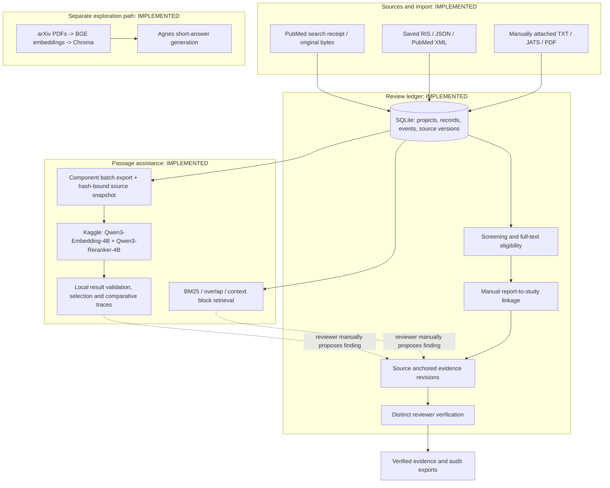
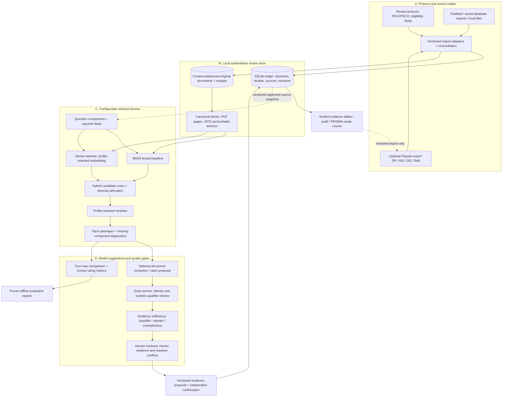
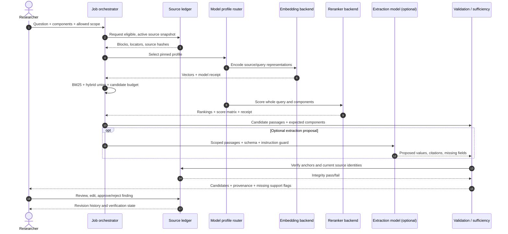
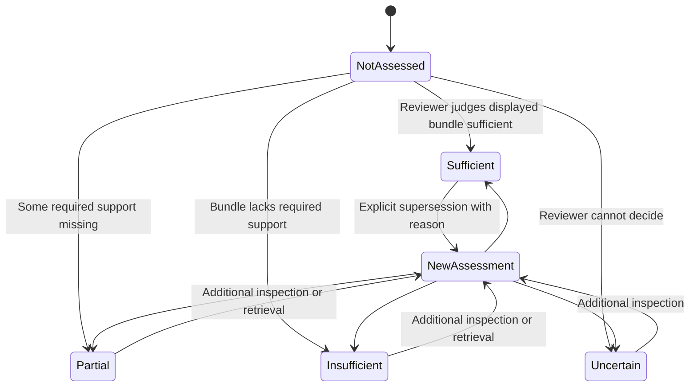

# Lit-review-engine: current and proposed architecture

**Research date:** 15 October 2026
**Code baseline:** [`main@aefa26e`](https://github.com/hnt119/lit-rev-engine/tree/aefa26ebc616952c51c07d6aad9ac1155eb8b6d8).
**Legend:** `[IMPLEMENTED BASELINE]` describes `aefa26e`; `[CYCLE 1]` describes the additive local workbench in [the usage guide](../../docs/review-workbench.md); `[PROPOSED]` means later work. **Dashed arrows** show proposed integrations or reviewer-mediated handoffs.

## Architecture decision

Build a **review-ledger-centered, evaluation-first evidence workbench** with *optional* Rayyan ingestion and provider/model switching. Keep three trust domains separate:

1. **Source truth:** immutable original files, identifiers, extraction boundaries, checksums and review eligibility.
2. **Model assistance:** rankings, extracted-value proposals, comparison traces and uncertainty flags. Models never set eligibility or verified status.
3. **Human authority:** independent screening, study linkage, structured extraction and verification, with retained reasoned revisions.

The existing repo already enforces much of domains 1 and 3 for its ledger and has a small evaluated component retriever for domain 2. New development should strengthen missing semantic checks and usability rather than merge the separate legacy Chroma demo directly into the audit ledger without a design.

## 1. As-built system (inspected repository)



**Repo boundaries that must survive:** original search receipts, every imported occurrence, conservative duplicate matching, source versioning, project-scoped eligibility, manually reviewed study links, exact quotation anchors, append-only evidence revisions, independent verification, reproducible exports and read-only retrieval. **Current limitations:** no authenticated users or enforced reviewer quorum, scanned-PDF OCR incomplete, no completed real-team pilot, and score/selection rules do not assess whether a question is answerable. The current pilot has one human reviewer: her assessments can be single-reviewed, while independent verification remains `NOT_RUN`.

## 2. Target architecture (proposal; not a claim of existing features)



**Key design choice:** In the proposed architecture, `model scores`, `semantic relevance`, `complete support`, `human verification`, and `study risk of bias` are **different fields**. None is automatically inferred from the other.

### Components and ownership

| Layer | Reuse existing | Proposed addition | Acceptance obligation |
|---|---|---|---|
| Protocol/source intake | Review CLI, PubMed receipts, supported saved formats | Rayyan export bridge, richer provenance reconciliation | Record counts and hashes must reconcile; ambiguities remain flagged |
| Storage | Local SQLite, source hash/version checks | Optional object store for large corpus; migration-safe indexes | No source disappearance; every audit event preserved |
| Parsing | TXT/JATS/PDF canonical blocks | Table-cell/footnote extraction, supplements and separately evaluated OCR | Stable locators + tested Unicode spans; never silently guess missing cells |
| Retrieval | BM25/context; Qwen finite Kaggle component retrieval | Search adapter interface and optional alternative embedding/reranker profiles | Match model/profile pin, method and source scope on import |
| Extraction | Manual exact-anchored finding proposal | Typed model-generated *suggestions* with validation | Every exported value points to source + units/denominator/timepoint |
| Semantic validation | Source/integrity checks; source scope | Scope/entailment checks, explicit sufficiency/abstention | Test on high-scoring near-matches and held-out nulls |
| Verification | Independent evidence review identifiers and revision history | Authenticated reviewer identities, protocol-driven quorum | No auto-verification; stale source/association revokes current eligibility |
| Evaluation | Frozen positive/null truth, four methods (candidate + three comparators), portable replay | Cycle 1 descriptive human ratings; later calibrated sufficiency and ranking evaluation | Explicit denominators; fresh source-first gold for accuracy/nDCG; historical gates unchanged |
| Output | Ledger and audit exports | Reviewer UI, evidence matrix, reusable PRISMA summaries | No misleading completed-study count or unsupported synthesis |

## 3. Model call architecture: make calls replaceable and inspectable



**Backends: implemented vs planned.** Qwen3 4B embedding/reranking is **implemented as a finite, pinned Kaggle batch**. Local BGE/Chroma plus Agnes is **implemented separately in the exploration route**. A production **model-profile router that can swap OpenAI, Qwen, local models, or other vendors is proposed**; do not treat these providers as already integrated. Model names/availability, prices and licensing must be checked at implementation time.

### Proposed model strategy

| Workload | Cheapest valid approach first | Escalation rule | Model call requires |
|---|---|---|---|
| Title/abstract sorting | Existing human decisions + transparent lexical screening features | Train/evaluate citation-screening model only with adequate labeled data | Source record ID, protocol version, training/decision provenance |
| Initial passage retrieval | Local BM25 with exact source anchors | Add dense retrieval when lexical misses components | Source manifest and method/version |
| Passage reranking | Run only for a bounded candidate pool | Use pinned Qwen or evaluated alternative | Whole + component queries, pair limits, numeric traces |
| Numeric extraction | Human-first manual field entry in pilot | Optional constrained JSON model after source blocks are chosen | Typed output schema, original passage anchors, full prompt/model receipt |
| Claim checking | Exact quote/span match + deterministic schema checks | Optional *independent* semantic verifier for ambiguous claims | Explicit supports / contradicts / context / uncertain labels |
| Synthesis | Only verified structured rows | Optional citation-rich prose draft, reviewed before release | Frozen evidence snapshot, zero invented citations |

Use task-based model routing rather than paying for the largest model on every query. Keep a no-LLM lexical path as a baseline and offline recovery mode. Cache by **source snapshot + model revision + query + profile + instruction version**. Cache invalidation must react to eligibility or source changes.

### Proposed profile descriptor (illustrative, **not** a working repository config)

```yaml
profile_id: evidence-components-v2-proposal
source_scope: included
query_decomposition: human_declared
retrieval:
  lexical: bm25_context_blocks
  dense_backend: qwen3_embedding_4b
  candidate_pool: 20
  fusion: reciprocal_rank_fusion
reranking:
  backend: qwen3_reranker_4b
  display_budget: 5
extraction:
  enabled: false  # switch on only after separate validation
  output_schema: finding_proposal_v1
validation:
  exact_anchor_required: true
  source_scope_required: true
  require_population_outcome_timepoint_match: true
  verification: human_required
privacy:
  allow_external_model_calls: false  # opt in with source-by-source approval
```

Do not modify the frozen v1 profile **or its implementation files**. Preserve all paths and hashes bound by `docs/qwen-components-confirmation-freeze-v1.json`, `docs/qwen-components-development-freeze-v1.json` and `docs/qwen-kaggle-freeze-v2.json`. Cycle 1 uses the new `review_workbench.py` entry point and `src/review_workbench/` namespace, importing frozen pure validation helpers without changing them. Future retrieval changes require a **new** profile, evaluator contract and held-out split.

## 4. Assessment sidecar contract and trust states

A retrieval result is not a verified finding. Cycle 1 adds an **assessment sidecar**, bound to an immutable saved receipt. It does not migrate the canonical ledger finding schema, whose revisions accept exactly one quotation anchor. Multiple supporting passages belong to the assessment bundle; creating or verifying a canonical finding remains a separate manual ledger action.

The record envelope retains an immutable UUID, UTC time, payload hash, receipt whole-file and payload hashes, job/results/profile/source-snapshot hashes, project/question/trace bindings, reviewer label, display mode and explicit supersession history. The following is an illustrative *draft* submitted through the page; exact saved fields are documented in [the workbench guide](../../docs/review-workbench.md):

```json
{
  "packet_id": "hash-bound-packet-id",
  "bundle_id": "hash-bound-bundle-id",
  "reviewer": "reviewer_1",
  "status": "partial",
  "reason": "The clinical study period is missing from this bundle.",
  "ratings": [
    {"passage_id": "bound-passage-id", "rating": 2,
     "component_ratings": {"period": 0, "agreement": 3}}
  ],
  "supporting_passage_ids": ["bound-passage-id"],
  "missing_components": ["period"],
  "contradiction": false,
  "source_inspected": true,
  "supersedes": null,
  "review_seconds": null
}
```

The question, component and passage IDs must exist in the trusted packet. Numeric examples are illustrative, not clinical judgments. A null rating means **unassessed**, never zero. Whole-question and component ratings remain separate; averaging scores cannot establish complete support. `sufficient` requires named support and no missing components; `partial` and `insufficient` require named missing components. An explicit reason is required for assessed states.



All statuses have `judgment_scope: retrieved_bundle`. A separate `contradiction` flag can coexist with sufficient or partial coverage. A bundle judged insufficient does **not** establish source absence: retrieval may have missed a supporting paragraph. `source_answerability` stays `not_assessed`; a future source-level assessment must examine the original source independently of the returned passages and record its own scope and evidence.

Receipt replay checks the retained snapshot and exact anchors. It does not open the live review database or prove present-day eligibility: `current_ledger_state` remains `not_checked`. Human assessments are `single_human`; independent verification is `NOT_RUN`. The canonical distinct-reviewer guard is preserved. No reviewer alias or AI assessment can substitute for a second human.

**Fail closed on integrity errors.** Return explicit incomplete or uncertain bundle judgments instead of inventing an answer. Even a properly assessed source-scoped absence would not prove that no other publication has relevant evidence.

## 5. Security, provenance and reproducibility

- **Source licensing:** JATS/PDF and supplementary files may have different licenses; don't upload proprietary full texts to an external service unless permission/contract permits it.
- **Credentials:** Local `.env` and model/API secrets must never enter Git, reviewer exports, prompt receipts or shared artifacts. Adopt scoped tokens and audit access before multi-user deployment.
- **Reviewer data:** Rayyan exports can carry reviewer names/emails and action histories. Restrict imported raw ZIPs and exclude real review identifiers from public fixtures.
- **Prompt injection:** Treat paper text as untrusted evidence, never instructions to override the workflow. Require typed outputs and validate quote offsets independently of the model.
- **Version pinning:** Store code commit, model revision, tokenizer version, prompt, query/component text, source manifest, hyperparameters, normalized retrieval scores, runtime/cost and error state.
- **Replay semantics:** Deterministic local validation of saved results is achievable; replaying a model's generated text byte-for-byte across hardware/providers is not guaranteed. Preserve input and output bytes, not just hashes.
- **Human review:** A distinct **string identifier** is not authentication. Account management, authorization, blinded review and reviewer assignment are future work if you develop a collaborative product.
- **Operational limits:** Batch, token and PDF limits should fail explicitly; no hidden truncation, silent paid fallback or silent source substitution.

## 6. Recommended repository layout (proposal)

Existing frozen paths remain in place. Cycle 1 additions are separate; the other additions below remain proposals:

```text
lit-rev-engine/
├── review.py                          # IMPLEMENTED: ledger CLI
├── review_components.py               # IMPLEMENTED: component batch CLI
├── src/review/                      # IMPLEMENTED: ledger, evidence, source, search
├── src/review_components/           # IMPLEMENTED: component scoring and adapter
├── review_workbench.py                # CYCLE 1: local reviewer / assessment CLI
├── src/review_workbench/              # CYCLE 1: additive sidecars, local page, reports
│   ├── receipts.py                   # pinned receipt + frozen trace replay
│   ├── assessments.py                # immutable judgments + explicit supersession
│   ├── evaluation.py                 # descriptive single-human comparison
│   └── server.py                     # loopback-only page, no external inference
├── src/model_gateway/               # PROPOSED: provider/profile interface
│   ├── registry.py
│   ├── embedding.py
│   ├── rerank.py
│   └── extraction.py
├── src/evaluation/                  # PROPOSED: human labels, metrics, reporting
│   ├── relevance_labels.py
│   ├── sufficiency.py
│   └── compare.py
├── src/integrations/rayyan/          # PROPOSED: export ZIP adapters
│   ├── parse_export.py
│   ├── map_decisions.py
│   └── reconcile.py
├── tests/fixtures/                   # IMPLEMENTED: frozen benchmarks; retain
└── docs/                             # Existing docs + this design package
```

**Do not create all proposed modules at once.** First validate real-team needs, then add narrowly scoped components with tests and frozen evaluation protocols. [Current architecture](https://github.com/hnt119/lit-rev-engine/blob/aefa26ebc616952c51c07d6aad9ac1155eb8b6d8/docs/architecture.md) · [current pilot contract](https://github.com/hnt119/lit-rev-engine/blob/aefa26ebc616952c51c07d6aad9ac1155eb8b6d8/docs/pilot-milestone.md).

## Architecture acceptance checklist

- [ ] Every displayed candidate replays against its saved exact anchor; the page discloses that live eligibility is not checked.
- [ ] Canonical verified findings still require current eligible sources, manual proposal and the existing distinct-reviewer verification.
- [ ] Insufficient bundle support never becomes a source-absence claim.
- [ ] Single-human assessment time is separate from independently verified finding time (`NOT_RUN` in this pilot).
- [ ] Every accepted numeric value retains its denominator/unit/CI/timepoint where required by the question.
- [ ] The system differentiates candidate relevance from complete evidence, support from contradictions and model confidence from verified evidence.
- [ ] Model swaps keep comparator budgets and source scope fixed and record versioned profiles.
- [ ] Stale source versions invalidate current verification without erasing history.
- [ ] Real-team screening/extraction remains human-authored and separately auditable.
- [ ] No external inference call happens without recorded user authorization and source-use permission.
- [ ] Existing frozen evaluation fixtures/results remain immutable.

**External methodological anchor:** the [Cochrane Handbook, Chapter 5](https://www.cochrane.org/authors/handbooks-and-manuals/handbook/current/chapter-05) distinguishes reports from studies and emphasizes independently extracted outcome data. The [PRISMA 2020 site](https://www.prisma-statement.org/prisma-2020) provides reporting checklists and flow diagrams; it does not itself certify a pipeline's methodological validity.
