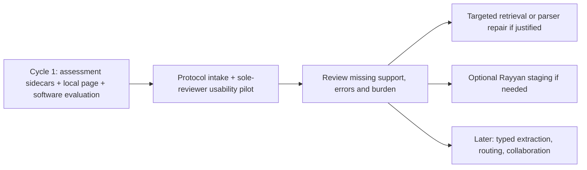
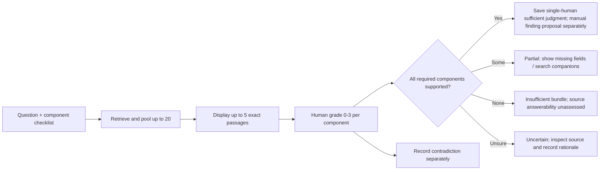

# Delivery roadmap, evaluation protocol and release gates

**Research date:** 15 October 2026
**Baseline:** [`main@aefa26e`](https://github.com/hnt119/lit-rev-engine/tree/aefa26ebc616952c51c07d6aad9ac1155eb8b6d8).
**Interpretation:** Existing results are historical facts from the saved repository; anything described as a **target**, **ticket** or **gate proposal** is not yet implemented or validated.

## Decision memo: what to build next

**Current order:** implement **hash-bound assessment records + a thin local reviewer page + descriptive evaluation** → finish protocol intake and run one single-reviewer usability pilot → review errors and burden → repair the highest-value demonstrated gap. Add **Rayyan staging only if needed**, and defer model routing, automated extraction and large-scale collaboration.

Cycle 1 is documented in [the workbench guide](../../docs/review-workbench.md) and [independent software evaluation](../../docs/workbench-cycle-1-evaluation.md). The exposed saved benchmark is a software regression/demo fixture; using it does not create a new blind confirmation or a human review result.

This is deliberately narrower than “rebuild Rayyan with AI.” Rayyan already covers full-text screening, extraction, RoB and ResearchPilot; the opportunity is to prove **higher-quality, independently verifiable evidence handling** in a niche where missed qualifiers matter.

## 1. Phased delivery plan

### Cycle 1 — assessment records, local reviewer page and evaluation

**Scope:** replay an explicitly hash-pinned existing component receipt, present anonymous method bundles and retained source text, save reasoned single-human judgments, and export descriptive comparisons. No new GPU calls, changes to screening, evidence verification, frozen source code, historical grades or model profiles.

**Acceptance criteria:**

1. Recompute all four method traces from the receipt and reject tampered or mismatched inputs; bind every assessment to question, trace and source snapshot.
2. Save immutable records with explicit supersession; reject unknown references, stale bindings, invalid states, unsafe paths and silent overwrites. A reload retains current judgments and history.
3. Let a reviewer inspect canonical source text, rate passages, identify support and missing components, and save without editing JSON. Use anonymous method labels by default; reveal diagnostics only in an explicit session mode.
4. Show unassessed, partial, insufficient and uncertain separately. Contradiction is independent of completeness. Source answerability stays unassessed and independent verification stays `NOT_RUN`.
5. Report actual denominators, missing judgments and single-human effort. No accuracy, nDCG or false-acceptance claim without separate source-first reference labels. All frozen file hashes remain unchanged.
6. The standard-library demo works from committed public fixtures without `.env`, a review database, model execution, network access or private data. Synthetic test judgments never become real pilot decisions.

### Next — protocol-defined single-reviewer usability pilot

**Known inputs:** systematic review; women originating from Asia, with Southeast Asia preferred; gut microbiome and reproductive longevity, healthy aging, gynecological disease, diet/exposome. One designated human reviewer will conduct the usability pilot. Operational population criteria, primary question/outcome, eligible designs, dates/languages and search strategy still require protocol decisions.

**Inputs before real screening:** frozen question/eligibility, source/search strategy, extraction form, rights to full texts, reviewer role and stopping rules. A 20–50-record workflow sample is a diagnostic suggestion, not a comprehensive systematic review or statistical validation.

**Deliverables:** separate pilot ledger, actual import/search receipts and reconciled counts, source inventory, reviewer judgments, assessment export and user friction record. Include compound and unsupported questions; define expected support from source inspection before showing model rankings where feasible.

**Stop/go:** every selected source maps to a record, counts reconcile, missing support and eligibility conflicts are visible, and the reviewer can explain the saved judgments. Results remain **single-reviewed/proposed**. Independent verification and time to independently verified extraction are `NOT_RUN`; completing this usability pilot does not complete the systematic review or satisfy independent outcome extraction.

### Phase 2 — Rayyan export bridge (**conditional on actual user need**)

Start with **explicit ZIP / RIS / CSV import**, not automatic account integration. Parse Rayyan exports into a provenance-preserving *staging area*, show an identity/decision diff, and let a reviewer approve changes. The export contains references and a `customizations_log`; notes fields can encode `RAYYAN-INCLUSION`, labels, exclusion reasons and user notes. Data Extraction and RoB are **separate exports**. Rayyan's Blind Mode changes what reviewer decisions are present in an export. See the [interoperability playbook](04_rayyan_interoperability_playbook.md).

**Stop/go:** one known Rayyan export round-trips through a staging import with exact input hashes, reconciled counts, no silent reviewer-vote overwrite, and an explicit list of unsupported/missing fields. Exporting back to Rayyan is not assumed to be lossless or automated.

### Phase 3 — typed, source-grounded extraction and provider routing

First add **one** narrow extraction schema (e.g. diagnostic sensitivity/specificity or randomized-trial event counts). Compare manually extracted gold against an optional model-generated proposal. Validate exact source span, study/arm, outcome, comparator, denominator, unit, timepoint and CI. Add one alternate model only after an identical corpus/question evaluation contract exists.

**Stop/go:** no unanchored proposal can enter verified evidence; all missing qualifiers appear explicitly; quantitative extraction precision and unacceptable-error rates are independently reported. Different models run on the same frozen sources and gold and cannot silently change study scope.

### Phase 4 — collaboration UI and structured synthesis (later)

Cycle 1 already includes a minimal local page. Only after the core proves useful, expand to authenticated collaboration, assignments, original PDF/HTML viewing, field editing, conflict resolution and blind independent review. Produce evidence tables and optional narrative drafts **solely from current verified entries**. Add source-to-answer trace links and preserve a visible `not enough evidence` state.

**Stop/go:** a real reviewer can complete the pilot without needing internal JSON manipulation, while exports and audit events remain reproducible. Do not claim enterprise multi-user security until authentication/authorization and reviewer privacy are tested.

### Phase 5 — scale, domain adaptation and commercialization (optional)

Try additional journals, JATS structures, scanned documents, supplements, preprints and domain-specific workflows. Separate parser regression testing from retrieval quality. Consider worker queues, per-tenant storage, permissions, offline operation and bounded cloud inference only if pilot demand supports the investment.

**Stop/go:** cross-source performance and operational failure modes meet a **new**, prospectively frozen contract. Every change has its own budget and regression baseline.

## 2. Evaluation: distinguish five different questions

| Question | Metric family | Unit | What not to infer |
|---|---|---|---|
| Did we **find the right papers**? | Known-item recall, search strategy coverage and excluded/duplicate reconciliation | Bibliographic records / distinct studies | A high passage benchmark score does **not** prove literature search completeness |
| Did retrieval show **useful passages**? | Graded relevance, Precision@5, nDCG@5, source-scope errors | Retrieved blocks per question | Similarity or reranker score is not a clinical confidence estimate |
| Were **all required facts** found? | Required-span/component coverage, complete-positive rate, pool vs display loss | Compound questions | Coverage does not measure the correctness of subsequent prose |
| Was the proposed answer **faithful**? | Claim-level support/contradiction, numeric-field exactness, wrong-cohort/timepoint rate | Claims / extracted fields | A citation label does not establish entailment |
| Did the review **actually improve**? | Minutes per verified finding, corrections, reviewer agreement, user satisfaction | Review tasks and human decisions | Faster is not safer if miss/acceptance errors rise |

### Your existing frozen component evaluation: preserve it

The saved component confirmation covers **two original full-text articles, six positive compound questions and two source-scoped nulls**, with **five displayed blocks**. Its four-way comparison is:

| Method | Mean required-evidence support | Complete positives |
|---|---:|---:|
| Whole-query lexical | 61.1% | 2/6 |
| Component lexical | 77.8% | 3/6 |
| Whole-query Qwen | 86.1% | 4/6 |
| **Component Qwen** | **94.4%** | **5/6** |

The **historical prospective acceptance gates** included support ≥85%, ≥4/6 complete positives, nonregression against the three matched comparators, exact anchors/scope/replay, ≤1,800-second batch, and zero paid calls. They passed for the **first preserved confirmation**, but **do not establish clinical validity or a universal future threshold**. Preserve the original failed earlier Qwen run and all historical benchmark source/gold files. [First-run record](https://github.com/hnt119/lit-rev-engine/blob/aefa26ebc616952c51c07d6aad9ac1155eb8b6d8/docs/qwen-components-runs-v1.md).

## 3. Proposed manual rating and review form

**Two distinct label scopes:** enter a whole-question passage grade, and optionally separate grades for each requested component. Do not derive either from their average. Unknown component grades remain null. The shared rubric is:

| Rating | Anchor interpretation | Example |
|---|---|---|
| **0 — Inapplicable** | Wrong study, population, outcome, timepoint or no connection | Pediatric outcome requested from an adult-only cohort |
| **1 — Context** | Topic-related; does not give needed evidence | Paper title or general discussion for a request for an effect estimate |
| **2 — Partial** | Useful but lacks essential qualifier or companion evidence | Effect estimate without specified comparator or confidence interval |
| **3 — Direct support** | Valid exact-source evidence for the scope being rated (whole question or named component), with relevant qualifiers | Exact enrollment criterion, denominator and named analysis population |

Cycle 1 records support references, missing components, contradiction, source-inspected declaration, reason, reviewer, time and receipt bindings. Proposed future richer fields are `correct_source`, `own_study_vs_background_reference`, `population_match`, `outcome_match`, `timepoint_match` and `claim_relation` (`supports|contradicts|context|uncertain`); they are not a claim of current automated semantic validation. A paper can provide high-quality **contradictory evidence**; don't reduce relevance simply because it disagrees with an expected effect.

**Per retrieved bundle:** `not_assessed`, `sufficient`, `partial`, `insufficient`, or `uncertain`. A sufficient bundle must support every required component; its status is a declared human judgment, not a computed average. `contradiction` is a separate flag, since relevant, complete evidence can disagree. `source_answerability: not_assessed` remains separate: failure to retrieve support does not prove absence from the source. No status promotes a canonical finding to `verified`.

### Worked illustration: exact date versus similar date

Question: *What was the study's clinical enrollment period, eligibility, and overall agreement?*

| Retrieved passage | Relevance to **study-period** component | Why |
|---|---:|---|
| Methods paragraph with **January 2021–January 2022 clinical period** | **3** | Direct and source-specific |
| Paragraph describing **July 2020 sonographer training** | **0** | Wrong time concept for the requested clinical period (`wrong_time_concept`) |
| Table with **overall κ and 95% CI** | **0 for date**, **3 for agreement** | A passage may serve one component but not another |

Your saved confirmation missed the proper clinical-period block from the final **20-block pool**; the inappropriate training-date candidate was still selected. A threshold on the *selected passage's* score would not recover a passage absent from the pool. Candidate allocation and component coverage need their own diagnostic.

## 4. Proposed prospective evaluation methodology

### Data construction and protection against leakage

1. Define a new **development** set and **unseen confirmation** set **before** model/prompt/threshold tuning. Use *source-disjoint documents* rather than merely different queries from the same article.
2. Include a useful mix of easy single-block, difficult Methods+Results multi-block, table/footnote, date/population mismatch, contradiction, legitimate null, and missing-supplement cases.
3. Inspect original documents **before model rankings** to define required AND/OR supporting spans, allowable alternatives, field values and source scope. Store these source-first reference annotations separately from bundle ratings. Prefer two independent annotators on consequential fields and adjudicate disagreements. The sole-reviewer pilot must disclose familiarity, repeated-source carryover and absent independent annotation; default anonymous labels do not remove these limitations.
4. Evaluate the four methods under the same source set, question wording and five-passage reviewer budget. Prospectively randomize anonymous method/question order and retain its mapping; hide model names, scores and selection reasons until rating is complete. Cycle 1 uses deterministic anonymous ordering and records diagnostic reveal mode; it is not adversarial blinding or a randomized experiment. Five displayed passages equalize reviewer budget, **not compute**. Report pairs, tokens and timing separately. The saved Kaggle run has a shared batch timer, not independently measured per-method runtime.
5. Do not inspect confirmation labels before choosing method/threshold. Once results have been examined, freeze them as regression history and use **fresh** documents to confirm subsequent changes.

**Pilot dataset design suggestion (not a statistical power claim):** ~30–50 questions from at least 10 independently sourced documents, including ≥10 intentionally unsupported/source-scoped nulls. This is a starting diagnostic batch; determine confidence intervals and additional sample needs before product or clinical claims.

### Metrics and formulas

- **Cycle 1 human-rated precision:** useful means whole-question rating ≥2; strict means rating 3. Report observed-rated proportions with their actual rated denominator. Report P@5 only for bundles with exactly five displayed passages and all five graded; ungraded passages remain unknown. Do not treat them as zero or silently exclude incomplete bundles from coverage reporting.
- **nDCG@5 (future, NOT_RUN in Cycle 1):** gain-weighted ranking quality against a prespecified common judged candidate universe for each question, with gain such as `2^rating − 1`. Define handling of unjudged passages and zero ideal gain in advance. Sorting each method’s own returned grades cannot establish comparable ranking quality.
- **Cycle 1 sufficiency counts:** per method, report sufficient/partial/insufficient/uncertain/not-assessed bundle judgments and number of assessed questions/reviewers. These are descriptive human judgments, not accuracy. **Future complete-evidence rate** requires source-first answerable labels and prespecified sufficient AND-of-anchor sets.
- **Required-evidence coverage:** per question, maximum coverage across prespecified sufficient alternatives, averaged across answerable questions. Nulls do not earn positive-support credit.
- **Pool loss vs selection loss:** missing required anchors before reranking/selection versus lost despite being present in the candidate pool.
- **False sufficiency acceptance:** fraction of insufficient/incorrect outputs that a decision policy falsely classifies as sufficient. Measure per source-scoped null and hard near-match.
- **False insufficiency rejection:** fraction of fully supported answers rejected; also report how many extra full-text lookups are needed.
- **Citation/number fidelity:** exact anchor match, population/arm/denominator/unit/CI/timepoint consistency and absence of unsupported claims.
- **Reviewer effort:** Cycle 1 reports declared single-human assessment seconds and its observed denominator. Source-first annotation effort and time to independently verified extraction are separate measures; independent verification is `NOT_RUN` in the sole-reviewer pilot.

Report denominators, per-question error descriptions and uncertainty. On only ten null questions, even zero observed false accepts offers limited evidence about a rare-error rate; avoid exaggerated safety claims.

### Example scorecard for a new (not-yet-run) pilot

| Dimension | Illustrative provisional gate | Critical interpretation |
|---|---|---|
| Integrity | **100%** valid current source identities and quote bounds; zero silently overwritten votes | Structural correctness is mandatory |
| Pilot review | Every saved assessment is attributable and hash-bound; independent verification is `NOT_RUN` | Single-human usability evidence does not establish extraction accuracy |
| Canonical verified finding | Existing distinct-reviewer verification and current-source checks still pass | No automated truth promotion |
| Retrieval | Prefer complete evidence and graded relevance against all matched baselines | Compare with paired per-question results and confidence intervals |
| Null handling | No fabricated *verified* evidence for source-scoped nulls | Track false model-sufficiency decisions separately |
| Quantitative extraction | Zero unflagged wrong population, denominator, unit or CI in the inspected release sample | A provisional gate, not proof of zero future error |
| Operational | Explicit limits, no hidden truncation/paid fallback, replayable receipts | Freeze token, batch and cost budgets per profile |

**Do not adopt a universal reranker probability cutoff like 0.8/0.9 without label-based calibration.** The existing saved data contains high-scoring title/context candidates for unsupported questions; reranker scores reflect relevance under a model, not assured completeness. Maintain separate stages for retrieval selection and sufficiency/verification.

## 5. Concrete engineering tickets

| Ticket | Owner profile | Changes | Acceptance test | Dependency |
|---|---|---|---|---|
| **WB1** | Implementation | New `review_workbench.py` + receipt-bound immutable assessment sidecars and descriptive report | Tamper/reference/status/history tests; no frozen edits or ledger writes | Saved receipt contract |
| **WB2** | Implementation / UI | New local page, source inspection and support checklist | Save/reload without JSON; default anonymous methods; safe rendering | WB1 API |
| **WB3** | Evaluation | Independent adversarial acceptance tests and evidence report | Freeze preservation, clean offline demo, actual limits disclosed | WB1 + WB2 |
| **PILOT-01** | Coordinator + sole domain reviewer | Freeze real protocol; import and single-review small sample | Counts/source audit, explicit single-human status, friction log | WB3 accepted + protocol decisions |
| **RET-01** | Retrieval | Targeted repair if pilot demonstrates companion omission | New version and fresh confirmation; no historical fixture edits | Reviewed pilot evidence |
| **RYN-01** | Retrieval / integration | Rayyan read-only staging and reconciliation | Correct counting role, foreign-event attribution and prerequisites | Demonstrated need |
| **MODEL-01** | Implementation | One profile abstraction or alternate backend | Same source/gold budget, pinned provenance, bounded cost | New evaluation contract |
| **EXTRACT-01** | Implementation + domain reviewer | One typed numeric proposal schema | Exact fields/anchors and separate human review | Source-first gold |
| **COLLAB-01** | Product / infrastructure | Authenticated assignments and independent review | Privacy, access and reviewer-role tests | Demonstrated demand |

Each ticket should update its own tests and docs. Freeze old evaluation inputs and record new profile/contract versions for changes in query decomposition, candidate allocation, threshold policy, prompt, model or parsing semantics.

## 6. How to benchmark against Rayyan without overstating results

A real head-to-head requires actual access to a defined Rayyan plan, permitted use of its features, and matched review tasks. Do **not** compare a Rayyan **title/abstract SVM screening rating** to your **full-text passage evidence coverage** as if they were the same outcome.

**Two sensible experiments:**

- **Screening workflow (optional):** identical citations, frozen inclusion/exclusion protocol and reviewers; compare screening minutes, agreement, recall of known-included papers and adjudication burden. Rayyan's regular relevance ranking and any licensed ResearchPilot screening behavior must be identified separately.
- **Full-text extraction workflow (core niche):** same licensed PDFs, predefined fields and blinded reference truth; compare raw proposals with raw proposals, and separately compare post-human-review outputs under the same review procedure. Use the same source-first reference truth, numerical-field criteria, missing qualifiers, correction time and auditability. Do not compare unreviewed Rayyan output with already verified engine output.

A potential outcome is **“Rayyan handles screening better; our system handles intricate quantitative evidence auditing better.”** That could still be a defensible product if proven. If neither yields improved user outcomes, focus on niche research tooling rather than a replacement platform.

## 7. Research and methodology references

- [Rayyan overview and current supported review stages](https://help.rayyan.ai/hc/en-us/articles/22697630697617-Getting-Started-with-Rayyan)
- [Rayyan Auto Extraction](https://help.rayyan.ai/hc/en-us/articles/46065925755921-Auto-Extraction-ResearchPilot)
- [Rayyan Ratings and Relevance Ranking](https://help.rayyan.ai/hc/en-us/articles/45819983751569-How-to-Use-Ratings-and-Relevance-Ranking-in-Rayyan)
- [Cochrane Handbook Chapter 5: Collecting data](https://www.cochrane.org/authors/handbooks-and-manuals/handbook/current/chapter-05) — independent extraction of critical outcome data and report/study distinction
- [PRISMA 2020](https://www.prisma-statement.org/prisma-2020) — reporting requirements, not a certification or retrieval metric
- [Repository current pilot milestone](https://github.com/hnt119/lit-rev-engine/blob/aefa26ebc616952c51c07d6aad9ac1155eb8b6d8/docs/pilot-milestone.md)
- [Repository component run record](https://github.com/hnt119/lit-rev-engine/blob/aefa26ebc616952c51c07d6aad9ac1155eb8b6d8/docs/qwen-components-runs-v1.md)

**Scope caution:** these are engineering plans and proposed quality criteria; no new model run, Rayyan product trial, clinical validation, or human pilot was performed to write this document.
