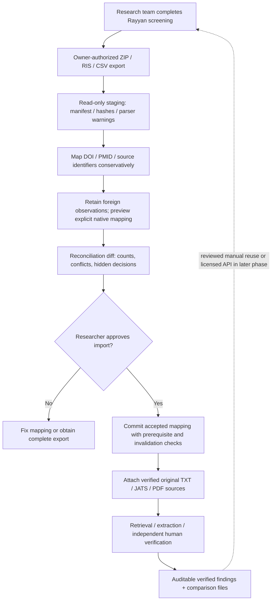
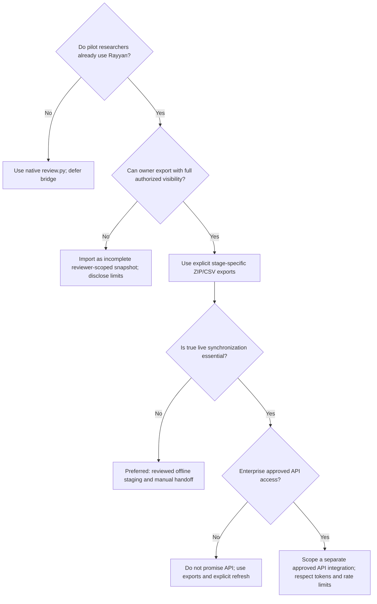

# Rayyan interoperability playbook for lit-rev-engine

**Status:** PROPOSAL — the Rayyan-specific staging adapter described below has **not** been implemented in `hnt119/lit-rev-engine`. This is a conservative design based on Rayyan's published export formats as of **15 October 2026** and the existing review ledger.

## Integration principle

**Start with explicit, user-authorized offline exports.** Users can perform collaborative screening in Rayyan and hand off a frozen snapshot to the local evidence-review engine. Do not claim live synchronization or lossless round-trip support. An automated Rayyan API is currently documented for **Enterprise accounts with approved access**, not generally available on all plans ([Rayyan API & SDK](https://help.rayyan.ai/hc/en-us/articles/19077819340305-Rayyan-API-and-Python-SDK)).

## 1. Verified Rayyan export mechanics

- Rayyan exports selected **Screening** or **Full-text screening** references as an export ZIP with an articles file and a `customizations_log`. Export options include abstracts, decisions, reasons, labels and notes. Supported article formats include `.ris`, `.bib`, `.enw`, `.csv`. [Export guide](https://help.rayyan.ai/hc/en-us/articles/45958575934737-How-to-Export-References-and-Decisions-from-Rayyan), [export structure](https://help.rayyan.ai/hc/en-us/articles/45958666246161-Understanding-Your-Rayyan-Export-Files).
- The articles-file **notes** field may contain prefixes such as `RAYYAN-INCLUSION`, `RAYYAN-LABELS`, `RAYYAN-EXCLUSION-REASONS`, `USER-NOTES`; its decision example uses a Ruby-style hash (`{"USER1"=>"Excluded"}`), **not ordinary JSON**. Treat it as its own versioned serialization contract. [Export structure](https://help.rayyan.ai/hc/en-us/articles/45958666246161-Understanding-Your-Rayyan-Export-Files).
- The `customizations_log` records action timestamps, user IDs/emails, article IDs, keys and values. Respect reviewers' privacy and keep raw archives under restricted access. [Export structure](https://help.rayyan.ai/hc/en-us/articles/45958666246161-Understanding-Your-Rayyan-Export-Files).
- Separate **Data Extraction** export is a CSV with article metadata and one column per extraction question. **Risk of Bias** is exported separately with one column per assessment form. Unresolved answers can appear as multiple values; never silently pick the first one. [DE export](https://help.rayyan.ai/hc/en-us/articles/46033403107345-How-to-Export-Data-Extraction-Results-from-Rayyan), [RoB export](https://help.rayyan.ai/hc/en-us/articles/46785972951825-How-to-Export-Risk-of-Bias-Results-from-Rayyan).
- **Blind Mode** matters: with it **on**, the exporting reviewer sees/exports only their own decisions, not all collaborators' decisions. For a complete reconciliation, the authorized review owner must turn Blind Mode **off** before exporting. This is a product UI action, not something the engine should circumvent. [Blind Mode](https://help.rayyan.ai/hc/en-us/articles/17460918624145-How-to-Use-Blind-Mode-in-Rayyan).
- An exported PDF **filename** does not guarantee local access to the underlying PDF bytes. Ingest full texts via separately supplied files with license/rights checks; do not invent original document versions from an attachment-name field.

## 2. Proposed integration workflow



**Unresolved importer semantics must stop import, not guess.** In particular, an omitted reviewer from a blinded export is **missing data**, not evidence of zero votes; a report/record match is not a study-identity match; and a PDF filename is not source bytes.

### Normalization stages

| Stage | Safe behavior | Explicitly prohibited shortcut |
|---|---|---|
| ZIP intake | Validate allowed member names, size limits, hashes, UTF-8, path safety and exact export stage | Arbitrary ZIP extraction or trusting embedded paths |
| Identity | Match validated DOI/PMID first, then record lower-confidence candidates for manual reconciliation | Merge distinct trials/reports on similar titles alone |
| Screening decisions | Retain immutable foreign observations with external actor, stage, original event time (or unknown) and separate local import time | Replay foreign votes as native events or invent original timestamps |
| Exclusion reasons | Keep original free-text reasons and map to protocol codes only with a visible dictionary | Fabricate a standard reason from loosely matched text |
| Labels/notes | Retain every value; keep Rayyan annotations separate from scientific evidence | Promote notes into quoted findings |
| Data extraction | Preserve all stacked cell values; assign a collaborator only when a verified join to the action log supports it | Infer reviewer identity from cell order or treat a value as independently verified truth |
| RoB | Preserve tool name and per-reviewer domain assessments; distinguish RoB 2/MMAT/NOS | Normalize unlike appraisal instruments to a single confidence number |
| Full texts | Attach separately supplied, checked source bytes and proper locators | Claim source integrity from a PDF filename |
| Confirmation | Preview counts, prerequisites, mappings and dependent evidence invalidation before accepted commit | Mutate the live ledger during staging or promise old verified rows remain current after eligibility changes |

### Counting role and event prerequisites

The bridge remains proposed; ordinary bibliography import cannot safely stand in for it. A Rayyan export usually derives from references already identified elsewhere. Even if deduplication merges its canonical records, an ordinary import adds identification occurrences and duplicates, inflating PRISMA-style counts.

Require an explicit `counting_role`: `derivative_snapshot`, `primary_search`, or `unknown`. A derivative snapshot links to existing occurrences without adding identification counts. Missing original query, run date and database result count remain unknown. Unknown role blocks count-affecting commit until resolved. A primary search must carry its own documented provenance; do not reconstruct an invented search from a screened subset.

External observations retain foreign actor/stage/time and local import time separately. The current native ledger generates its own IDs and local event times, and requires title/abstract inclusion plus full-text retrieval before a full-text decision; an exclusion needs a reason. Preserve those guards. Any future accepted native mapping is a **new local action** with an external-observation link, not historical replay. It must preview prerequisites, conflicts and downstream evidence invalidation. Staging has zero live-ledger effects; after an approved eligibility change, existing dependency checks may legitimately suppress previously verified rows.

## 3. Proposed staging/report schemas (illustrative)

A manifest and reconciliation report might look like:

```json
{
  "import_type": "rayyan_snapshot_v1_proposal",
  "stage": "full_text_screening",
  "counting_role": "derivative_snapshot",
  "original_search_query": null,
  "original_search_run_at": null,
  "original_search_result_count": null,
  "source_export_sha256": "actual_sha256_to_be_computed",
  "export_scope": "reviewer_visibility_must_be_recorded",
  "records_in_articles_file": null,
  "distinct_record_candidates": null,
  "decision_event_count": null,
  "unresolved_identity_mappings": [],
  "reviewer_conflicts": [],
  "unmatched_data_extraction_answers": [],
  "missing_pdf_bytes": [],
  "requires_human_confirmation": true
}
```

`null` above means **unmeasured**, not zero. Document which raw files were present, which were absent, their hashes, any parser version warnings and whether known review-member decisions may have been excluded by Blind Mode.

### Example mismatch case

A screening ZIP contains 120 references and only one reviewer's decisions. Your engine previously imported 130 historical occurrences from two bibliographic databases. Do **not** assert that ten references were deleted, that there was only one reviewer, or that the remaining records are unique. Possible causes include stage filtering, duplicate removal, export scope, different underlying search sets and Blind Mode. Report **120 exported references**, **130 historical occurrences**, the matching key map, and *unresolved causes*. The derivative snapshot must not add another 120 identification occurrences. Require a human explanation and explicit accepted mapping before appending any native actions.

## 4. Testing contract for the bridge

Use synthetic fixtures containing duplicate DOIs, null identifiers, accented author names, line breaks and quotes in notes, conflicting reviewer decisions, Maybe decisions, multi-valued extraction cells, missing archive members, malicious ZIP paths, a PDF filename without bytes, and two separately exported stages. No real patient/reviewer data should enter public test fixtures.

**Required assertions:**

- Input ZIP and member bytes survive read-only staging with hashes.
- Repeated import of an identical **keyed snapshot** is idempotent; changed payload under the same key fails.
- All canonical record merges satisfy explicit identity rules; ambiguities are reported.
- No reviewer decision is silently overwritten, dropped, invented or assigned to the wrong stage.
- Blind Mode incompleteness remains a visible warning.
- Decisions, extraction answers and RoB forms are not conflated.
- Full-text quotation anchors still require separately checked source bytes.
- Read-only staging leaves the live ledger unchanged. An accepted native mapping previews invalidation and preserves native prerequisites; later eligibility changes correctly suppress stale verified rows.
- Derivative snapshots add zero identification occurrences; unknown counting roles cannot silently alter reconciled counts.
- External actor/time are never replaced by fabricated native historical events. Stacked extraction values remain unattributed unless a checked log join establishes authorship.
- An unchanged exported ledger still produces reproducible counts and files.

## 5. Interoperability decision tree



## 6. What not to build yet

- No unofficial scraping of a logged-in Rayyan account as a replacement for its supported exports or licensed API.
- No bidirectional sync before conflict and provenance semantics have been defined and tested.
- No automated use of **Rayyan-generated ratings** as if they were paper-level quality appraisal or verified evidence.
- No assumption that the data extraction and RoB exports equal exact-source verified findings in the local ledger.
- No plan-entitlement assumptions: institutional/enterprise features may depend on contracts.

## Product outcome

A successful first release of this bridge would let a research team say:

> “We screened collaboratively in Rayyan, then imported an attributable snapshot into our local evidence pipeline. Each extracted numerical finding has an exact original quote, study link, verifier event and fully reproducible comparison trace. Differences between the Rayyan snapshot and our ledger are disclosed.”

That is a concrete, credible integration promise—not a claim that your engine replaces every Rayyan feature.
