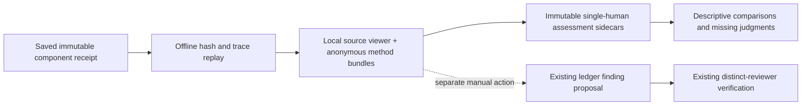

# Rayyan × lit-rev-engine: workflow and architecture

**Updated:** 15 October 2026. **Frozen engine baseline:** [`aefa26e`](https://github.com/hnt119/lit-rev-engine/tree/aefa26ebc616952c51c07d6aad9ac1155eb8b6d8).

This pack separates implemented baseline behavior, the additive Cycle 1 workbench, documented Rayyan capabilities, and future proposals. The [usage guide](../../docs/review-workbench.md) explains the actual commands; the [evaluation report](../../docs/workbench-cycle-1-evaluation.md) records software checks and limitations. A real human review pilot has not been completed.

## Read in this order

1. [Positioning](01_rayyan_workflow_and_positioning.md): plausible differentiation and limits of the internal benchmark.
2. [Architecture and contracts](02_architecture_and_model_calls.md): frozen engine, receipt-bound sidecars, trust states and later model calls.
3. [Roadmap and acceptance](03_roadmap_evaluation_and_acceptance.md): Cycle 1 tickets, single-reviewer pilot and fair evaluation.
4. [Rayyan interoperability](04_rayyan_interoperability_playbook.md): a proposed staging adapter, counting roles and external-event provenance.

[The combined plan](lit_review_engine_full_plan.md) contains these four chapters verbatim. Regenerate it when editing a chapter; do not maintain a separate conflicting design.

## Current priority

Build a usable evidence-assessment workbench, then run the protocol-defined pilot. Inspect sources, record what the retrieved bundle supports and what is missing, and compare the saved judgments. A thin local page comes before expanded model routing and collaboration.

Bundle insufficiency does not establish source absence. Human relevance, completeness, contradiction, source answerability, study risk of bias and independent verification are separate claims. The sole-reviewer pilot records single-human judgments; independent verification remains `NOT_RUN`. The saved public benchmark is exposed historical regression material, not a fresh pilot or new accuracy study.

The existing Qwen code, profiles, source fixtures, grades and freeze manifests stay unchanged. New code lives in `review_workbench.py` and `src/review_workbench/`. Optional Rayyan staging, automatic extraction, model swaps and authenticated collaboration remain later proposals.

## Sources and limits

Rayyan descriptions use official documentation linked in each chapter, checked in October 2026. No authenticated Rayyan trial or competitive accuracy experiment was performed. Procurement requires checking current plan entitlement. For methodological context, see [Cochrane Chapter 5](https://www.cochrane.org/authors/handbooks-and-manuals/handbook/current/chapter-05) and [PRISMA 2020](https://www.prisma-statement.org/prisma-2020); software checks do not certify systematic-review validity.
