# Lit-review-engine — strategy, architecture and delivery plan

**Updated:** 15 October 2026
**Frozen baseline:** `aefa26ebc616952c51c07d6aad9ac1155eb8b6d8`

This document combines the four chapters verbatim. Cycle 1 adds a local assessment workbench around the unchanged engine. Later capabilities remain proposals. See [the usage guide](../../docs/review-workbench.md) and [software evaluation](../../docs/workbench-cycle-1-evaluation.md); no human pilot or competitive accuracy validation is claimed.

# Rayyan workflow and a realistic differentiation strategy

**Research date:** 15 October 2026
**Compared with:** [`hnt119/lit-rev-engine`, `main` at `aefa26ebc616952c51c07d6aad9ac1155eb8b6d8`](https://github.com/hnt119/lit-rev-engine/tree/aefa26ebc616952c51c07d6aad9ac1155eb8b6d8)
**Status convention:** **Verified Rayyan** = publicly documented feature; **Implemented baseline** = inspected at `aefa26e`; **Cycle 1** = the additive local assessment workbench described in [the usage guide](../../docs/review-workbench.md); **Proposed** = later work. Validation and limitations are recorded in [the cycle report](../../docs/workbench-cycle-1-evaluation.md).

## Executive conclusion

Rayyan is **not** merely a title-and-abstract screening tool. As of October 2026, Rayyan supports bibliographic imports, deduplication, independent and collaborative screening, full-text screening with attached PDFs, structured data extraction, risk-of-bias assessment, exports, and—depending on the plan—AI assistance including full-text Auto Extraction. Competing by adding those basic features alone is unlikely to produce a meaningful technical advantage.

The strongest plausible niche for `lit-rev-engine` is **reproducible, evidence-grounded research analysis**: configurable retrieval and model providers; transparent, multi-part question answering with exact anchors; traceable numeric extraction; explicit insufficient-evidence decisions; frozen comparative evaluations; and reviewer-owned verification. In the near term, **complement Rayyan as a specialist evidence-analysis engine**, rather than reproduce its mature user interface, collaboration, and screening workflow.

## 1. How a reviewer works in Rayyan

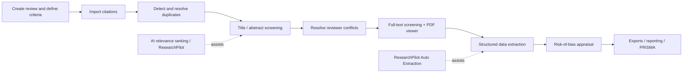

### Rayyan workflow: what happens, and what matters

| Stage | Typical user action | Verified Rayyan behavior | Implications for this project |
|---|---|---|---|
| Set up | Create a review, define inclusion/exclusion criteria, invite members | Criteria are shared and can support AI Reviewer/Analyzer; team members can work independently | Mirror the **protocol** and eligibility definitions, not merely search keywords |
| Import | Upload reference exports from databases/reference managers | Supports RIS, BibTeX, CSV and other formats; import and deduplication are core features | Preserve original source files, original occurrences, hashes and exact search strategies |
| Screen titles/abstracts | Include / Exclude / Maybe, labels, reasons, notes | Blind Mode hides other reviewers' decisions while screening; conflicts can be resolved later | Preserve separate human votes and reasons; AI suggestions should not silently become human decisions |
| Rank undecided records | Review predicted relevance | On all plans, the ranking learns from reviewer decisions; a five-level rating helps prioritization | An improved **passage retriever** is not the same as improved **citation screening**; evaluate separately |
| Full text | Bring eligible records into full-text screening; read PDF and decide | Rayyan has a PDF viewer, full-text decisions and full-text conflict handling | **Do not** claim Rayyan lacks full-text screening |
| Extract | Define study fields/questions; enter values | Rayyan supports structured Data Extraction; ResearchPilot Auto Extraction (eligible institutional plans) reads attached text-searchable PDFs and highlights source passages | Differentiate by multi-document support, numeric qualification, provenance/replay, and rigorous benchmark artifacts—not by basic extraction alone |
| Appraise | Use study-design-suited appraisal form | RoB 2, MMAT, and Newcastle–Ottawa Scale are documented, with plan-dependent access | Domain-specific **appraisal support**, traceable judgments and flexible tools may be opportunities; never confuse automated appraisal with validation |
| Report | Reconcile and export | Exports for references, extraction and RoB are supported; paid plans have PRISMA diagram generation | Design interoperability, audit-preserving exports, and cross-tool reproducibility |

**Rayyan's AI capabilities in more detail:**

- **Relevance Ranking** predicts how likely an undecided *reference* is to be included, from title/abstract features including unigrams, bigrams and MeSH terms. Rayyan says at least **50 decisions**, including **5 Include and 5 Exclude**, are required before computing ratings. This is screening prioritization, not proof that an article provides a particular finding. [Rayyan relevance-ranking documentation](https://help.rayyan.ai/hc/en-us/articles/45819983751569-How-to-Use-Ratings-and-Relevance-Ranking-in-Rayyan).
- **AI Reviewer** (ResearchPilot, institutional access) independently applies screening criteria and returns reasoned decisions. **AI Analyzer** offers on-demand criteria-based recommendations. [AI Reviewer](https://help.rayyan.ai/hc/en-us/articles/46034112564497-AI-Reviewer-ResearchPilot) · [AI Analyzer](https://help.rayyan.ai/hc/en-us/articles/46034177350161-AI-Analyzer-ResearchPilot).
- **Review Articles Mode** lets users ask questions of a selected set of references and set a relevance threshold for that mode. It operates on the loaded subset, not necessarily the entire corpus. [Mode guide](https://help.rayyan.ai/hc/en-us/articles/46034049051409-Review-Articles-Mode-ResearchPilot).
- **Auto Extraction** can read attached full-text PDFs and populate configured questions, highlighting source material for verification; outputs still require human checking. [Auto Extraction](https://help.rayyan.ai/hc/en-us/articles/46065925755921-Auto-Extraction-ResearchPilot).
- Rayyan includes **full-text screening**, **structured data extraction** and **risk-of-bias workflows**. [Rayyan four-stage workflow](https://help.rayyan.ai/hc/en-us/articles/45703234075281-How-to-Screen-References-in-Rayyan) · [RoB documentation](https://help.rayyan.ai/hc/en-us/articles/46607683693073-How-to-Assess-Risk-of-Bias-in-Rayyan).

**Access changes:** feature availability depends on plan, seat and institutional contract; use the [official pricing comparison](https://www.rayyan.ai/pricing) and [plans guide](https://help.rayyan.ai/hc/en-us/articles/46067741714321-Rayyan-Plans-Overview) for any current procurement decision. Do not hard-code prices into a long-lived technical plan.

## 2. Comparison with your actual repository

### Inspected current code: three adjacent flows

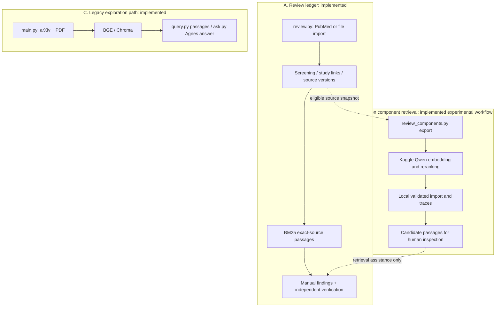

The ledger is the authoritative record of decisions, source versions and verified evidence. The separate exploration pipeline is **not** a substitute for the ledger. The Qwen workflow is a **finite export → external inference → validation/import** process; it does not silently update evidence decisions.

The repository already contains important differentiation foundations:

1. **Source/identity controls:** conservative citation deduplication, report/study links, source versions, hashes and exact quotation anchors.
2. **User-verifiable evidence:** manual finding revisions and review by a reviewer identifier distinct from the author; stale or ineligible dependencies block current verified evidence. Identity strings are not authenticated user accounts, so this is not yet enterprise-grade reviewer security.
3. **Comparative retrieval:** four frozen methods (whole-query lexical, component lexical, whole-query Qwen, component Qwen), source-grounded positive and no-answer questions, replayable results and fixed acceptance gates.
4. **Component-aware search:** an original compound question plus 2–3 reviewer-declared components, 20-block candidate allocation and 5-block output.
5. **Model provenance:** versioned jobs/results, integrity checks, pinned model execution and local replay.

**Latest bounded benchmark, not real-world clinical validation:** first saved Qwen component confirmation on **two articles, six answerable questions and two source-scoped null questions**:

| Method | Mean required-evidence coverage | Complete positives |
|---|---:|---:|
| Whole-question lexical | 61.1% | 2/6 |
| Component lexical | 77.8% | 3/6 |
| Whole-question Qwen | 86.1% | 4/6 |
| **Component Qwen** | **94.4%** | **5/6** |

The missing question concerns the **clinical study period**: the correct date block was outside the final candidate pool even though another passage about training dates ranked highly. Both unsupported questions still returned passages. **A high reranker score is not proof of answerability.** [Saved first-run record](https://github.com/hnt119/lit-rev-engine/blob/aefa26ebc616952c51c07d6aad9ac1155eb8b6d8/docs/qwen-components-runs-v1.md) · [evaluation contract](https://github.com/hnt119/lit-rev-engine/blob/aefa26ebc616952c51c07d6aad9ac1155eb8b6d8/docs/qwen-components-contract-v1.md).

## 3. Do not build a false competitive story

| Generic sales claim | Reality | Better positioning |
|---|---|---|
| “Rayyan cannot work with full texts.” | False: it has full-text screening, PDF viewing and full-text Auto Extraction (plan dependent). | “Our pipeline exposes more configurable **retrieval and evidence provenance**.” |
| “Rayyan cannot extract data.” | False: Data Extraction and Auto Extraction exist. | “We are optimizing **compound quantitative extraction**, traceable qualifications and source-version integrity.” |
| “Rayyan has no quality appraisal.” | False: RoB 2, MMAT and NOS are documented. | “We can make **domain-specific appraisal schemas** and compare inter-reviewer outcomes.” |
| “Rayyan has no AI or rating threshold.” | False: reference relevance ranking and ResearchPilot scoring are documented. | “We preserve a **bounded, replayable internal passage-support benchmark**. Future sufficiency thresholds require new labels, calibration and independent evaluation.” |
| “Our Qwen pipeline is proven more accurate than Rayyan.” | Not established; the current benchmark compares *internal* methods, not Rayyan outputs. | “We have a **replayable internal benchmark**; a direct Rayyan comparison requires matched tasks, access and independent annotation.” |

Absence of public documentation for a feature is **not** proof that Rayyan lacks it. Contrast **documented product behavior** with **observed behavior in the repo**, and identify proposal status explicitly.

## 4. The plausible strategic edge

**Positioning statement:** *An open, source-grounded evidence-verification layer for research teams that need custom models, precise numerical evidence and independent reproducibility.*

| Differentiator | Problem it solves | What to demonstrate | Priority |
|---|---|---|---|
| **Compound-evidence completeness** | Important facts spread across Methods, Results and tables | Recovery of all required pieces at fixed reviewer passage budget | P0 |
| **Correct-population/timepoint validation** | Highly scored, genuine passage refers to wrong cohort/date/outcome | False acceptance rate of high-scoring near-matches | P0 |
| **Inspectable source-to-claim chain** | Finding detached from primary evidence | Exact quote, locator, source version, model/job hash and human verification | P0 |
| **Explicit abstention and conflict flags** | Retrieval returns plausible passages for unanswered questions | Sufficiency decisions on positive, null and contradictory questions | P0 |
| **Model portability and cost control** | One hosted provider/plan may be inappropriate | Swap model profile with intact evaluation and privacy receipt | P1 |
| **Rayyan-friendly handoff** | Researchers already screen in Rayyan | Lossless-enough records/decisions import with full reconciliation report | P1 |
| **Typed numeric data extraction** | Numerator, denominator, unit, confidence interval or timepoint omitted | Per-field fidelity, not a single prose answer score | P2 |
| **Cross-study synthesis** | Multiple reports and contradictory outcomes | Comparison table from independently verified findings | P2 |
| **Minimal local reviewer page** | Ratings and support checks require manual JSON editing | Save, reload and compare single-reviewer judgments with receipt bindings | P0: Cycle 1 |
| **Collaboration UI and scale** | Larger teams need assignment, permissions and efficient review | Measured reviewer outcomes, privacy and access tests | Later |

### Best initial positioning: complementary, not a Rayyan clone

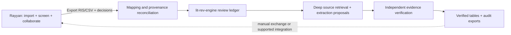

A thin local page is needed now to test whether the evidence workflow helps a reviewer. A full collaboration product remains later work. Cycle 1 stores single-human assessment sidecars; it neither changes screening decisions nor creates verified findings. The existing benchmark is exposed historical material and serves as a software demo, not a fresh quality confirmation.

## 5. Questions to ask real users before committing to features

1. Which review type and document families matter (RCTs, diagnostics, observational, scoping reviews, engineering papers)?
2. At which stage do teams spend the most time or find the most consequential errors?
3. Which exact extraction fields need **multiple paragraphs/tables** to answer faithfully?
4. Does the team already use Rayyan? What does its licensed plan offer, and what export data can the team access?
5. What is the cost of wrongly accepting an unsupported answer versus asking a reviewer to inspect another passage?
6. Which original sources may legally be retained or sent to an external inference provider?

## Sources and scope

**Rayyan primary documentation (checked October 2026):** [Getting started](https://help.rayyan.ai/hc/en-us/articles/22697630697617-Getting-Started-with-Rayyan), [screening](https://help.rayyan.ai/hc/en-us/articles/45703234075281-How-to-Screen-References-in-Rayyan), [Blind Mode](https://help.rayyan.ai/hc/en-us/articles/17460918624145-How-to-Use-Blind-Mode-in-Rayyan), [relevance ranking](https://help.rayyan.ai/hc/en-us/articles/45819983751569-How-to-Use-Ratings-and-Relevance-Ranking-in-Rayyan), [ResearchPilot](https://help.rayyan.ai/hc/en-us/articles/28790380408337-What-is-ResearchPilot), [Auto Extraction](https://help.rayyan.ai/hc/en-us/articles/46065925755921-Auto-Extraction-ResearchPilot), [risk of bias](https://help.rayyan.ai/hc/en-us/articles/46607683693073-How-to-Assess-Risk-of-Bias-in-Rayyan).

**Repository documentation:** [architecture](https://github.com/hnt119/lit-rev-engine/blob/aefa26ebc616952c51c07d6aad9ac1155eb8b6d8/docs/architecture.md), [component guide](https://github.com/hnt119/lit-rev-engine/blob/aefa26ebc616952c51c07d6aad9ac1155eb8b6d8/docs/qwen-components-guide.md), [first saved results](https://github.com/hnt119/lit-rev-engine/blob/aefa26ebc616952c51c07d6aad9ac1155eb8b6d8/docs/qwen-components-runs-v1.md).

**Limitations:** No authenticated hands-on Rayyan review or head-to-head Rayyan-versus-engine benchmark was run. Current plan entitlements can vary. These are research-backed product descriptions and proposed differentiation hypotheses, not measured competitive superiority.

---

# Lit-review-engine: current and proposed architecture

**Research date:** 15 October 2026
**Code baseline:** [`main@aefa26e`](https://github.com/hnt119/lit-rev-engine/tree/aefa26ebc616952c51c07d6aad9ac1155eb8b6d8).
**Legend:** `[IMPLEMENTED BASELINE]` describes `aefa26e`; `[CYCLE 1]` describes the additive local workbench in [the usage guide](../../docs/review-workbench.md); `[PROPOSED]` means later work. **Dashed arrows** show proposed integrations or reviewer-mediated handoffs.

## Architecture decision

Build a **review-ledger-centered, evaluation-first evidence workbench** with *optional* Rayyan ingestion and provider/model switching. Keep three trust domains separate:

1. **Source truth:** immutable original files, identifiers, extraction boundaries, checksums and review eligibility.
2. **Model assistance:** rankings, extracted-value proposals, comparison traces and uncertainty flags. Models never set eligibility or verified status.
3. **Human authority:** independent screening, study linkage, structured extraction and verification, with retained reasoned revisions.

The existing repo already enforces much of domains 1 and 3 for its ledger and has a small evaluated component retriever for domain 2. New development should strengthen missing semantic checks and usability rather than merge the separate legacy Chroma demo directly into the audit ledger without a design.

## 1. As-built system (inspected repository)

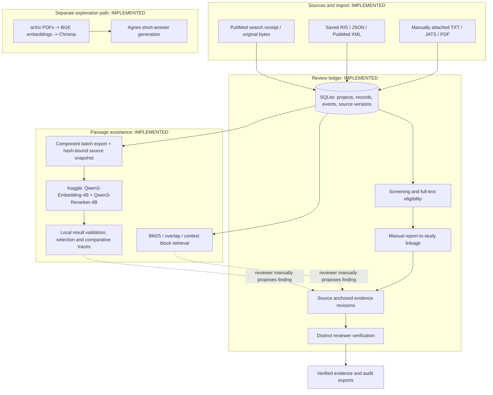

**Repo boundaries that must survive:** original search receipts, every imported occurrence, conservative duplicate matching, source versioning, project-scoped eligibility, manually reviewed study links, exact quotation anchors, append-only evidence revisions, independent verification, reproducible exports and read-only retrieval. **Current limitations:** no authenticated users or enforced reviewer quorum, scanned-PDF OCR incomplete, no completed real-team pilot, and score/selection rules do not assess whether a question is answerable. The current pilot has one human reviewer: her assessments can be single-reviewed, while independent verification remains `NOT_RUN`.

## 2. Target architecture (proposal; not a claim of existing features)

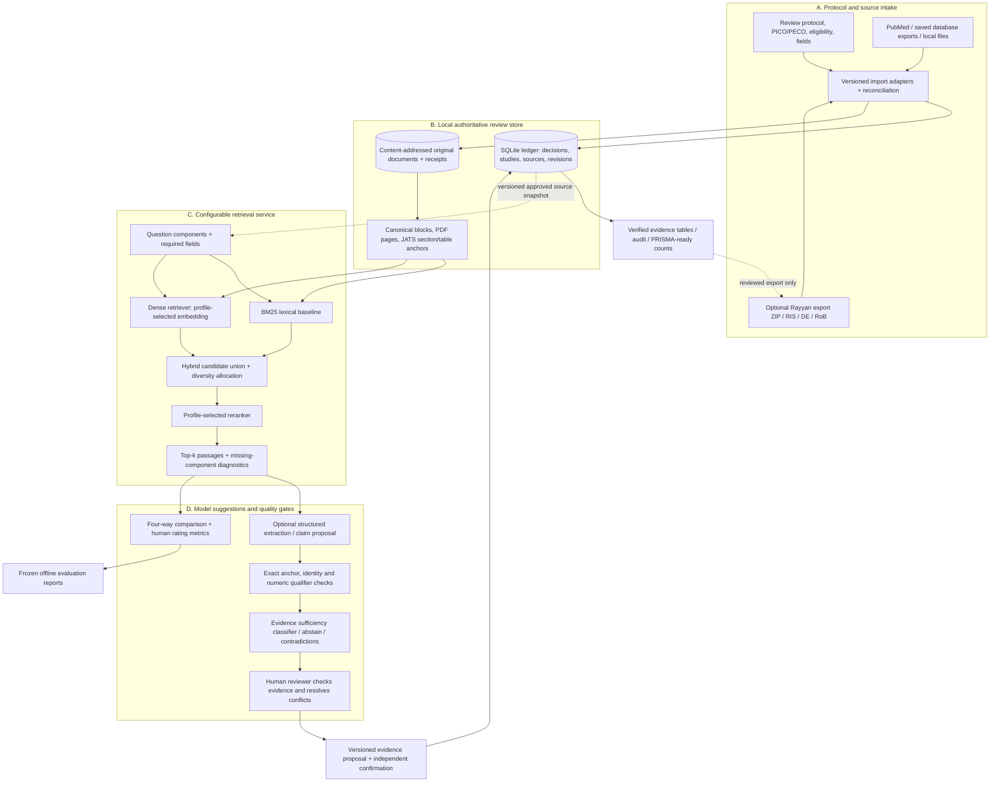

**Key design choice:** In the proposed architecture, `model scores`, `semantic relevance`, `complete support`, `human verification`, and `study risk of bias` are **different fields**. None is automatically inferred from the other.

### Components and ownership

| Layer | Reuse existing | Proposed addition | Acceptance obligation |
|---|---|---|---|
| Protocol/source intake | Review CLI, PubMed receipts, supported saved formats | Rayyan export bridge, richer provenance reconciliation | Record counts and hashes must reconcile; ambiguities remain flagged |
| Storage | Local SQLite, source hash/version checks | Optional object store for large corpus; migration-safe indexes | No source disappearance; every audit event preserved |
| Parsing | TXT/JATS/PDF canonical blocks | Table-cell/footnote extraction, supplements and separately evaluated OCR | Stable locators + tested Unicode spans; never silently guess missing cells |
| Retrieval | BM25/context; Qwen finite Kaggle component retrieval | Search adapter interface and optional alternative embedding/reranker profiles | Match model/profile pin, method and source scope on import |
| Extraction | Manual exact-anchored finding proposal | Typed model-generated *suggestions* with validation | Every exported value points to source + units/denominator/timepoint |
| Semantic validation | Source/integrity checks; source scope | Scope/entailment checks, explicit sufficiency/abstention | Test on high-scoring near-matches and held-out nulls |
| Verification | Independent evidence review identifiers and revision history | Authenticated reviewer identities, protocol-driven quorum | No auto-verification; stale source/association revokes current eligibility |
| Evaluation | Frozen positive/null truth, four methods (candidate + three comparators), portable replay | Cycle 1 descriptive human ratings; later calibrated sufficiency and ranking evaluation | Explicit denominators; fresh source-first gold for accuracy/nDCG; historical gates unchanged |
| Output | Ledger and audit exports | Reviewer UI, evidence matrix, reusable PRISMA summaries | No misleading completed-study count or unsupported synthesis |

## 3. Model call architecture: make calls replaceable and inspectable

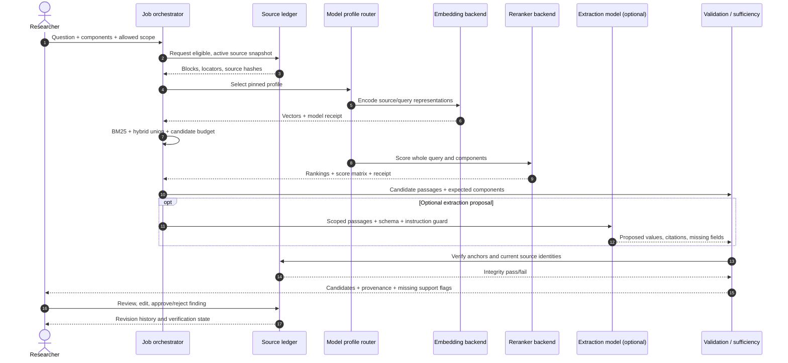

**Backends: implemented vs planned.** Qwen3 4B embedding/reranking is **implemented as a finite, pinned Kaggle batch**. Local BGE/Chroma plus Agnes is **implemented separately in the exploration route**. A production **model-profile router that can swap OpenAI, Qwen, local models, or other vendors is proposed**; do not treat these providers as already integrated. Model names/availability, prices and licensing must be checked at implementation time.

### Proposed model strategy

| Workload | Cheapest valid approach first | Escalation rule | Model call requires |
|---|---|---|---|
| Title/abstract sorting | Existing human decisions + transparent lexical screening features | Train/evaluate citation-screening model only with adequate labeled data | Source record ID, protocol version, training/decision provenance |
| Initial passage retrieval | Local BM25 with exact source anchors | Add dense retrieval when lexical misses components | Source manifest and method/version |
| Passage reranking | Run only for a bounded candidate pool | Use pinned Qwen or evaluated alternative | Whole + component queries, pair limits, numeric traces |
| Numeric extraction | Human-first manual field entry in pilot | Optional constrained JSON model after source blocks are chosen | Typed output schema, original passage anchors, full prompt/model receipt |
| Claim checking | Exact quote/span match + deterministic schema checks | Optional *independent* semantic verifier for ambiguous claims | Explicit supports / contradicts / context / uncertain labels |
| Synthesis | Only verified structured rows | Optional citation-rich prose draft, reviewed before release | Frozen evidence snapshot, zero invented citations |

Use task-based model routing rather than paying for the largest model on every query. Keep a no-LLM lexical path as a baseline and offline recovery mode. Cache by **source snapshot + model revision + query + profile + instruction version**. Cache invalidation must react to eligibility or source changes.

### Proposed profile descriptor (illustrative, **not** a working repository config)

```yaml
profile_id: evidence-components-v2-proposal
source_scope: included
query_decomposition: human_declared
retrieval:
  lexical: bm25_context_blocks
  dense_backend: qwen3_embedding_4b
  candidate_pool: 20
  fusion: reciprocal_rank_fusion
reranking:
  backend: qwen3_reranker_4b
  display_budget: 5
extraction:
  enabled: false  # switch on only after separate validation
  output_schema: finding_proposal_v1
validation:
  exact_anchor_required: true
  source_scope_required: true
  require_population_outcome_timepoint_match: true
  verification: human_required
privacy:
  allow_external_model_calls: false  # opt in with source-by-source approval
```

Do not modify the frozen v1 profile **or its implementation files**. Preserve all paths and hashes bound by `docs/qwen-components-confirmation-freeze-v1.json`, `docs/qwen-components-development-freeze-v1.json` and `docs/qwen-kaggle-freeze-v2.json`. Cycle 1 uses the new `review_workbench.py` entry point and `src/review_workbench/` namespace, importing frozen pure validation helpers without changing them. Future retrieval changes require a **new** profile, evaluator contract and held-out split.

## 4. Assessment sidecar contract and trust states

A retrieval result is not a verified finding. Cycle 1 adds an **assessment sidecar**, bound to an immutable saved receipt. It does not migrate the canonical ledger finding schema, whose revisions accept exactly one quotation anchor. Multiple supporting passages belong to the assessment bundle; creating or verifying a canonical finding remains a separate manual ledger action.

The record envelope retains an immutable UUID, UTC time, payload hash, receipt whole-file and payload hashes, job/results/profile/source-snapshot hashes, project/question/trace bindings, reviewer label, display mode and explicit supersession history. The following is an illustrative *draft* submitted through the page; exact saved fields are documented in [the workbench guide](../../docs/review-workbench.md):

```json
{
  "packet_id": "hash-bound-packet-id",
  "bundle_id": "hash-bound-bundle-id",
  "reviewer": "reviewer_1",
  "status": "partial",
  "reason": "The clinical study period is missing from this bundle.",
  "ratings": [
    {"passage_id": "bound-passage-id", "rating": 2,
     "component_ratings": {"period": 0, "agreement": 3}}
  ],
  "supporting_passage_ids": ["bound-passage-id"],
  "missing_components": ["period"],
  "contradiction": false,
  "source_inspected": true,
  "supersedes": null,
  "review_seconds": null
}
```

The question, component and passage IDs must exist in the trusted packet. Numeric examples are illustrative, not clinical judgments. A null rating means **unassessed**, never zero. Whole-question and component ratings remain separate; averaging scores cannot establish complete support. `sufficient` requires named support and no missing components; `partial` and `insufficient` require named missing components. An explicit reason is required for assessed states.

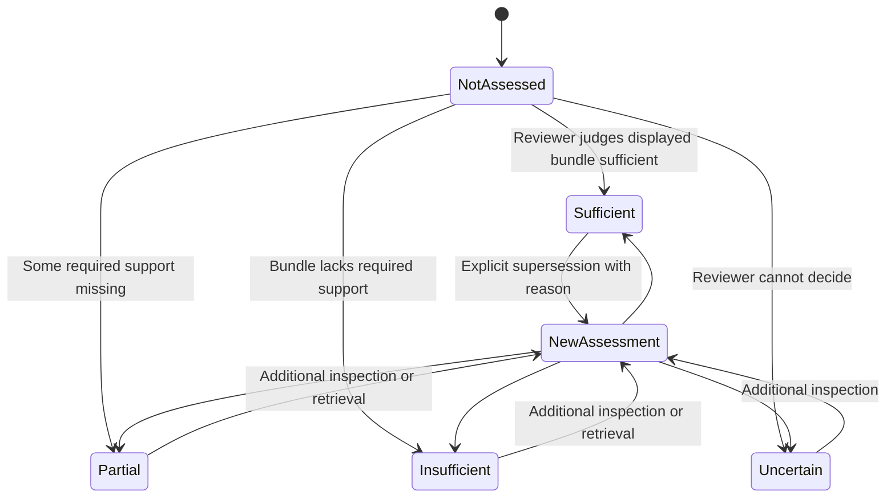

All statuses have `judgment_scope: retrieved_bundle`. A separate `contradiction` flag can coexist with sufficient or partial coverage. A bundle judged insufficient does **not** establish source absence: retrieval may have missed a supporting paragraph. `source_answerability` stays `not_assessed`; a future source-level assessment must examine the original source independently of the returned passages and record its own scope and evidence.

Receipt replay checks the retained snapshot and exact anchors. It does not open the live review database or prove present-day eligibility: `current_ledger_state` remains `not_checked`. Human assessments are `single_human`; independent verification is `NOT_RUN`. The canonical distinct-reviewer guard is preserved. No reviewer alias or AI assessment can substitute for a second human.

**Fail closed on integrity errors.** Return explicit incomplete or uncertain bundle judgments instead of inventing an answer. Even a properly assessed source-scoped absence would not prove that no other publication has relevant evidence.

## 5. Security, provenance and reproducibility

- **Source licensing:** JATS/PDF and supplementary files may have different licenses; don't upload proprietary full texts to an external service unless permission/contract permits it.
- **Credentials:** Local `.env` and model/API secrets must never enter Git, reviewer exports, prompt receipts or shared artifacts. Adopt scoped tokens and audit access before multi-user deployment.
- **Reviewer data:** Rayyan exports can carry reviewer names/emails and action histories. Restrict imported raw ZIPs and exclude real review identifiers from public fixtures.
- **Prompt injection:** Treat paper text as untrusted evidence, never instructions to override the workflow. Require typed outputs and validate quote offsets independently of the model.
- **Version pinning:** Store code commit, model revision, tokenizer version, prompt, query/component text, source manifest, hyperparameters, normalized retrieval scores, runtime/cost and error state.
- **Replay semantics:** Deterministic local validation of saved results is achievable; replaying a model's generated text byte-for-byte across hardware/providers is not guaranteed. Preserve input and output bytes, not just hashes.
- **Human review:** A distinct **string identifier** is not authentication. Account management, authorization, blinded review and reviewer assignment are future work if you develop a collaborative product.
- **Operational limits:** Batch, token and PDF limits should fail explicitly; no hidden truncation, silent paid fallback or silent source substitution.

## 6. Recommended repository layout (proposal)

Existing frozen paths remain in place. Cycle 1 additions are separate; the other additions below remain proposals:

```text
lit-rev-engine/
├── review.py                          # IMPLEMENTED: ledger CLI
├── review_components.py               # IMPLEMENTED: component batch CLI
├── src/review/                      # IMPLEMENTED: ledger, evidence, source, search
├── src/review_components/           # IMPLEMENTED: component scoring and adapter
├── review_workbench.py                # CYCLE 1: local reviewer / assessment CLI
├── src/review_workbench/              # CYCLE 1: additive sidecars, local page, reports
│   ├── receipts.py                   # pinned receipt + frozen trace replay
│   ├── assessments.py                # immutable judgments + explicit supersession
│   ├── evaluation.py                 # descriptive single-human comparison
│   └── server.py                     # loopback-only page, no external inference
├── src/model_gateway/               # PROPOSED: provider/profile interface
│   ├── registry.py
│   ├── embedding.py
│   ├── rerank.py
│   └── extraction.py
├── src/evaluation/                  # PROPOSED: human labels, metrics, reporting
│   ├── relevance_labels.py
│   ├── sufficiency.py
│   └── compare.py
├── src/integrations/rayyan/          # PROPOSED: export ZIP adapters
│   ├── parse_export.py
│   ├── map_decisions.py
│   └── reconcile.py
├── tests/fixtures/                   # IMPLEMENTED: frozen benchmarks; retain
└── docs/                             # Existing docs + this design package
```

**Do not create all proposed modules at once.** First validate real-team needs, then add narrowly scoped components with tests and frozen evaluation protocols. [Current architecture](https://github.com/hnt119/lit-rev-engine/blob/aefa26ebc616952c51c07d6aad9ac1155eb8b6d8/docs/architecture.md) · [current pilot contract](https://github.com/hnt119/lit-rev-engine/blob/aefa26ebc616952c51c07d6aad9ac1155eb8b6d8/docs/pilot-milestone.md).

## Architecture acceptance checklist

- [ ] Every displayed candidate replays against its saved exact anchor; the page discloses that live eligibility is not checked.
- [ ] Canonical verified findings still require current eligible sources, manual proposal and the existing distinct-reviewer verification.
- [ ] Insufficient bundle support never becomes a source-absence claim.
- [ ] Single-human assessment time is separate from independently verified finding time (`NOT_RUN` in this pilot).
- [ ] Every accepted numeric value retains its denominator/unit/CI/timepoint where required by the question.
- [ ] The system differentiates candidate relevance from complete evidence, support from contradictions and model confidence from verified evidence.
- [ ] Model swaps keep comparator budgets and source scope fixed and record versioned profiles.
- [ ] Stale source versions invalidate current verification without erasing history.
- [ ] Real-team screening/extraction remains human-authored and separately auditable.
- [ ] No external inference call happens without recorded user authorization and source-use permission.
- [ ] Existing frozen evaluation fixtures/results remain immutable.

**External methodological anchor:** the [Cochrane Handbook, Chapter 5](https://www.cochrane.org/authors/handbooks-and-manuals/handbook/current/chapter-05) distinguishes reports from studies and emphasizes independently extracted outcome data. The [PRISMA 2020 site](https://www.prisma-statement.org/prisma-2020) provides reporting checklists and flow diagrams; it does not itself certify a pipeline's methodological validity.

---

# Delivery roadmap, evaluation protocol and release gates

**Research date:** 15 October 2026
**Baseline:** [`main@aefa26e`](https://github.com/hnt119/lit-rev-engine/tree/aefa26ebc616952c51c07d6aad9ac1155eb8b6d8).
**Interpretation:** Existing results are historical facts from the saved repository; anything described as a **target**, **ticket** or **gate proposal** is not yet implemented or validated.

## Decision memo: what to build next

**Current order:** implement **hash-bound assessment records + a thin local reviewer page + descriptive evaluation** → finish protocol intake and run one single-reviewer usability pilot → review errors and burden → repair the highest-value demonstrated gap. Add **Rayyan staging only if needed**, and defer model routing, automated extraction and large-scale collaboration.

Cycle 1 is documented in [the workbench guide](../../docs/review-workbench.md) and [independent software evaluation](../../docs/workbench-cycle-1-evaluation.md). The exposed saved benchmark is a software regression/demo fixture; using it does not create a new blind confirmation or a human review result.

This is deliberately narrower than “rebuild Rayyan with AI.” Rayyan already covers full-text screening, extraction, RoB and ResearchPilot; the opportunity is to prove **higher-quality, independently verifiable evidence handling** in a niche where missed qualifiers matter.

## 1. Phased delivery plan

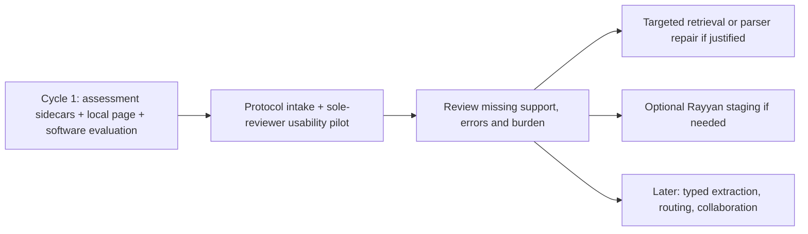

### Cycle 1 — assessment records, local reviewer page and evaluation

**Scope:** replay an explicitly hash-pinned existing component receipt, present anonymous method bundles and retained source text, save reasoned single-human judgments, and export descriptive comparisons. No new GPU calls, changes to screening, evidence verification, frozen source code, historical grades or model profiles.

**Acceptance criteria:**

1. Recompute all four method traces from the receipt and reject tampered or mismatched inputs; bind every assessment to question, trace and source snapshot.
2. Save immutable records with explicit supersession; reject unknown references, stale bindings, invalid states, unsafe paths and silent overwrites. A reload retains current judgments and history.
3. Let a reviewer inspect canonical source text, rate passages, identify support and missing components, and save without editing JSON. Use anonymous method labels by default; reveal diagnostics only in an explicit session mode.
4. Show unassessed, partial, insufficient and uncertain separately. Contradiction is independent of completeness. Source answerability stays unassessed and independent verification stays `NOT_RUN`.
5. Report actual denominators, missing judgments and single-human effort. No accuracy, nDCG or false-acceptance claim without separate source-first reference labels. All frozen file hashes remain unchanged.
6. The standard-library demo works from committed public fixtures without `.env`, a review database, model execution, network access or private data. Synthetic test judgments never become real pilot decisions.

### Next — protocol-defined single-reviewer usability pilot

**Known inputs:** systematic review; women originating from Asia, with Southeast Asia preferred; gut microbiome and reproductive longevity, healthy aging, gynecological disease, diet/exposome. One designated human reviewer will conduct the usability pilot. Operational population criteria, primary question/outcome, eligible designs, dates/languages and search strategy still require protocol decisions.

**Inputs before real screening:** frozen question/eligibility, source/search strategy, extraction form, rights to full texts, reviewer role and stopping rules. A 20–50-record workflow sample is a diagnostic suggestion, not a comprehensive systematic review or statistical validation.

**Deliverables:** separate pilot ledger, actual import/search receipts and reconciled counts, source inventory, reviewer judgments, assessment export and user friction record. Include compound and unsupported questions; define expected support from source inspection before showing model rankings where feasible.

**Stop/go:** every selected source maps to a record, counts reconcile, missing support and eligibility conflicts are visible, and the reviewer can explain the saved judgments. Results remain **single-reviewed/proposed**. Independent verification and time to independently verified extraction are `NOT_RUN`; completing this usability pilot does not complete the systematic review or satisfy independent outcome extraction.

### Phase 2 — Rayyan export bridge (**conditional on actual user need**)

Start with **explicit ZIP / RIS / CSV import**, not automatic account integration. Parse Rayyan exports into a provenance-preserving *staging area*, show an identity/decision diff, and let a reviewer approve changes. The export contains references and a `customizations_log`; notes fields can encode `RAYYAN-INCLUSION`, labels, exclusion reasons and user notes. Data Extraction and RoB are **separate exports**. Rayyan's Blind Mode changes what reviewer decisions are present in an export. See the [interoperability playbook](04_rayyan_interoperability_playbook.md).

**Stop/go:** one known Rayyan export round-trips through a staging import with exact input hashes, reconciled counts, no silent reviewer-vote overwrite, and an explicit list of unsupported/missing fields. Exporting back to Rayyan is not assumed to be lossless or automated.

### Phase 3 — typed, source-grounded extraction and provider routing

First add **one** narrow extraction schema (e.g. diagnostic sensitivity/specificity or randomized-trial event counts). Compare manually extracted gold against an optional model-generated proposal. Validate exact source span, study/arm, outcome, comparator, denominator, unit, timepoint and CI. Add one alternate model only after an identical corpus/question evaluation contract exists.

**Stop/go:** no unanchored proposal can enter verified evidence; all missing qualifiers appear explicitly; quantitative extraction precision and unacceptable-error rates are independently reported. Different models run on the same frozen sources and gold and cannot silently change study scope.

### Phase 4 — collaboration UI and structured synthesis (later)

Cycle 1 already includes a minimal local page. Only after the core proves useful, expand to authenticated collaboration, assignments, original PDF/HTML viewing, field editing, conflict resolution and blind independent review. Produce evidence tables and optional narrative drafts **solely from current verified entries**. Add source-to-answer trace links and preserve a visible `not enough evidence` state.

**Stop/go:** a real reviewer can complete the pilot without needing internal JSON manipulation, while exports and audit events remain reproducible. Do not claim enterprise multi-user security until authentication/authorization and reviewer privacy are tested.

### Phase 5 — scale, domain adaptation and commercialization (optional)

Try additional journals, JATS structures, scanned documents, supplements, preprints and domain-specific workflows. Separate parser regression testing from retrieval quality. Consider worker queues, per-tenant storage, permissions, offline operation and bounded cloud inference only if pilot demand supports the investment.

**Stop/go:** cross-source performance and operational failure modes meet a **new**, prospectively frozen contract. Every change has its own budget and regression baseline.

## 2. Evaluation: distinguish five different questions

| Question | Metric family | Unit | What not to infer |
|---|---|---|---|
| Did we **find the right papers**? | Known-item recall, search strategy coverage and excluded/duplicate reconciliation | Bibliographic records / distinct studies | A high passage benchmark score does **not** prove literature search completeness |
| Did retrieval show **useful passages**? | Graded relevance, Precision@5, nDCG@5, source-scope errors | Retrieved blocks per question | Similarity or reranker score is not a clinical confidence estimate |
| Were **all required facts** found? | Required-span/component coverage, complete-positive rate, pool vs display loss | Compound questions | Coverage does not measure the correctness of subsequent prose |
| Was the proposed answer **faithful**? | Claim-level support/contradiction, numeric-field exactness, wrong-cohort/timepoint rate | Claims / extracted fields | A citation label does not establish entailment |
| Did the review **actually improve**? | Minutes per verified finding, corrections, reviewer agreement, user satisfaction | Review tasks and human decisions | Faster is not safer if miss/acceptance errors rise |

### Your existing frozen component evaluation: preserve it

The saved component confirmation covers **two original full-text articles, six positive compound questions and two source-scoped nulls**, with **five displayed blocks**. Its four-way comparison is:

| Method | Mean required-evidence support | Complete positives |
|---|---:|---:|
| Whole-query lexical | 61.1% | 2/6 |
| Component lexical | 77.8% | 3/6 |
| Whole-query Qwen | 86.1% | 4/6 |
| **Component Qwen** | **94.4%** | **5/6** |

The **historical prospective acceptance gates** included support ≥85%, ≥4/6 complete positives, nonregression against the three matched comparators, exact anchors/scope/replay, ≤1,800-second batch, and zero paid calls. They passed for the **first preserved confirmation**, but **do not establish clinical validity or a universal future threshold**. Preserve the original failed earlier Qwen run and all historical benchmark source/gold files. [First-run record](https://github.com/hnt119/lit-rev-engine/blob/aefa26ebc616952c51c07d6aad9ac1155eb8b6d8/docs/qwen-components-runs-v1.md).

## 3. Proposed manual rating and review form

**Two distinct label scopes:** enter a whole-question passage grade, and optionally separate grades for each requested component. Do not derive either from their average. Unknown component grades remain null. The shared rubric is:

| Rating | Anchor interpretation | Example |
|---|---|---|
| **0 — Inapplicable** | Wrong study, population, outcome, timepoint or no connection | Pediatric outcome requested from an adult-only cohort |
| **1 — Context** | Topic-related; does not give needed evidence | Paper title or general discussion for a request for an effect estimate |
| **2 — Partial** | Useful but lacks essential qualifier or companion evidence | Effect estimate without specified comparator or confidence interval |
| **3 — Direct support** | Valid exact-source evidence for the scope being rated (whole question or named component), with relevant qualifiers | Exact enrollment criterion, denominator and named analysis population |

Cycle 1 records support references, missing components, contradiction, source-inspected declaration, reason, reviewer, time and receipt bindings. Proposed future richer fields are `correct_source`, `own_study_vs_background_reference`, `population_match`, `outcome_match`, `timepoint_match` and `claim_relation` (`supports|contradicts|context|uncertain`); they are not a claim of current automated semantic validation. A paper can provide high-quality **contradictory evidence**; don't reduce relevance simply because it disagrees with an expected effect.

**Per retrieved bundle:** `not_assessed`, `sufficient`, `partial`, `insufficient`, or `uncertain`. A sufficient bundle must support every required component; its status is a declared human judgment, not a computed average. `contradiction` is a separate flag, since relevant, complete evidence can disagree. `source_answerability: not_assessed` remains separate: failure to retrieve support does not prove absence from the source. No status promotes a canonical finding to `verified`.

### Worked illustration: exact date versus similar date

Question: *What was the study's clinical enrollment period, eligibility, and overall agreement?*

| Retrieved passage | Relevance to **study-period** component | Why |
|---|---:|---|
| Methods paragraph with **January 2021–January 2022 clinical period** | **3** | Direct and source-specific |
| Paragraph describing **July 2020 sonographer training** | **0** | Wrong time concept for the requested clinical period (`wrong_time_concept`) |
| Table with **overall κ and 95% CI** | **0 for date**, **3 for agreement** | A passage may serve one component but not another |

Your saved confirmation missed the proper clinical-period block from the final **20-block pool**; the inappropriate training-date candidate was still selected. A threshold on the *selected passage's* score would not recover a passage absent from the pool. Candidate allocation and component coverage need their own diagnostic.

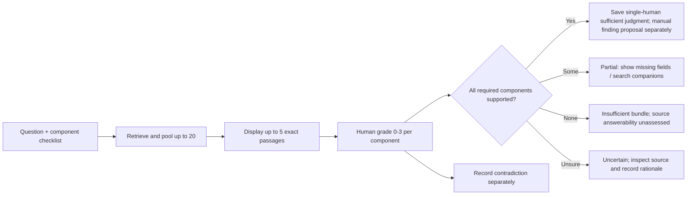

## 4. Proposed prospective evaluation methodology

### Data construction and protection against leakage

1. Define a new **development** set and **unseen confirmation** set **before** model/prompt/threshold tuning. Use *source-disjoint documents* rather than merely different queries from the same article.
2. Include a useful mix of easy single-block, difficult Methods+Results multi-block, table/footnote, date/population mismatch, contradiction, legitimate null, and missing-supplement cases.
3. Inspect original documents **before model rankings** to define required AND/OR supporting spans, allowable alternatives, field values and source scope. Store these source-first reference annotations separately from bundle ratings. Prefer two independent annotators on consequential fields and adjudicate disagreements. The sole-reviewer pilot must disclose familiarity, repeated-source carryover and absent independent annotation; default anonymous labels do not remove these limitations.
4. Evaluate the four methods under the same source set, question wording and five-passage reviewer budget. Prospectively randomize anonymous method/question order and retain its mapping; hide model names, scores and selection reasons until rating is complete. Cycle 1 uses deterministic anonymous ordering and records diagnostic reveal mode; it is not adversarial blinding or a randomized experiment. Five displayed passages equalize reviewer budget, **not compute**. Report pairs, tokens and timing separately. The saved Kaggle run has a shared batch timer, not independently measured per-method runtime.
5. Do not inspect confirmation labels before choosing method/threshold. Once results have been examined, freeze them as regression history and use **fresh** documents to confirm subsequent changes.

**Pilot dataset design suggestion (not a statistical power claim):** ~30–50 questions from at least 10 independently sourced documents, including ≥10 intentionally unsupported/source-scoped nulls. This is a starting diagnostic batch; determine confidence intervals and additional sample needs before product or clinical claims.

### Metrics and formulas

- **Cycle 1 human-rated precision:** useful means whole-question rating ≥2; strict means rating 3. Report observed-rated proportions with their actual rated denominator. Report P@5 only for bundles with exactly five displayed passages and all five graded; ungraded passages remain unknown. Do not treat them as zero or silently exclude incomplete bundles from coverage reporting.
- **nDCG@5 (future, NOT_RUN in Cycle 1):** gain-weighted ranking quality against a prespecified common judged candidate universe for each question, with gain such as `2^rating − 1`. Define handling of unjudged passages and zero ideal gain in advance. Sorting each method’s own returned grades cannot establish comparable ranking quality.
- **Cycle 1 sufficiency counts:** per method, report sufficient/partial/insufficient/uncertain/not-assessed bundle judgments and number of assessed questions/reviewers. These are descriptive human judgments, not accuracy. **Future complete-evidence rate** requires source-first answerable labels and prespecified sufficient AND-of-anchor sets.
- **Required-evidence coverage:** per question, maximum coverage across prespecified sufficient alternatives, averaged across answerable questions. Nulls do not earn positive-support credit.
- **Pool loss vs selection loss:** missing required anchors before reranking/selection versus lost despite being present in the candidate pool.
- **False sufficiency acceptance:** fraction of insufficient/incorrect outputs that a decision policy falsely classifies as sufficient. Measure per source-scoped null and hard near-match.
- **False insufficiency rejection:** fraction of fully supported answers rejected; also report how many extra full-text lookups are needed.
- **Citation/number fidelity:** exact anchor match, population/arm/denominator/unit/CI/timepoint consistency and absence of unsupported claims.
- **Reviewer effort:** Cycle 1 reports declared single-human assessment seconds and its observed denominator. Source-first annotation effort and time to independently verified extraction are separate measures; independent verification is `NOT_RUN` in the sole-reviewer pilot.

Report denominators, per-question error descriptions and uncertainty. On only ten null questions, even zero observed false accepts offers limited evidence about a rare-error rate; avoid exaggerated safety claims.

### Example scorecard for a new (not-yet-run) pilot

| Dimension | Illustrative provisional gate | Critical interpretation |
|---|---|---|
| Integrity | **100%** valid current source identities and quote bounds; zero silently overwritten votes | Structural correctness is mandatory |
| Pilot review | Every saved assessment is attributable and hash-bound; independent verification is `NOT_RUN` | Single-human usability evidence does not establish extraction accuracy |
| Canonical verified finding | Existing distinct-reviewer verification and current-source checks still pass | No automated truth promotion |
| Retrieval | Prefer complete evidence and graded relevance against all matched baselines | Compare with paired per-question results and confidence intervals |
| Null handling | No fabricated *verified* evidence for source-scoped nulls | Track false model-sufficiency decisions separately |
| Quantitative extraction | Zero unflagged wrong population, denominator, unit or CI in the inspected release sample | A provisional gate, not proof of zero future error |
| Operational | Explicit limits, no hidden truncation/paid fallback, replayable receipts | Freeze token, batch and cost budgets per profile |

**Do not adopt a universal reranker probability cutoff like 0.8/0.9 without label-based calibration.** The existing saved data contains high-scoring title/context candidates for unsupported questions; reranker scores reflect relevance under a model, not assured completeness. Maintain separate stages for retrieval selection and sufficiency/verification.

## 5. Concrete engineering tickets

| Ticket | Owner profile | Changes | Acceptance test | Dependency |
|---|---|---|---|---|
| **WB1** | Implementation | New `review_workbench.py` + receipt-bound immutable assessment sidecars and descriptive report | Tamper/reference/status/history tests; no frozen edits or ledger writes | Saved receipt contract |
| **WB2** | Implementation / UI | New local page, source inspection and support checklist | Save/reload without JSON; default anonymous methods; safe rendering | WB1 API |
| **WB3** | Evaluation | Independent adversarial acceptance tests and evidence report | Freeze preservation, clean offline demo, actual limits disclosed | WB1 + WB2 |
| **PILOT-01** | Coordinator + sole domain reviewer | Freeze real protocol; import and single-review small sample | Counts/source audit, explicit single-human status, friction log | WB3 accepted + protocol decisions |
| **RET-01** | Retrieval | Targeted repair if pilot demonstrates companion omission | New version and fresh confirmation; no historical fixture edits | Reviewed pilot evidence |
| **RYN-01** | Retrieval / integration | Rayyan read-only staging and reconciliation | Correct counting role, foreign-event attribution and prerequisites | Demonstrated need |
| **MODEL-01** | Implementation | One profile abstraction or alternate backend | Same source/gold budget, pinned provenance, bounded cost | New evaluation contract |
| **EXTRACT-01** | Implementation + domain reviewer | One typed numeric proposal schema | Exact fields/anchors and separate human review | Source-first gold |
| **COLLAB-01** | Product / infrastructure | Authenticated assignments and independent review | Privacy, access and reviewer-role tests | Demonstrated demand |

Each ticket should update its own tests and docs. Freeze old evaluation inputs and record new profile/contract versions for changes in query decomposition, candidate allocation, threshold policy, prompt, model or parsing semantics.

## 6. How to benchmark against Rayyan without overstating results

A real head-to-head requires actual access to a defined Rayyan plan, permitted use of its features, and matched review tasks. Do **not** compare a Rayyan **title/abstract SVM screening rating** to your **full-text passage evidence coverage** as if they were the same outcome.

**Two sensible experiments:**

- **Screening workflow (optional):** identical citations, frozen inclusion/exclusion protocol and reviewers; compare screening minutes, agreement, recall of known-included papers and adjudication burden. Rayyan's regular relevance ranking and any licensed ResearchPilot screening behavior must be identified separately.
- **Full-text extraction workflow (core niche):** same licensed PDFs, predefined fields and blinded reference truth; compare raw proposals with raw proposals, and separately compare post-human-review outputs under the same review procedure. Use the same source-first reference truth, numerical-field criteria, missing qualifiers, correction time and auditability. Do not compare unreviewed Rayyan output with already verified engine output.

A potential outcome is **“Rayyan handles screening better; our system handles intricate quantitative evidence auditing better.”** That could still be a defensible product if proven. If neither yields improved user outcomes, focus on niche research tooling rather than a replacement platform.

## 7. Research and methodology references

- [Rayyan overview and current supported review stages](https://help.rayyan.ai/hc/en-us/articles/22697630697617-Getting-Started-with-Rayyan)
- [Rayyan Auto Extraction](https://help.rayyan.ai/hc/en-us/articles/46065925755921-Auto-Extraction-ResearchPilot)
- [Rayyan Ratings and Relevance Ranking](https://help.rayyan.ai/hc/en-us/articles/45819983751569-How-to-Use-Ratings-and-Relevance-Ranking-in-Rayyan)
- [Cochrane Handbook Chapter 5: Collecting data](https://www.cochrane.org/authors/handbooks-and-manuals/handbook/current/chapter-05) — independent extraction of critical outcome data and report/study distinction
- [PRISMA 2020](https://www.prisma-statement.org/prisma-2020) — reporting requirements, not a certification or retrieval metric
- [Repository current pilot milestone](https://github.com/hnt119/lit-rev-engine/blob/aefa26ebc616952c51c07d6aad9ac1155eb8b6d8/docs/pilot-milestone.md)
- [Repository component run record](https://github.com/hnt119/lit-rev-engine/blob/aefa26ebc616952c51c07d6aad9ac1155eb8b6d8/docs/qwen-components-runs-v1.md)

**Scope caution:** these are engineering plans and proposed quality criteria; no new model run, Rayyan product trial, clinical validation, or human pilot was performed to write this document.

---

# Rayyan interoperability playbook for lit-rev-engine

**Status:** PROPOSAL — the Rayyan-specific staging adapter described below has **not** been implemented in `hnt119/lit-rev-engine`. This is a conservative design based on Rayyan's published export formats as of **15 October 2026** and the existing review ledger.

## Integration principle

**Start with explicit, user-authorized offline exports.** Users can perform collaborative screening in Rayyan and hand off a frozen snapshot to the local evidence-review engine. Do not claim live synchronization or lossless round-trip support. An automated Rayyan API is currently documented for **Enterprise accounts with approved access**, not generally available on all plans ([Rayyan API & SDK](https://help.rayyan.ai/hc/en-us/articles/19077819340305-Rayyan-API-and-Python-SDK)).

## 1. Verified Rayyan export mechanics

- Rayyan exports selected **Screening** or **Full-text screening** references as an export ZIP with an articles file and a `customizations_log`. Export options include abstracts, decisions, reasons, labels and notes. Supported article formats include `.ris`, `.bib`, `.enw`, `.csv`. [Export guide](https://help.rayyan.ai/hc/en-us/articles/45958575934737-How-to-Export-References-and-Decisions-from-Rayyan), [export structure](https://help.rayyan.ai/hc/en-us/articles/45958666246161-Understanding-Your-Rayyan-Export-Files).
- The articles-file **notes** field may contain prefixes such as `RAYYAN-INCLUSION`, `RAYYAN-LABELS`, `RAYYAN-EXCLUSION-REASONS`, `USER-NOTES`; its decision example uses a Ruby-style hash (`{"USER1"=>"Excluded"}`), **not ordinary JSON**. Treat it as its own versioned serialization contract. [Export structure](https://help.rayyan.ai/hc/en-us/articles/45958666246161-Understanding-Your-Rayyan-Export-Files).
- The `customizations_log` records action timestamps, user IDs/emails, article IDs, keys and values. Respect reviewers' privacy and keep raw archives under restricted access. [Export structure](https://help.rayyan.ai/hc/en-us/articles/45958666246161-Understanding-Your-Rayyan-Export-Files).
- Separate **Data Extraction** export is a CSV with article metadata and one column per extraction question. **Risk of Bias** is exported separately with one column per assessment form. Unresolved answers can appear as multiple values; never silently pick the first one. [DE export](https://help.rayyan.ai/hc/en-us/articles/46033403107345-How-to-Export-Data-Extraction-Results-from-Rayyan), [RoB export](https://help.rayyan.ai/hc/en-us/articles/46785972951825-How-to-Export-Risk-of-Bias-Results-from-Rayyan).
- **Blind Mode** matters: with it **on**, the exporting reviewer sees/exports only their own decisions, not all collaborators' decisions. For a complete reconciliation, the authorized review owner must turn Blind Mode **off** before exporting. This is a product UI action, not something the engine should circumvent. [Blind Mode](https://help.rayyan.ai/hc/en-us/articles/17460918624145-How-to-Use-Blind-Mode-in-Rayyan).
- An exported PDF **filename** does not guarantee local access to the underlying PDF bytes. Ingest full texts via separately supplied files with license/rights checks; do not invent original document versions from an attachment-name field.

## 2. Proposed integration workflow

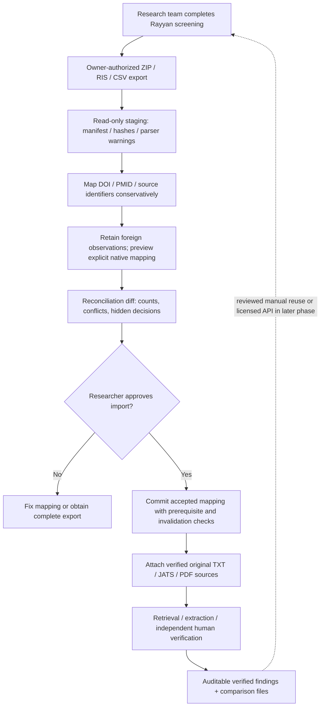

**Unresolved importer semantics must stop import, not guess.** In particular, an omitted reviewer from a blinded export is **missing data**, not evidence of zero votes; a report/record match is not a study-identity match; and a PDF filename is not source bytes.

### Normalization stages

| Stage | Safe behavior | Explicitly prohibited shortcut |
|---|---|---|
| ZIP intake | Validate allowed member names, size limits, hashes, UTF-8, path safety and exact export stage | Arbitrary ZIP extraction or trusting embedded paths |
| Identity | Match validated DOI/PMID first, then record lower-confidence candidates for manual reconciliation | Merge distinct trials/reports on similar titles alone |
| Screening decisions | Retain immutable foreign observations with external actor, stage, original event time (or unknown) and separate local import time | Replay foreign votes as native events or invent original timestamps |
| Exclusion reasons | Keep original free-text reasons and map to protocol codes only with a visible dictionary | Fabricate a standard reason from loosely matched text |
| Labels/notes | Retain every value; keep Rayyan annotations separate from scientific evidence | Promote notes into quoted findings |
| Data extraction | Preserve all stacked cell values; assign a collaborator only when a verified join to the action log supports it | Infer reviewer identity from cell order or treat a value as independently verified truth |
| RoB | Preserve tool name and per-reviewer domain assessments; distinguish RoB 2/MMAT/NOS | Normalize unlike appraisal instruments to a single confidence number |
| Full texts | Attach separately supplied, checked source bytes and proper locators | Claim source integrity from a PDF filename |
| Confirmation | Preview counts, prerequisites, mappings and dependent evidence invalidation before accepted commit | Mutate the live ledger during staging or promise old verified rows remain current after eligibility changes |

### Counting role and event prerequisites

The bridge remains proposed; ordinary bibliography import cannot safely stand in for it. A Rayyan export usually derives from references already identified elsewhere. Even if deduplication merges its canonical records, an ordinary import adds identification occurrences and duplicates, inflating PRISMA-style counts.

Require an explicit `counting_role`: `derivative_snapshot`, `primary_search`, or `unknown`. A derivative snapshot links to existing occurrences without adding identification counts. Missing original query, run date and database result count remain unknown. Unknown role blocks count-affecting commit until resolved. A primary search must carry its own documented provenance; do not reconstruct an invented search from a screened subset.

External observations retain foreign actor/stage/time and local import time separately. The current native ledger generates its own IDs and local event times, and requires title/abstract inclusion plus full-text retrieval before a full-text decision; an exclusion needs a reason. Preserve those guards. Any future accepted native mapping is a **new local action** with an external-observation link, not historical replay. It must preview prerequisites, conflicts and downstream evidence invalidation. Staging has zero live-ledger effects; after an approved eligibility change, existing dependency checks may legitimately suppress previously verified rows.

## 3. Proposed staging/report schemas (illustrative)

A manifest and reconciliation report might look like:

```json
{
  "import_type": "rayyan_snapshot_v1_proposal",
  "stage": "full_text_screening",
  "counting_role": "derivative_snapshot",
  "original_search_query": null,
  "original_search_run_at": null,
  "original_search_result_count": null,
  "source_export_sha256": "actual_sha256_to_be_computed",
  "export_scope": "reviewer_visibility_must_be_recorded",
  "records_in_articles_file": null,
  "distinct_record_candidates": null,
  "decision_event_count": null,
  "unresolved_identity_mappings": [],
  "reviewer_conflicts": [],
  "unmatched_data_extraction_answers": [],
  "missing_pdf_bytes": [],
  "requires_human_confirmation": true
}
```

`null` above means **unmeasured**, not zero. Document which raw files were present, which were absent, their hashes, any parser version warnings and whether known review-member decisions may have been excluded by Blind Mode.

### Example mismatch case

A screening ZIP contains 120 references and only one reviewer's decisions. Your engine previously imported 130 historical occurrences from two bibliographic databases. Do **not** assert that ten references were deleted, that there was only one reviewer, or that the remaining records are unique. Possible causes include stage filtering, duplicate removal, export scope, different underlying search sets and Blind Mode. Report **120 exported references**, **130 historical occurrences**, the matching key map, and *unresolved causes*. The derivative snapshot must not add another 120 identification occurrences. Require a human explanation and explicit accepted mapping before appending any native actions.

## 4. Testing contract for the bridge

Use synthetic fixtures containing duplicate DOIs, null identifiers, accented author names, line breaks and quotes in notes, conflicting reviewer decisions, Maybe decisions, multi-valued extraction cells, missing archive members, malicious ZIP paths, a PDF filename without bytes, and two separately exported stages. No real patient/reviewer data should enter public test fixtures.

**Required assertions:**

- Input ZIP and member bytes survive read-only staging with hashes.
- Repeated import of an identical **keyed snapshot** is idempotent; changed payload under the same key fails.
- All canonical record merges satisfy explicit identity rules; ambiguities are reported.
- No reviewer decision is silently overwritten, dropped, invented or assigned to the wrong stage.
- Blind Mode incompleteness remains a visible warning.
- Decisions, extraction answers and RoB forms are not conflated.
- Full-text quotation anchors still require separately checked source bytes.
- Read-only staging leaves the live ledger unchanged. An accepted native mapping previews invalidation and preserves native prerequisites; later eligibility changes correctly suppress stale verified rows.
- Derivative snapshots add zero identification occurrences; unknown counting roles cannot silently alter reconciled counts.
- External actor/time are never replaced by fabricated native historical events. Stacked extraction values remain unattributed unless a checked log join establishes authorship.
- An unchanged exported ledger still produces reproducible counts and files.

## 5. Interoperability decision tree

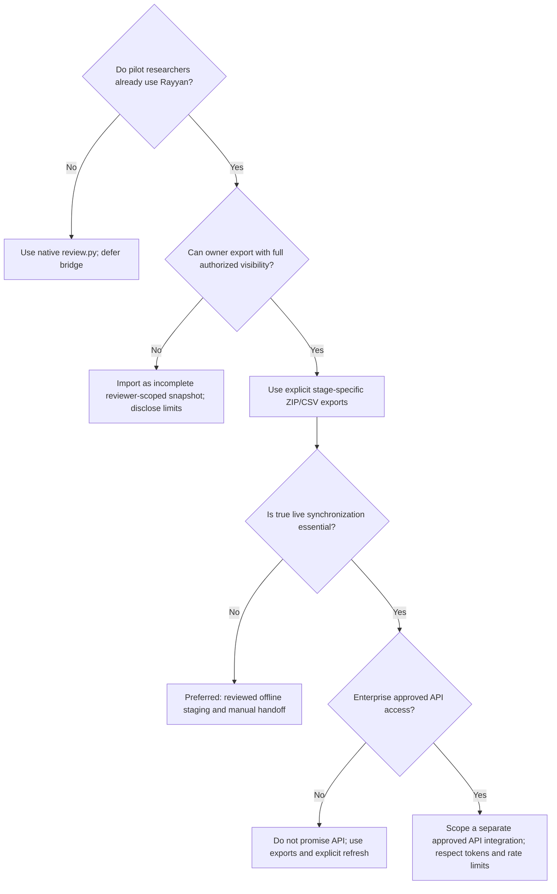

## 6. What not to build yet

- No unofficial scraping of a logged-in Rayyan account as a replacement for its supported exports or licensed API.
- No bidirectional sync before conflict and provenance semantics have been defined and tested.
- No automated use of **Rayyan-generated ratings** as if they were paper-level quality appraisal or verified evidence.
- No assumption that the data extraction and RoB exports equal exact-source verified findings in the local ledger.
- No plan-entitlement assumptions: institutional/enterprise features may depend on contracts.

## Product outcome

A successful first release of this bridge would let a research team say:

> “We screened collaboratively in Rayyan, then imported an attributable snapshot into our local evidence pipeline. Each extracted numerical finding has an exact original quote, study link, verifier event and fully reproducible comparison trace. Differences between the Rayyan snapshot and our ledger are disclosed.”

That is a concrete, credible integration promise—not a claim that your engine replaces every Rayyan feature.
